# Informe final — Predicción de incumplimiento de préstamos personales de Lending Club

**Curso:** Machine Learning, UTEC. **Grupo:** 8.

**Integrantes:** Gavino Navarrete Adrian Piero; Hernández Yataco, Josué Renzo; Rojas Cruz, José Alvaro; Sanchez Dominguez, Matias Sebastian.

Este documento integra los diez notebooks oficiales, el suplemento [`11_svm_muestra.ipynb`](../notebooks/11_svm_muestra.ipynb), las métricas históricas conservadas y el pipeline vigente. Distingue las pruebas iniciales sobre una muestra, la selección temporal sobre desarrollo y la evaluación histórica de test. La revisión documental no ejecutó entrenamientos, búsquedas ni nuevas evaluaciones. Los valores de las tablas se redondean para su lectura; los archivos enlazados conservan la precisión original.

## 1. Resumen ejecutivo

El proyecto estima el riesgo individual de que un préstamo personal aceptado por Lending Club termine declarado incobrable, frente a pagarse por completo. Cada observación corresponde a un préstamo y la respuesta se codifica como `Fully Paid = 0` y `Charged Off = 1`. Se utiliza información del solicitante, su historial crediticio y las condiciones conocidas al otorgamiento; se excluyen pagos, recuperaciones y otros campos posteriores que permitirían anticipar artificialmente el resultado.

El archivo original contiene 2,260,701 registros y 151 columnas. La población binaria comprende 1,345,310 préstamos originados entre 2007 y 2018 con alguno de los dos desenlaces seleccionados. La investigación comenzó con una muestra aleatoria de 220,003 préstamos y luego utilizó el desarrollo completo anterior a 2017. Se compararon una referencia de clase mayoritaria, regresiones logísticas, árboles de decisión, SVM lineal y distintas configuraciones de HistGradientBoosting. La selección de variables y de hiperparámetros evolucionó hacia cuatro cortes temporales expansivos, con imputación y transformaciones ajustadas exclusivamente en el entrenamiento de cada corte.

La configuración final admite variables con hasta 50% de faltantes en su entrenamiento, imputa numéricas con su mediana y categóricas con «Sin información», sin indicadores numéricos adicionales. El ajuste definitivo utiliza 826,604 préstamos de 2007–2015 y reserva 293,095 de 2016 para calibración sigmoide. En los 225,611 préstamos elegibles de 2017–2018, **HistGradientBoosting obtuvo el mejor desempeño de los tres modelos finales**: ROC-AUC 0.70321, Average Precision 0.37791, Brier 0.15364 y Log Loss 0.47428. Estos resultados corresponden a la evaluación histórica del notebook 10.

El resultado es útil como comparación académica de estimadores de riesgo, pero no valida una política de concesión de crédito. Solo se observan préstamos aceptados con desenlace final seleccionado; el seguimiento de los préstamos recientes es desigual y el test ya había sido consultado en etapas históricas. Además, con umbral descriptivo 0.5, el modelo principal detecta solo 13.06% de los incumplimientos. La evaluación local posterior de los tres modelos serializados reprodujo las métricas históricas a los seis decimales mostrados; se contrastaron sus CSV guardados, sin repetir la evaluación en esta revisión. No se afirma preparación para decisiones crediticias reales.

## 2. Descripción del problema

### 2.1. Pregunta predictiva y alcance

> Dado un préstamo que Lending Club acaba de aprobar, y usando únicamente la información disponible el día del desembolso, ¿qué probabilidad hay de que termine declarado incobrable (`Charged Off`) en lugar de pagarse por completo (`Fully Paid`)?

El incumplimiento crediticio implica que no se recupera el pago conforme a las obligaciones del préstamo. En este trabajo, la etiqueta concreta es la declaración contable `Charged Off`; no se equiparan automáticamente atraso, periodo de gracia e incobrabilidad. Anticipar ese desenlace puede ayudar a ordenar préstamos por riesgo, revisar exposiciones y priorizar análisis, siempre dentro de la población estudiada.

La tarea es una clasificación binaria supervisada. Su salida principal es una estimación individual entre 0 y 1, no el ROC-AUC ni un promedio de incumplimientos del conjunto. Por ejemplo, una estimación de 0.30 representa un riesgo estimado de 30% para ese préstamo bajo las condiciones del modelo. No demuestra que ese cliente incumplirá ni permite conocer de antemano la probabilidad individual «verdadera». La calibración evalúa si, entre préstamos con estimaciones semejantes, las frecuencias observadas son compatibles con ellas.

### 2.2. Información y decisión

Los predictores incluyen ingresos declarados, relación deuda/ingreso, plazo, monto, FICO al origen, consultas y cuentas de crédito previas, vivienda y finalidad del préstamo. Que un campo aparezca en el archivo no demuestra por sí mismo que estuviera disponible al desembolso: su significado temporal debe contrastarse con el diccionario y el proceso de recopilación. En las variantes iniciales también se estudian tasa, grado y otras condiciones asignadas por Lending Club, identificadas separadamente del escenario principal.

Predecir riesgo de préstamos otorgados es distinto de decidir a quién aprobar. No se dispone del pago hipotético de solicitudes rechazadas. Convertir una estimación en una alerta exige además un umbral y una valoración de los costos de error. Por ello se distingue entre discriminación, calidad de probabilidades y clasificación a un umbral específico. La formulación corresponde al horizonte «hasta el desenlace observado», no a incumplimiento dentro de un plazo uniforme de doce meses.

## 3. Descripción del dataset

### 3.1. Fuente, unidad y población

Se utiliza el archivo `accepted_2007_to_2018Q4.csv`, distribuido en [Lending Club Loan Data, de wordsforthewise](https://www.kaggle.com/datasets/wordsforthewise/lending-club). El conjunto contiene información de préstamos aceptados; no se incorpora el archivo de solicitudes rechazadas. La descarga y el diccionario disponible se describen en [data/README.md](../data/README.md). La auditoría de referencia es [outputs/auditoria.json](../outputs/auditoria.json).

La publicación de descarga está identificada por el usuario **wordsforthewise** en Kaggle, mientras que Lending Club es la entidad de procedencia de los préstamos. No se atribuye al publicador la recopilación original de todos los campos. **La licencia de esta publicación no pudo verificarse en la fuente primaria durante la revisión del 17 de noviembre de 2026:** la página citada no proporcionó una ficha legible y las consultas directas a la página y sus metadatos devolvieron HTTP 404. [data/README.md](../data/README.md) documenta la procedencia y la obtención, pero no contiene una licencia ni condiciones específicas de reutilización; tampoco se encontró una declaración aplicable al dataset en los archivos del proyecto revisados.

En consecuencia, no se afirma que el conjunto sea de dominio público ni se le asigna CC0, Creative Commons u otra licencia a partir de referencias de terceros. No fue posible confirmar restricciones o permisos específicos de esa publicación. En este proyecto se utiliza una copia obtenida previamente para investigación y evaluación académica del curso; ese propósito no sustituye la verificación de las condiciones de uso. Los datos originales no se redistribuyen en GitHub. Antes de una nueva descarga, redistribución o uso distinto debe verificarse la licencia y conservarse una evidencia accesible de ella. La referencia bibliográfica identifica la fuente y esta limitación de acceso.

| Característica | Valor y significado |
| --- | --- |
| Registros originales | 2,260,701 |
| Columnas originales | 151 |
| Unidad de observación | Un préstamo aceptado |
| Periodo de originación analizado | 2007–2018 |
| Población binaria elegible | 1,345,310 préstamos |
| Pagados por completo | 1,076,751 |
| Declarados incobrables | 268,559 |
| Desarrollo hasta 2016 | 1,119,699 préstamos elegibles |
| Test histórico 2017–2018 | 225,611 préstamos elegibles |

Las 151 columnas originales no equivalen a 151 predictores. Existen identificadores, texto, campos posteriores al préstamo, fechas auxiliares y la propia etiqueta. En la lectura restringida de exploración completa se consideran 97 columnas: 95 candidatas predictoras y dos auxiliares (`loan_status` e `issue_d`). Los recuentos posteriores de variables se refieren a características originales antes de One-Hot Encoding; las columnas transformadas pueden ser muchas más.

### 3.2. Estados incluidos y excluidos

| Estado original | Registros | Uso |
| --- | --- | --- |
| Fully Paid | 1,076,751 | Incluir; clase 0 |
| Charged Off | 268,559 | Incluir; clase 1 |
| Current | 878,317 | Excluir; sin desenlace final seleccionado |
| Late (31-120 days) | 21,467 | Excluir; atraso no equivale a Charged Off |
| In Grace Period | 8,436 | Excluir; periodo de gracia |
| Late (16-30 days) | 4,349 | Excluir; atraso |
| Does not meet the credit policy. Status:Fully Paid | 1,988 | Excluir; estado histórico distinto |
| Does not meet the credit policy. Status:Charged Off | 761 | Excluir; estado histórico distinto |
| Default | 40 | Excluir; no recodificar sin justificación |
| Sin estado | 33 | Excluir; sin etiqueta elegible |

Fuente: conteos globales de `outputs/auditoria.json`. Los 915,391 registros restantes no son necesariamente filas vacías: la mayoría son préstamos activos. «Otorgado» describe la aprobación y desembolso; «con desenlace final observado» exige además que el estado registrado sea uno de los dos seleccionados. Esta diferencia delimita la población y el sesgo de selección del estudio.

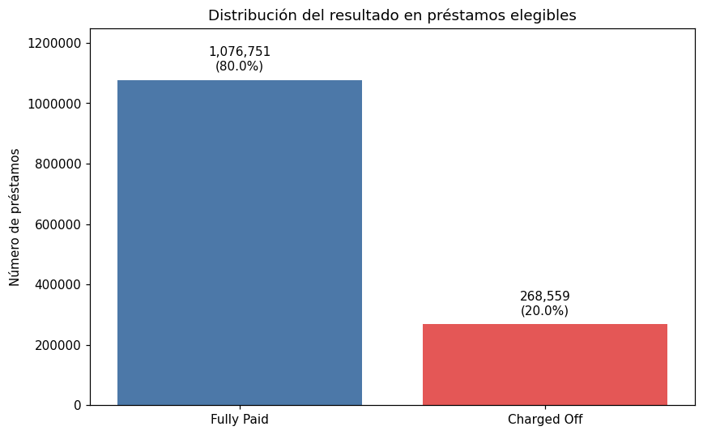

*Figura 1. Distribución de los dos desenlaces en toda la población elegible. Fuente: elaboración del Grupo 8; [notebook 04](../notebooks/04_exploracion_completa.ipynb), salida guardada de distribución del objetivo.*

Aproximadamente cuatro de cada cinco préstamos elegibles fueron pagados y uno terminó incobrable. El desbalance motiva utilizar ROC-AUC y Average Precision en lugar de juzgar el modelo únicamente por accuracy. No se fuerza una distribución artificial 50/50.

### 3.3. Tipos de información y distribución temporal

Las variables numéricas incluyen montos monetarios, porcentajes, cantidades de cuentas, meses transcurridos y puntuaciones FICO. Las categóricas representan, entre otras, vivienda, finalidad, verificación de ingresos, antigüedad laboral y estado de residencia. Las fechas permiten reconocer el periodo de originación y la antigüedad de la información. Un faltante no es otra variable de respuesta: indica ausencia de un valor y requiere tratamiento según el tipo y su disponibilidad histórica.

El volumen de préstamos no es uniforme entre años. El desarrollo completo contiene 93,153 préstamos hasta 2012, 134,804 de 2013, 223,102 de 2014, 375,545 de 2015 y 293,095 de 2016. En el test histórico hay 169,300 de 2017 y 56,311 de 2018. Los porcentajes y conteos de la muestra inicial no deben trasladarse sin identificar su población. Estos datos no representan a todos los solicitantes de crédito, otros países ni condiciones actuales de concesión.

## 4. Limpieza y preparación de datos

### 4.1. Filtrado de observaciones y revisión de campos

Se conservan únicamente las dos etiquetas finales y se construye `default`. No se convierten préstamos activos en ejemplos negativos ni atrasos en positivos. Tampoco se eliminan todas las filas con algún faltante, pues eso reduciría la población de forma selectiva. Las conversiones de fechas esperadas y del plazo se realizan de forma explícita; no se documenta como aplicada una eliminación general de registros por «fecha inválida».

La auditoría inicial señala 361 ingresos iguales a cero y dos valores negativos de deuda/ingreso, con 363 registros alertados. Son alertas de revisión, no evidencia de una depuración automática de esas filas. El flujo final normaliza valores no finitos como ausentes antes del tratamiento numérico. Detectar un valor extremo o sospechoso no basta para declarar que es un error: un ingreso elevado puede ser legítimo y una utilización superior a 100% requiere interpretación financiera, no eliminación mecánica.

### 4.2. Prevención de información posterior al otorgamiento

La exclusión conceptual precede a las comparaciones predictivas. Se retiran campos que describen el comportamiento del mismo préstamo después del desembolso. Un modelo que emplease recuperaciones o pagos acumulados podría reconocer un desenlace ya ocurrido, pero no resolvería la pregunta planteada.

| Familia retirada | Ejemplos reales | Motivo |
| --- | --- | --- |
| Pagos y recuperaciones | `total_pymnt`, `total_rec_prncp`, `total_rec_int`, `recoveries`, `collection_recovery_fee` | Se acumulan durante o después del préstamo |
| Saldo pendiente del préstamo | `out_prncp`, `out_prncp_inv` | Estado posterior del capital del mismo préstamo |
| Últimos pagos y consultas | `last_pymnt_d`, `last_pymnt_amnt`, `next_pymnt_d`, `last_credit_pull_d` | Información actualizada después del origen |
| FICO actualizado | `last_fico_range_low`, `last_fico_range_high` | No equivale al FICO al otorgamiento |
| Dificultades y acuerdos | `hardship_*`, `deferral_term`, `payment_plan_start_date`, `debt_settlement_*`, `settlement_*`, `pymnt_plan` | Planes o acuerdos asociados a la evolución posterior |

La distinción se refiere al tiempo del evento. Por ejemplo, `tot_cur_bal` resume cuentas del historial crediticio disponible en el origen y no se confunde automáticamente con `out_prncp`, saldo actualizado del préstamo que se intenta predecir. El diccionario y las listas de exclusión del código son necesarios para resolver casos particulares; no se excluye una columna solo por contener la palabra «saldo».

Se retiran también identificadores (`id`, `member_id`, `url`), `zip_code`, texto libre (`desc`, `title`, `emp_title`) y `policy_code` fuera del alcance del modelo. El texto y la ubicación fina podrían contener información, pero no se les atribuye una utilidad comprobada ni ausencia de sesgo. `loan_status` construye la respuesta y no entra en X. `issue_d` sirve para los cortes, sin convertirse en una señal que revele el resultado.

### 4.3. Lectura, tipos y memoria

La exploración completa prepara tipos verificados y carga de una vez las columnas seleccionadas. El ahorro de memoria consiste en evitar campos innecesarios y representar de forma más compacta los enteros y categorías, manteniendo los decimales que requieren `float64`. Los enteros solo se reducen si sus valores caben en el rango del tipo; las categorías almacenan códigos junto con un vocabulario. No se afirma que reducir memoria implique siempre una lectura más rápida: crear categorías y convertir tipos tiene costo.

La lectura por bloques fue útil en auditorías que recorren el archivo sin conservarlo completo, pero concatenar todos los bloques sigue necesitando memoria para la tabla final y puede añadir un pico transitorio. El cargador del pipeline final, a diferencia de la lectura directa del notebook 04, recorre bloques de 100,000 filas, conserva los préstamos elegibles del periodo y finalmente concatena sus partes. Por tanto, su conjunto de desarrollo sí termina en memoria; no es un algoritmo de entrenamiento externo que evite almacenar la tabla completa. Esta diferencia de implementación se describe según el código vigente. Los resultados de [benchmark_memoria](../outputs/benchmark_memoria) y [comparacion_carga](../outputs/comparacion_carga) son experimentos de recursos, no pruebas de calidad predictiva. Aquí no se cambia el método ni se vuelve a medir RAM. Renombrar columnas para tablas y gráficos mejora su lectura; las interfaces reutilizables y el diccionario conservan la correspondencia con los nombres originales.

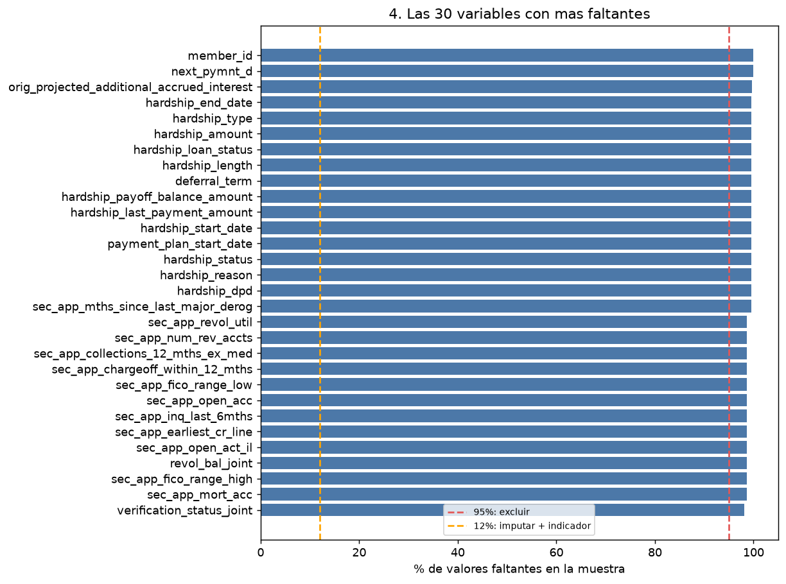

*Figura 2. Faltantes en la muestra antes de la exclusión conceptual. Fuente: elaboración del Grupo 8; [notebook 01](../notebooks/01_exploracion_inicial_baseline.ipynb) y [auditoría inicial](../outputs/auditoria.json).*

Esta figura describe la muestra y todavía muestra campos como identificadores o información de dificultades de pago. No representa la lista final de predictores. Su utilidad es mostrar por qué el porcentaje de vacíos debe combinarse con el significado y el momento de disponibilidad de cada variable.

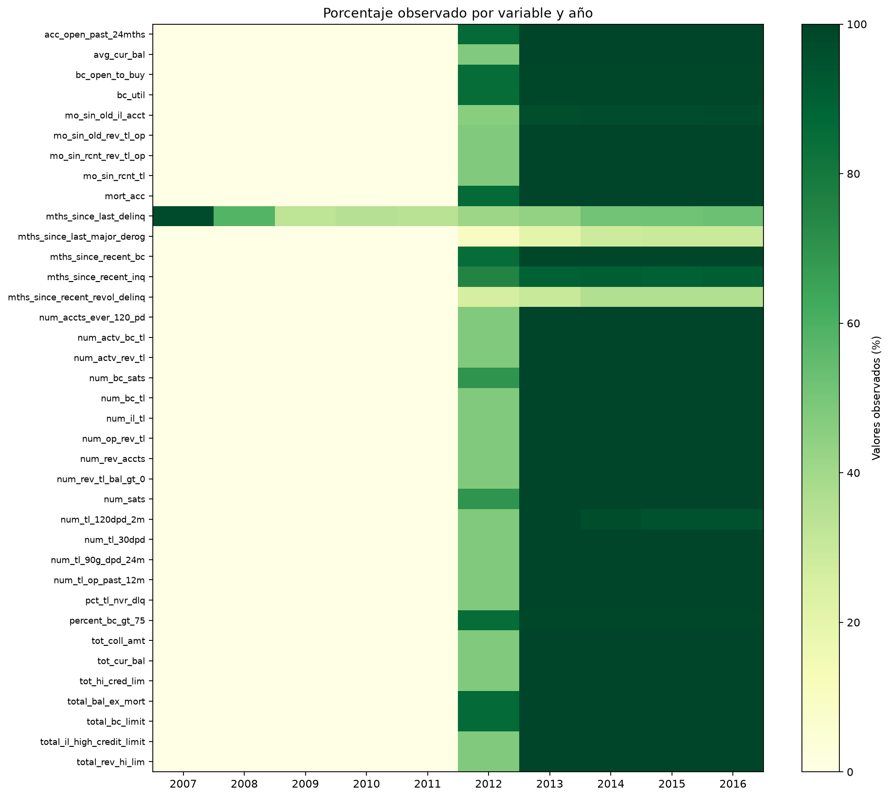

*Figura 3. Disponibilidad de variables a través de los años. Fuente: elaboración del Grupo 8; [notebook 07](../notebooks/07_umbrales_sensibilidad.ipynb) y [disponibilidad anual](../outputs/analisis_sensibilidad_faltantes/disponibilidad_anual_variables.csv).*

Las franjas de disponibilidad cambian con el año. Parte de los vacíos refleja campos que no se recopilaban en periodos antiguos. Usar la mediana de años futuros para completarlos antes de validar introduciría información que no pertenecía al entrenamiento.

La transformación de fechas ya implementada calcula `meses_desde_earliest_cr_line` como la diferencia en meses entre `issue_d` y `earliest_cr_line`: doce veces la diferencia de años más la diferencia de meses. La fecha original del historial se sustituye por esa antigüedad; `issue_d` sigue sirviendo para el periodo. Esto es una característica derivada existente, distinta de nuevas interacciones o razones no evaluadas.

### 4.4. Evolución de la selección de características

El proyecto no utilizó desde el inicio una única lista definitiva. En la muestra inicial quedaron 65 variables tras las exclusiones conceptuales y el control de faltantes de entrenamiento. Al cambiar a toda la población se revisó la cobertura histórica: seleccionar sobre datos hasta 2012 y seleccionar hasta 2016 produce conjuntos distintos, aunque el porcentaje límite sea idéntico.

| Etapa | Regla y población de selección | Características originales | Alcance |
| --- | --- | --- | --- |
| Muestra inicial | Exclusiones y umbral de faltantes del entrenamiento inicial | 65 | Referencia histórica |
| Conjunto fijo restrictivo | Hasta 10% de faltantes en entrenamiento hasta 2012 | 26 | Disponible desde el primer corte |
| Conjunto fijo ampliado | Hasta 10% en desarrollo hasta 2016 | 59 | Exploratorio: conoce cobertura de años posteriores |
| Selección temporal al 10% | Regla recalculada solo en entrenamiento de cada corte | 26 / 26 / 26 / 57 | Comparación temporal |
| Selección temporal al 50% | Regla recalculada solo en entrenamiento de cada corte | 26 / 60 / 60 / 60 | Configuración adoptada |
| Ajuste final | Regla de 50% en entrenamiento 2007–2015 | 60; 136 columnas transformadas | Antes de calibrar en 2016 |

La regla se fija con entrenamiento y se aplica sin redescubrir columnas en validación. Los porcentajes se calculan sobre la población elegible de ese periodo. Por tanto, la variación de 26 a 60 columnas entre cortes es una consecuencia documentada de la selección temporal, no una mezcla de observaciones. Una columna sin datos no tiene una mediana estimable en ese entrenamiento y no se rescata usando años posteriores.

En [comparacion_variables_temporal](../outputs/comparacion_variables_temporal/resumen_promedios_y_variabilidad.csv), con los mismos hiperparámetros de Gradient Boosting, las 26 variables sin indicadores alcanzaron ROC-AUC medio 0.699985 y AP 0.355088; las 59 exploratorias, 0.713069 y 0.371702. La selección estrictamente temporal al 10% obtuvo 0.703295 y 0.359341. La ventaja de 59 es una señal exploratoria favorable, pero no demuestra por sí sola que ese conjunto fijo estuviera disponible para elegirlo antes de 2013.

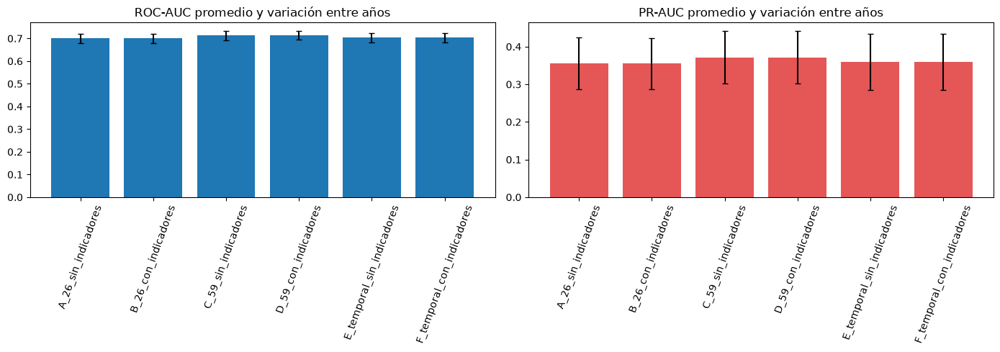

*Figura 4. Comparación de conjuntos y de indicadores de faltantes. Fuente: elaboración del Grupo 8; [notebook 06](../notebooks/06_comparacion_variables_imputacion.ipynb), comparación temporal de conjuntos.*

Ampliar las variables produce una mejora mayor que añadir indicadores en estas configuraciones. Las diferencias con y sin indicadores son pequeñas: por ejemplo, 26 variables cambian de ROC-AUC 0.699985 a 0.699885. No se presenta esa variación como una mejora ni como una prueba de inutilidad universal de los indicadores.

| Modelo | Umbral de faltantes | ROC-AUC medio | AP media | Desviación ROC-AUC |
| --- | --- | --- | --- | --- |
| HistGradientBoosting | 10% | 0.703295 | 0.359341 | 0.021337 |
| HistGradientBoosting | 30% | 0.710493 | 0.368658 | 0.025920 |
| HistGradientBoosting | 50% | 0.710428 | 0.368693 | 0.025910 |
| HistGradientBoosting | 75% | 0.713506 | 0.372133 | 0.020252 |
| Logística | 10% | 0.696181 | 0.352192 | 0.019305 |
| Logística | 50% | 0.702187 | 0.359320 | 0.023857 |
| Logística | 75% | 0.705483 | 0.362564 | 0.018185 |
| SVM lineal | 10% | 0.696135 | 0.351507 | 0.019515 |
| SVM lineal | 50% | 0.702212 | 0.358570 | 0.024140 |
| SVM lineal | 75% | 0.705374 | 0.361687 | 0.018694 |

Fuente: [resumen de umbrales](../outputs/comparacion_umbrales_faltantes/resumen_promedios_y_variabilidad.csv); desviaciones según la agregación conservada en esa tabla. **El umbral de 50% no fue el que maximizó ROC-AUC ni el que minimizó su dispersión.** El de 75% fue superior en ambas cifras para Gradient Boosting en esta comparación. La decisión adoptada es conservadora respecto a cobertura e imputación y debe entenderse como un compromiso metodológico, no como el ganador inequívoco de todas las métricas.


*Figura 5. ROC-AUC medio según el límite de faltantes. Fuente: elaboración del Grupo 8; [notebook 07](../notebooks/07_umbrales_sensibilidad.ipynb) y comparación de umbrales.*

Los tres modelos pueden aprovechar variables adicionales, aunque la magnitud cambia. El gráfico impide justificar 50% afirmando que obtuvo el máximo: la elección exige considerar la procedencia temporal de los datos y el beneficio por corte, además del promedio.

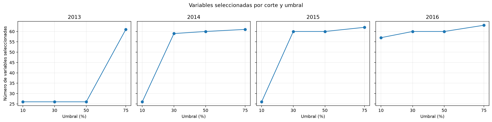

*Figura 6. Número de variables admitidas por corte y umbral. Fuente: elaboración del Grupo 8; [conteo de variables](../outputs/comparacion_umbrales_faltantes/conteo_variables_por_corte_y_umbral.csv), notebook 07.*

Un mismo umbral no fuerza un número fijo de características. El 50% admite 26 en el primer entrenamiento y 60 en los tres siguientes. El aumento refleja cobertura histórica y explica por qué no se utilizó una mediana imposible de calcular en columnas completamente vacías.

La sensibilidad entre 50% y 75% muestra, para Gradient Boosting, una mejora media de ROC-AUC de 0.003078 y de AP de 0.003440. La mejora de ROC-AUC se concentra en 2013 (+0.012523); en 2014, 2015 y 2016 los cambios son −0.000123, −0.000085 y −0.000003. No es una ganancia sostenida de discriminación en todos los años. En los modelos lineales, el patrón no es idéntico y no debe inferirse a partir del ensamble.

Los intervalos pareados guardados para esa comparación contienen otra cautela: el código intenta agrupar por `member_id`, pero la auditoría lo registra completamente vacío y el procedimiento asigna identificadores por fila cuando falta. Por ello no se interpreta el archivo denominado «por prestatario» como evidencia de un remuestreo efectivo por prestatario conocido. La incertidumbre puede estar subestimada si existen dependencias entre préstamos de una misma persona que no pudieron identificarse.


*Figura 7. Cambio anual de ROC-AUC al pasar de 50% a 75%. Fuente: elaboración del Grupo 8; [diferencias anuales](../outputs/analisis_sensibilidad_faltantes/metricas_anuales_50_vs_75.csv), notebook 07.*

La mejora temprana y las diferencias casi nulas posteriores respaldan una interpretación prudente del aumento promedio. No demuestran equivalencia estadística ni establecen que 50% sea óptimo. Queda pendiente contrastar esta decisión en un periodo independiente.

### 4.5. Imputación y preprocesamiento definitivo

En cada entrenamiento se calcula una mediana para cada numérica seleccionada y se utiliza la misma para completar su validación. Las categóricas reciben «Sin información»; después se aplica One-Hot Encoding con una categoría de referencia retirada y manejo de categorías desconocidas. No se ajusta el vocabulario a partir del conjunto de prueba. Una categoría desconocida puede quedar representada con ceros, limitación que debe vigilarse porque puede confundirse con la referencia.

El flujo final utiliza escalado numérico ajustado con entrenamiento. En los modelos lineales se conserva una representación compatible con matrices dispersas, sin centrar cuando ello destruiría la dispersión; en HistGradientBoosting se construye la matriz densa. Aunque un árbol no requiere escalado para ordenar particiones, se describe la transformación existente en el código compartido, no una alternativa teórica. El conjunto final cuenta con 60 variables antes de One-Hot Encoding y 136 columnas transformadas; estos números no son intercambiables. Incluye seis categóricas (`emp_length`, `home_ownership`, `verification_status`, `purpose`, `addr_state`, `application_type`) y 54 numéricas, incluida la antigüedad del historial derivada de la fecha. «Variables originales» en las tablas de resultados significa antes de codificar, no que se retenga la fecha sin transformar.

Se evaluaron indicadores binarios numéricos calculados antes de imputar y se compararon con la mediana sola y el manejo nativo de ausentes del ensamble. Sus ganancias fueron mínimas o inconsistentes en las comparaciones guardadas, por lo que el preprocesamiento adoptado no los incorpora. «Sin información» se mantiene en categóricas; no se crea otro indicador redundante. No se aplicaron nuevas interacciones ni razones financieras sin evidencia de ejecución. Las reglas y transformaciones corresponden a [src/features.py](../src/features.py), [src/modelado.py](../src/modelado.py) y [src/etapas_finales.py](../src/etapas_finales.py).


*Figura 8. Distribución observada e imputada de la antigüedad de crédito a plazos. Fuente: elaboración del Grupo 8; [resumen del efecto de imputación](../outputs/analisis_sensibilidad_faltantes/resumen_efecto_imputacion.csv), notebook 07.*

La mediana concentra valores en una posición y no reconstruye la variabilidad ausente. Estas comparaciones son diagnósticas: no prueban que todos los vacíos tengan el mismo significado ni que una variable imputada intensamente conserve la misma información que una observada.

## 5. Análisis exploratorio

### 5.1. Población y cambios temporales

La exploración inicial se realizó sobre 220,003 préstamos y sus análisis detallados de predictores utilizaron el entrenamiento de esa muestra. La exploración completa conserva una salida ejecutada de la distribución global del objetivo; otras figuras de correlaciones, categorías y cajas disponibles proceden de la muestra. Se identifica esa procedencia para evitar presentar como un nuevo EDA completo lo que no tiene salida guardada.

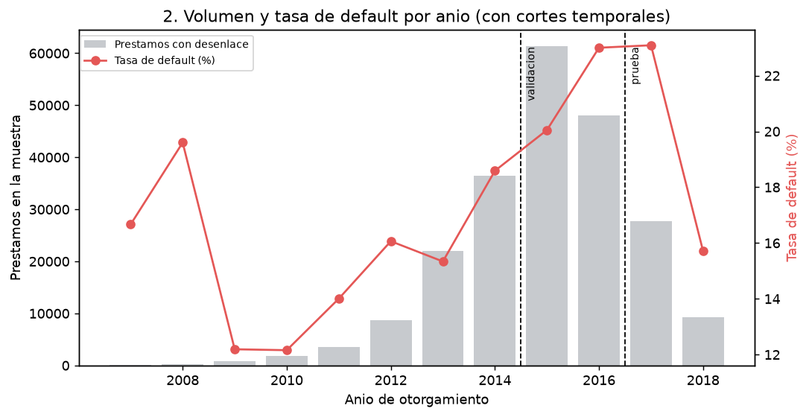

*Figura 9. Distribución temporal y proporción de incumplimiento en la muestra inicial. Fuente: elaboración del Grupo 8; [notebook 01](../notebooks/01_exploracion_inicial_baseline.ipynb) y auditoría inicial.*

Cambian el volumen y la proporción de incobrables entre años. El volumen creciente hace que un promedio ponderado por observaciones favorezca años grandes; la validación posterior utiliza el promedio de cuatro cortes para observar su estabilidad, sin asumir que las diferencias sean causales.

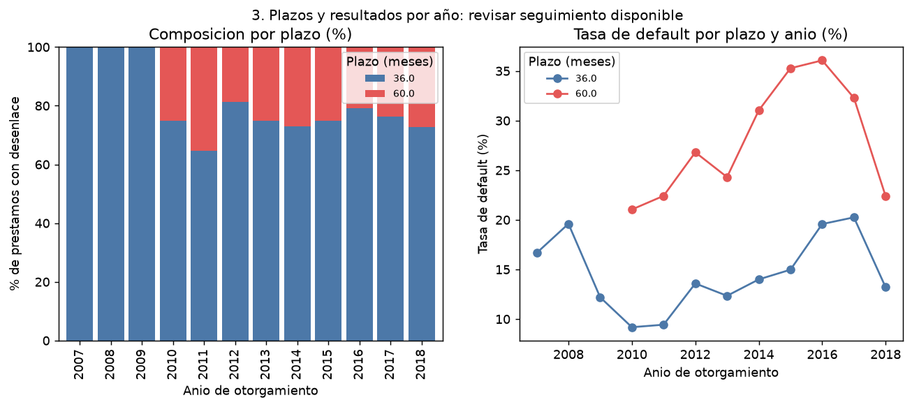

*Figura 10. Plazo y seguimiento disponible en la exploración inicial. Fuente: elaboración del Grupo 8; [notebook 01](../notebooks/01_exploracion_inicial_baseline.ipynb), muestra inicial.*

Los préstamos tienen plazos de 36 o 60 meses. En años recientes, seleccionar solo desenlaces finales puede sobrerrepresentar pagos anticipados o incumplimientos tempranos. Separar por año de otorgamiento no demuestra que todos los resultados ya fueran conocidos en la fecha simulada de entrenamiento.

### 5.2. Montos, ingresos y características crediticias

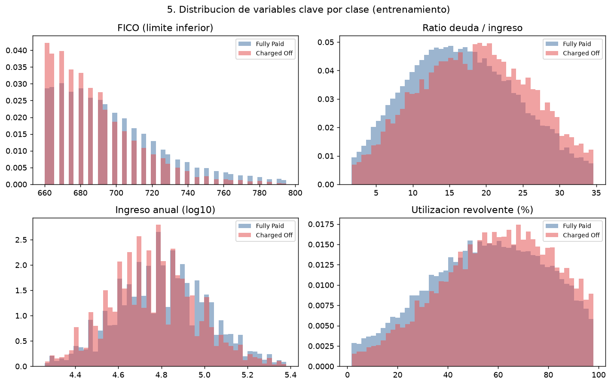

*Figura 11. Distribuciones de variables numéricas en el entrenamiento inicial. Fuente: elaboración del Grupo 8; [src/run_baseline.py](../src/run_baseline.py), figuras de la muestra inicial.*

Montos, ingresos y utilización presentan escalas y asimetrías distintas. En esta visualización se usan transformaciones o recortes de extremos para facilitar la lectura, como logaritmo de ingresos positivos y límites de percentiles en algunos paneles; no equivalen a eliminar esas filas del entrenamiento. Las colas largas motivan escalado, revisión de plausibilidad y comparación de modelos no lineales.

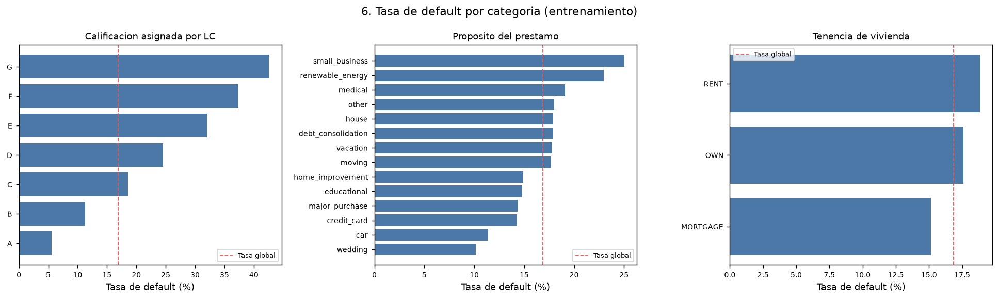

*Figura 12. Resultados según categorías en la muestra inicial. Fuente: elaboración del Grupo 8; [notebook 01](../notebooks/01_exploracion_inicial_baseline.ipynb) y generador de figuras del baseline.*

Las proporciones difieren entre categorías observadas. La figura puede incluir `grade`, estudiada en una variante de condiciones asignadas por Lending Club, sin que ello la convierta en predictor del escenario final. Los grupos mostrados tienen cobertura mínima para la visualización; las diferencias no acreditan efectos causales ni equidad.

### 5.3. Correlaciones antes y después de imputar

Se calcula correlación de Spearman entre cada numérica y `default`, que toma 0/1. Esto resume asociación de rangos y no el efecto conjunto de todos los predictores. Antes de imputar se utilizan pares observados; después, valores completados con la mediana del entrenamiento. Se conserva la misma lista y escala, sin añadir los nuevos indicadores a la comparación. Las correlaciones pueden cambiar, pues imputar modifica rangos, empates y la composición efectiva de cada cálculo.

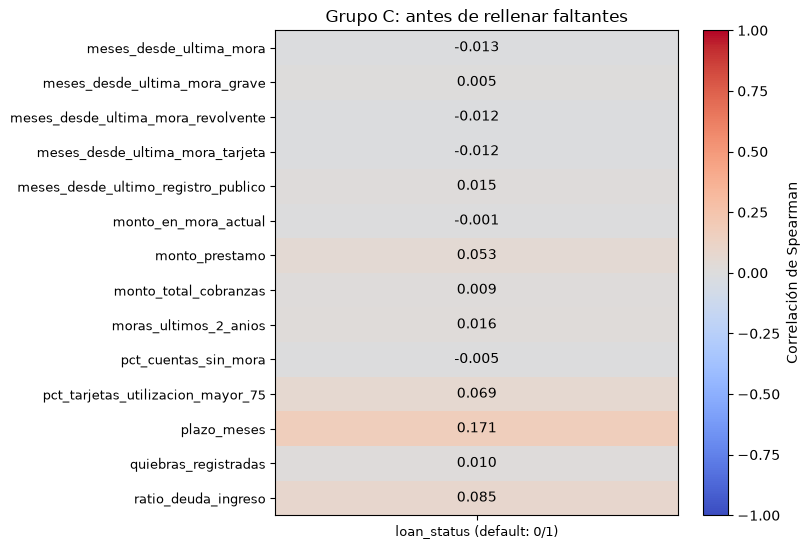

*Figura 13. Grupo C: asociación con el objetivo antes de completar faltantes. Fuente: elaboración del Grupo 8; [notebook 01](../notebooks/01_exploracion_inicial_baseline.ipynb), salida incrustada de la sección de correlación previa.*

La escala común de −1 a 1 evita exagerar asociaciones pequeñas. Una correlación próxima a cero no descarta efectos no lineales, interacciones ni utilidad condicional. Esta figura corresponde al entrenamiento de la muestra, no al test ni a los 1.3 millones de préstamos.

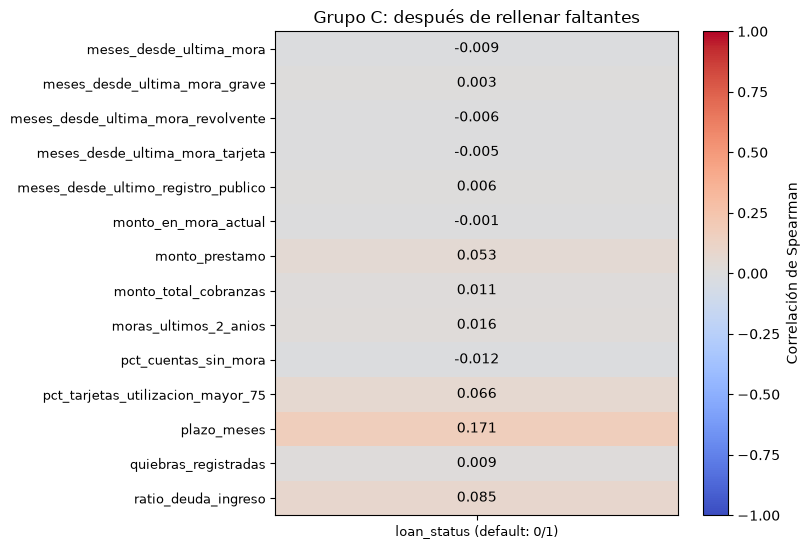

*Figura 14. Grupo C: asociación con el objetivo después de completar faltantes. Fuente: elaboración del Grupo 8; [notebook 01](../notebooks/01_exploracion_inicial_baseline.ipynb), salida incrustada de correlación posterior.*

La comparación permite revisar si completar con la mediana altera las asociaciones observadas; no demuestra que los valores imputados sean reales. Los otros tres grupos, con todas las numéricas de esta comparación, se conservan en el Anexo A.

### 5.4. Outliers y registros sospechosos

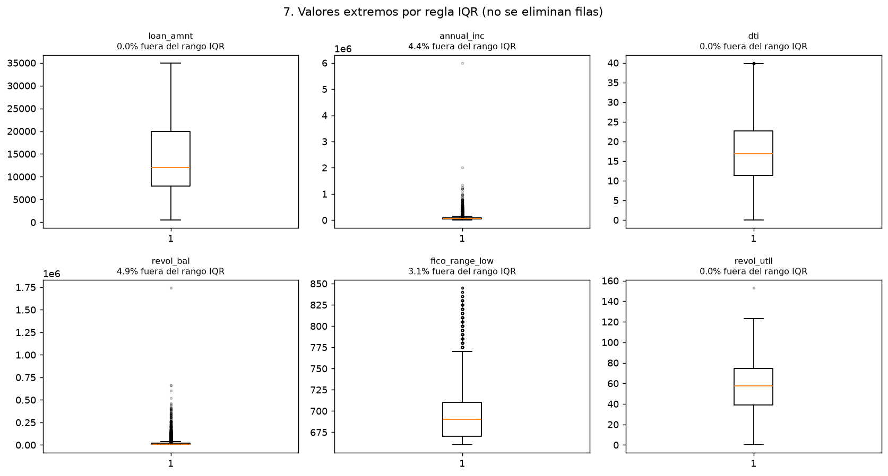

*Figura 15. Diagramas de caja de variables numéricas del entrenamiento inicial. Fuente: elaboración del Grupo 8; [notebook 01](../notebooks/01_exploracion_inicial_baseline.ipynb) y figura existente de outliers.*

Ingresos y saldos muestran colas extensas; FICO tiene una escala acotada. Se señalan valores fuera de Q1 − 1.5×IQR y Q3 + 1.5×IQR, pero no se elimina su unión ni se crea un subconjunto «limpio» para afirmar una mejora. La cantidad visual de puntos tampoco estima por sí sola el porcentaje de anomalías, pues pueden superponerse.

El diagnóstico después de imputar describe la distribución resultante, no valida errores. La mediana puede cambiar cuartiles y límites IQR, por lo que incluso valores originales sin modificar pueden cambiar de clasificación estadística. En este proyecto se conserva la distinción entre extremos y valores inválidos; no se ejecuta una limpieza multivariada por Mahalanobis ni se atribuyen resultados a un tratamiento de outliers que no se realizó.

## 6. Estrategia de partición y validación

### 6.1. Separación temporal

El objetivo es comparar cómo se comportan modelos entrenados con préstamos de años anteriores al aplicarlos a un año posterior. Una división aleatoria mezclaría información de periodos con cobertura y condiciones distintas y respondería otra pregunta. Se utiliza validación temporal expansiva: el entrenamiento crece y cada validación corresponde al siguiente año. La aleatoriedad de la búsqueda de hiperparámetros no cambia esta partición. La distinción entre selección y evaluación, así como las precauciones para datos ordenados en el tiempo, se apoya en scikit-learn developers (s. f.-b), [guía de validación cruzada](https://scikit-learn.org/1.8/modules/cross_validation.html).

| Corte | Entrenamiento por originación | n entrenamiento | Validación | n validación |
| --- | --- | --- | --- | --- |
| 1 | 2007–2012 | 93,153 | 2013 | 134,804 |
| 2 | 2007–2013 | 227,957 | 2014 | 223,102 |
| 3 | 2007–2014 | 451,059 | 2015 | 375,545 |
| 4 | 2007–2015 | 826,604 | 2016 | 293,095 |

Fuente: tablas de preparación temporal y [resultados de optimización por corte](../outputs/optimizacion_final/resultados_por_configuracion_y_corte.csv). Cada configuración se compara sobre las mismas observaciones de validación. Dentro de cada corte se estiman desde cero selección de variables, medianas, vocabularios y escaladores. No se calcula una mediana independiente de validación para aplicársela a sí misma. Los cuatro ROC-AUC y AP se promedian sin ponderaciones arbitrarias entre métricas; la dispersión entre años describe variación temporal, no un intervalo de confianza del promedio.

### 6.2. Separación para calibración y ajuste definitivo

La calibración requiere datos que no hayan servido para ajustar el modelo base. Esta separación y la interpretación de curvas por frecuencias siguen la [guía de calibración](https://scikit-learn.org/1.8/modules/calibration.html) de scikit-learn developers (s. f.-c). En su comparación temporal se reserva el año inmediatamente anterior a cada validación para aprender la transformación de calibración:

| Validación evaluada | Ajuste base | n base | Ajuste de calibración | n calibración |
| --- | --- | --- | --- | --- |
| 2013 | 2007–2011 | 39,786 | 2012 | 53,367 |
| 2014 | 2007–2012 | 93,153 | 2013 | 134,804 |
| 2015 | 2007–2013 | 227,957 | 2014 | 223,102 |
| 2016 | 2007–2014 | 451,059 | 2015 | 375,545 |

El ajuste definitivo entrena el modelo base y su preprocesamiento con 2007–2015 (826,604), aprende la calibración con 2016 (293,095) y utiliza 2017–2018 (225,611 elegibles) como test histórico. La regla de características final se aprende con 2007–2015, sin seleccionar usando 2016 ni test. El modelo no se reajusta incluyendo 2016 después de calibrar, pues cambiaría el estimador al que se aplicó esa calibración.

### 6.3. Alcance de la evidencia temporal

La división utiliza el año de originación, no una fecha conocida de cierre de cada etiqueta. Un préstamo de 2012 puede alcanzar su desenlace después de 2013; sin auditar esa fecha no se puede afirmar una simulación estricta de toda la información disponible en tiempo real. Además, algunas pruebas iniciales ya reportaron métricas de 2017–2018. La búsqueda posterior no utiliza test para seleccionar configuraciones, pero el periodo no fue completamente desconocido durante toda la investigación. Los resultados finales son retrospectivos y requieren una evaluación externa o prospectiva.

## 7. Baselines

### 7.1. Referencias y muestra inicial

Un baseline es una referencia reproducible que los modelos posteriores deben superar bajo condiciones comparables. No significa necesariamente devolver una media: aquí se utiliza tanto un clasificador trivial como regresión logística. La muestra inicial contiene 220,003 préstamos seleccionados sin reemplazo con fracción global aproximada 0.16353 de los elegibles. Conserva proporciones aproximadamente, sin imponer clases equilibradas. Se divide en 73,701 préstamos hasta 2014, 109,382 de 2015–2016 y 36,920 de 2017–2018.

El clasificador de clase mayoritaria siempre devuelve `Fully Paid`; sus puntuaciones constantes producen ROC-AUC 0.5 y AP igual a la prevalencia. En validación obtiene accuracy 78.66%, pero recall y F1 de incumplimiento iguales a cero. Esto muestra por qué una accuracy aparentemente elevada no basta.

| Referencia en muestra | ROC-AUC validación | AP validación | ROC-AUC test | AP test |
| --- | --- | --- | --- | --- |
| Clase mayoritaria | 0.500000 | 0.213445 | 0.500000 | 0.212459 |
| Logística sin indicadores | 0.712053 | 0.401609 | 0.690191 | 0.358399 |
| Logística con indicadores | 0.712758 | 0.402534 | 0.692175 | 0.361011 |
| Logística con condiciones LC | 0.724332 | 0.412460 | 0.701967 | 0.369762 |

Fuente: [outputs/metrics.json](../outputs/metrics.json). La logística sin indicadores utiliza 65 variables originales y 138 columnas codificadas. La variante con 31 indicadores numéricos produce 169 columnas. El escenario con condiciones LC utiliza 73 variables originales y una representación diferente; su mejor ROC-AUC no puede atribuirse solo a cambiar el algoritmo. Es importante distinguir características originales, indicadores y columnas One-Hot.

### 7.2. Interpretación del baseline

La regresión logística aprende una combinación lineal de características para estimar el logaritmo de las odds. Los coeficientes se ajustan por el algoritmo usando los datos de entrenamiento, con regularización. Las probabilidades obtenidas por `predict_proba` son individuales; ROC-AUC y AP evalúan su ordenamiento en el conjunto, no constituyen la respuesta para cada préstamo.

En el baseline inicial se estudiaron umbrales mediante validación; por ejemplo, la versión sin indicadores registra aproximadamente 0.17538. No es el umbral 0.5 descriptivo del análisis de errores final. No se comparan F1 o recall entre ambas etapas como si solo hubiera cambiado el modelo. Las pequeñas ganancias con indicadores motivaron contrastes posteriores, sin asumir que siempre sean favorables.

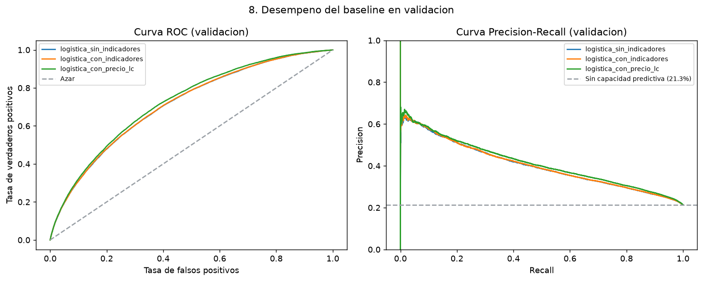

*Figura 16. Curvas y métricas de referencia del baseline inicial. Fuente: elaboración del Grupo 8; [notebook 01](../notebooks/01_exploracion_inicial_baseline.ipynb) y [métricas del baseline](../outputs/metrics.json).*

La comparación separa el clasificador trivial de las variantes logísticas. Las curvas revelan capacidad para ordenar riesgo por encima de la referencia constante, aunque las probabilidades iniciales todavía no forman parte del procedimiento final de calibración. Los resultados corresponden a la muestra y a sus periodos propios.

## 8. Modelos entrenados

### 8.1. Regresión logística

Es la referencia interpretable y una de las tres familias finales. Utiliza regularización controlada por `C`, escalado numérico y codificación categórica. Una representación lineal permite inspeccionar asociaciones condicionadas a las demás variables, pero no captura automáticamente interacciones complejas. Su buena relación entre costo y rendimiento justifica conservarla en todas las comparaciones, aun cuando el ensamble obtiene mejores resultados finales.

### 8.2. Árbol de Decisión

Un árbol divide el espacio de características mediante reglas sucesivas y puede capturar relaciones no lineales. La profundidad, el número mínimo de ejemplos por hoja y los pesos de clase limitan su complejidad. El árbol libre obtuvo ROC-AUC de entrenamiento 1.0, frente a 0.54073 en validación y 0.53295 en test: evidencia de una diferencia marcada entre ajuste y generalización en la muestra.

La grilla seleccionó `max_depth=10`, `min_samples_leaf=1000` y `class_weight=None`; el árbol resultante tuvo 58 hojas. Sus ROC-AUC fueron 0.68698 en entrenamiento, 0.67448 en validación y 0.63458 en test. Regularizar mejoró la validación frente al árbol libre, pero no superó a la regresión logística comparable. El árbol se mantiene como experimento inicial, no como candidato final calibrado.

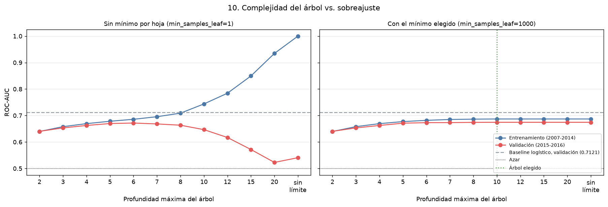

*Figura 17. Complejidad y generalización del árbol inicial. Fuente: elaboración del Grupo 8; [notebook 02](../notebooks/02_arbol_decision.ipynb) y [búsqueda del árbol](../outputs/busqueda_arbol.csv).*

La separación entre entrenamiento y validación crece con configuraciones flexibles. Limitar profundidad o exigir más observaciones por hoja reduce esa diferencia. Escoger un árbol regularizado no implica que la mejor alternativa encontrada sea superior al baseline logístico.

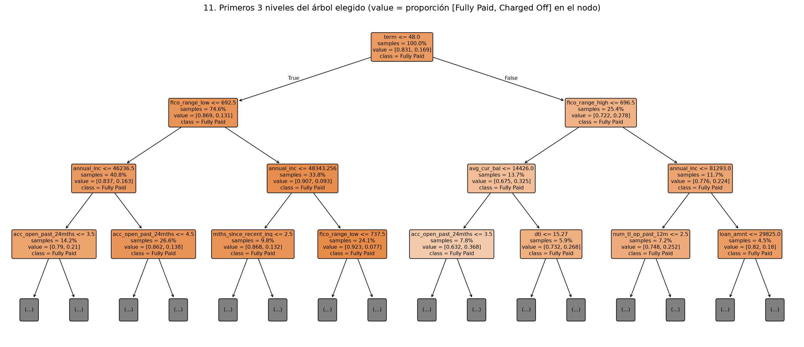

*Figura 18. Reglas superiores del árbol regularizado. Fuente: elaboración del Grupo 8; [reglas guardadas](../outputs/reglas_arbol.txt), notebook 02.*

Las divisiones hacen visible una lógica de segmentación, pero las frecuencias de sus hojas pertenecen al ajuste de ese árbol exploratorio. No se atribuyen estas reglas al HistGradientBoosting final ni se presentan como reglas crediticias causales.

### 8.3. Evolución de Gradient Boosting

El ensamble incorpora árboles de forma secuencial para corregir errores de la función aprendida. La implementación emplea bibliotecas de scikit-learn; no constituye una programación desde cero del algoritmo. El aprendizaje por histogramas reduce el costo de buscar particiones y permite relaciones no lineales e interacciones entre variables.

Existe una ejecución preliminar de aproximadamente 5,002 observaciones en [outputs/metrics_boosting.json](../outputs/metrics_boosting.json). No es una comparación homogénea con la muestra oficial: su sección de árbol conserva conteos de 220,003 préstamos, mientras otras entradas corresponden a 5,002. Esa mezcla de procedencias impide utilizar todo el JSON como una tabla única de modelos equivalentes. Las figuras preliminares relacionadas no se emplean para justificar el ganador final.

La comparación homogénea posterior sí está ejecutada y guardada en [outputs/gradient_boosting_220000](../outputs/gradient_boosting_220000). Utiliza los mismos 220,003 préstamos, 65 variables y periodos iniciales. El Gradient Boosting seleccionado registra ROC-AUC 0.74815 en entrenamiento, 0.71556 en validación y 0.69135 en test; AP de validación 0.40716. La ejecución guardada informa 1,068.69 segundos para su experimento, sin que ello sea una medición nueva ni un tiempo generalizable a otras máquinas.

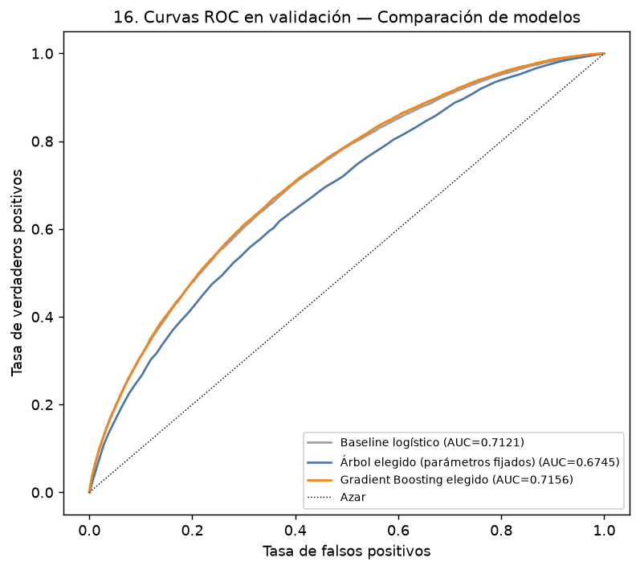

*Figura 19. Comparación homogénea con Gradient Boosting en 220,003 préstamos. Fuente: elaboración del Grupo 8; [métricas de la ejecución homogénea](../outputs/gradient_boosting_220000/metrics_boosting.json), notebook 03.*

El ensamble supera ligeramente a la logística sin indicadores en validación y test bajo esta muestra. No supera a toda variante logística imaginable: el escenario con condiciones LC emplea otra información y obtiene mejores cifras. El pequeño margen de test frente al baseline comparable no basta para afirmar una mejora significativa.

### 8.4. SVM lineal y candidatos finales

La SVM lineal aprende un margen de separación regularizado y aporta una familia distinta de la logística y los ensambles de árboles. `LinearSVC` entrega una puntuación continua mediante `decision_function`; esa puntuación permite calcular ROC-AUC y AP, pero no es por sí misma una probabilidad. La etapa de calibración aprende después su conversión a probabilidad. No se estudia aquí una SVM de kernel no lineal como si fuese el mismo estimador.

Las tres familias finales son regresión logística, SVM lineal e HistGradientBoosting. El último se adopta como modelo principal por su mejor balance de discriminación y calidad probabilística en los resultados conservados, no por su nombre ni por ganar todas las comparaciones históricas. Los experimentos finales comparten selección temporal, preparación y observaciones, con calibración posterior.

| Etapa y población | Modelo | ROC-AUC validación | ROC-AUC test histórico |
| --- | --- | --- | --- |
| Muestra 220,003 | Logística sin indicadores | 0.712053 | 0.690191 |
| Muestra 220,003 | Árbol regularizado | 0.674482 | 0.634576 |
| Muestra 220,003 | Gradient Boosting homogéneo | 0.715564 | 0.691355 |
| Desarrollo completo; cuatro cortes | Logística optimizada | 0.702351 (promedio) | 0.692591 (final calibrado) |
| Desarrollo completo; cuatro cortes | SVM optimizada | 0.702212 (promedio) | 0.691777 (final calibrado) |
| Desarrollo completo; cuatro cortes | HistGradientBoosting optimizado | 0.710493 (promedio) | 0.703213 (final calibrado) |

Fuentes: métricas iniciales, [optimización final](../outputs/optimizacion_final/resumen_todas_configuraciones.csv) y [evaluación histórica final](../outputs/evaluacion_final/metricas_finales_test.csv). Las dos últimas columnas de la etapa completa no corresponden al mismo ajuste: el promedio pertenece a búsqueda temporal; test utiliza entrenamiento hasta 2015 y calibración en 2016. La tabla identifica etapas y no mide el efecto aislado de aumentar el tamaño de datos.

## 9. Búsqueda de hiperparámetros

### 9.1. Del árbol y ensamble iniciales a la búsqueda temporal

La selección inicial del árbol evaluó 168 configuraciones: doce opciones de profundidad, siete mínimos por hoja y dos políticas de peso de clase. La evidencia está en [busqueda_arbol.csv](../outputs/busqueda_arbol.csv) y [metrics_arbol.json](../outputs/metrics_arbol.json). Se eligió por validación, sin considerar la perfección aparente en entrenamiento como criterio suficiente.

El Gradient Boosting sobre 220,003 préstamos evaluó 108 combinaciones. La configuración guardada utiliza `learning_rate=0.05`, `max_iter=200`, `max_leaf_nodes=15`, `min_samples_leaf=100` y `max_depth=8`. Esa búsqueda corresponde a los periodos de la muestra, no a cuatro cortes del desarrollo completo. Sus resultados no se presentan como pendientes ni como la optimización final.

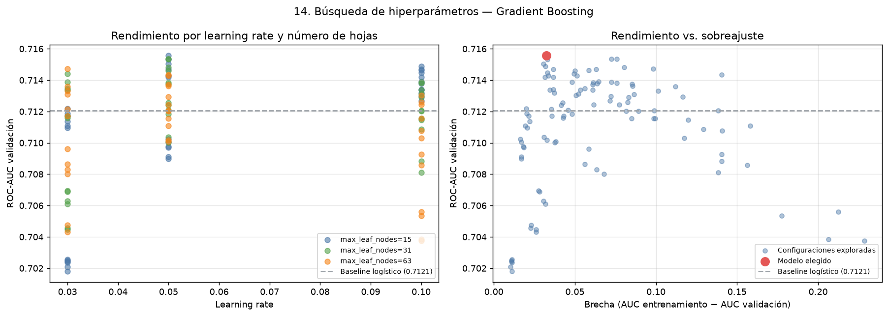

*Figura 20. Búsqueda de Gradient Boosting sobre la muestra homogénea. Fuente: elaboración del Grupo 8; [busqueda_boosting.csv](../outputs/gradient_boosting_220000/busqueda_boosting.csv), notebook 03.*

La figura muestra configuraciones de la búsqueda inicial. Seleccionar una de las mejores combinaciones de validación no garantiza un máximo universal ni justifica reutilizar sus métricas como si procedieran del esquema temporal posterior.

La primera búsqueda completa con 26 variables utiliza Randomized Search, diez configuraciones por cada una de las tres familias y cuatro cortes temporales. Para logística y SVM se exploran valores de `C` entre 0.01 y 10 y pesos de clase; para HistGradientBoosting, tasas de aprendizaje entre 0.03 y 0.20, entre 75 y 200 iteraciones, tamaño de árboles, mínimos por hoja y regularización L2. Las distribuciones y el muestreo exacto están en el código y las tablas de [hiperparametros_randomized_26_variables](../outputs/hiperparametros_randomized_26_variables).

La mejor configuración de esa etapa obtuvo ROC-AUC medio 0.692725 para logística, 0.692552 para SVM y 0.699985 para HistGradientBoosting. Este último utiliza aproximadamente `learning_rate=0.0811844`, 182 iteraciones, 31 hojas, mínimo de 46 observaciones por hoja y L2 0.3287747. Se mantuvo esa configuración durante las comparaciones de variables para separar el efecto de preprocesamiento del efecto de buscar parámetros nuevos.


*Figura 21. Primera búsqueda aleatoria con 26 variables. Fuente: elaboración del Grupo 8; [notebook 05](../notebooks/05_entrenamiento_busqueda_inicial.ipynb), salida guardada de comparación.*

La comparación utiliza años de validación comunes. HistGradientBoosting supera a las referencias lineales en esta representación restrictiva, pero el resultado no responde todavía qué cobertura de faltantes conviene admitir. Esa decisión se estudió después manteniendo parámetros constantes.

### 9.2. Optimización final al 50% de faltantes

Tras fijar el preprocesamiento, el notebook 08 utiliza combinaciones seleccionadas mediante `ParameterSampler` y evaluación explícita sobre los cuatro cortes. Se sigue el principio de muestrear un número limitado de combinaciones descrito por scikit-learn developers (s. f.-d), [RandomizedSearchCV](https://scikit-learn.org/1.8/modules/generated/sklearn.model_selection.RandomizedSearchCV.html), implementando en esta etapa el muestreo y la evaluación de forma explícita. Es una búsqueda aleatoria de configuraciones con validación temporal; las filas nunca se redistribuyen aleatoriamente entre años. Se incluyen ocho sorteos para logística, ocho para SVM y diez para HistGradientBoosting, más una referencia anterior por modelo: 29 configuraciones y 116 ajustes configuración–corte, según la configuración conservada.

En los modelos lineales se exploran `C` entre 10⁻³ y 10¹, pesos `None`/`balanced` y tolerancias entre 5×10⁻⁵ y 10⁻³. Para el ensamble se exploran tasas entre 0.02 y 0.16, iteraciones entre 100 y 200, máximos de hojas entre 7 y 33, mínimos por hoja entre 25 y 90 y L2 entre 0.05 y 10. El registro concreto de combinaciones, y no esos límites resumidos, define lo efectivamente evaluado.

Se prioriza ROC-AUC medio, se reportan AP y estabilidad y se evita crear una suma ponderada arbitraria de métricas. Todas las transformaciones se reajustan en entrenamiento. No se optimiza el umbral 0.5 ni se evalúa calibración en esta búsqueda. La configuración exacta procede de [configuracion_reproducible.json](../outputs/optimizacion_final/configuracion_reproducible.json).

| Modelo | Hiperparámetros seleccionados | ROC-AUC medio | AP media | Desv. ROC-AUC |
| --- | --- | --- | --- | --- |
| Logística | C=0.03148911648; class_weight=None; tol=0.00008662119 | 0.702351 | 0.359482 | 0.023706 |
| SVM lineal | C=0.01005394019; class_weight=balanced; tol=0.0001 | 0.702212 | 0.358570 | 0.024140 |
| HistGradientBoosting | learning_rate=0.05279087870; max_iter=200; max_leaf_nodes=25; min_samples_leaf=31; L2=9.149845593 | 0.710493 | 0.369530 | 0.024566 |

Además de los hiperparámetros buscados, el código conserva las opciones de ejecución: semilla 42, logística con `solver=lbfgs`, SVM lineal con `dual=auto` y el ensamble sin parada temprana aleatoria. La ausencia de una partición interna aleatoria para detener el ensamble evita sustituir accidentalmente la validación temporal por otra separación.


*Figura 22. Modelos originales y mejores configuraciones del espacio final. Fuente: elaboración del Grupo 8; [comparacion_anterior_vs_mejor.csv](../outputs/optimizacion_final/comparacion_anterior_vs_mejor.csv), notebook 08.*

La mejora de la búsqueda final es pequeña: logística aumenta ROC-AUC medio 0.000164; SVM conserva su referencia; Gradient Boosting aumenta 0.000065 y AP 0.000837. Son diferencias observadas y no pruebas de significación o de una gran ganancia de negocio.

| Año de validación | ROC logística | AP logística | ROC SVM | AP SVM | ROC HGB | AP HGB |
| --- | --- | --- | --- | --- | --- | --- |
| 2013 | 0.670098 | 0.263533 | 0.669406 | 0.262263 | 0.676775 | 0.268515 |
| 2014 | 0.705529 | 0.348549 | 0.705886 | 0.347800 | 0.714561 | 0.358909 |
| 2015 | 0.727206 | 0.408467 | 0.727597 | 0.408145 | 0.735746 | 0.420613 |
| 2016 | 0.706573 | 0.417378 | 0.705960 | 0.416071 | 0.714891 | 0.430082 |

Fuente: [comparación por año](../outputs/optimizacion_final/comparacion_por_anio.csv). La AP depende de la proporción de positivos y no se interpreta su aumento entre años como un efecto exclusivo de mejorar el algoritmo. HistGradientBoosting supera a las dos alternativas lineales en cada uno de estos cuatro cortes; frente a su propia configuración anterior mejora en dos años y empeora en dos. La configuración elegida es la mejor evaluada según el criterio declarado, no una demostración de óptimo universal.

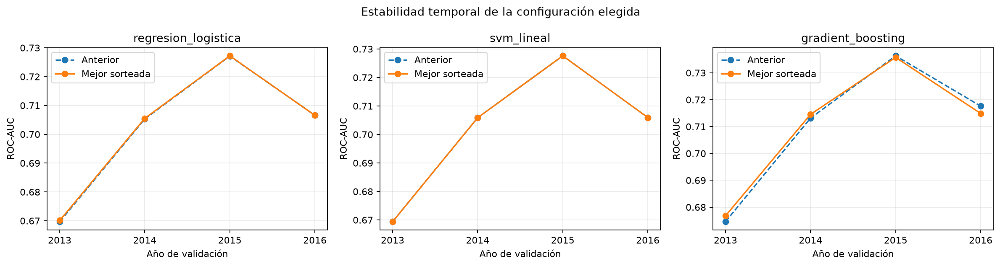

*Figura 23. Estabilidad temporal de las configuraciones finales. Fuente: elaboración del Grupo 8; [resultados por configuración y corte](../outputs/optimizacion_final/resultados_por_configuracion_y_corte.csv), notebook 08.*

El año 2013 es más difícil para todas las familias y 2015 muestra mayores ROC-AUC. La búsqueda no elimina esa heterogeneidad. Cuatro años son evidencia más informativa que una sola partición, pero el uso repetido de sus resultados también puede adaptar la selección a esos años.

## 10. Evaluación final

### 10.1. Calibración antes del test

El ordenamiento de riesgo y la calidad de probabilidades son propiedades distintas. Un modelo puede ordenar adecuadamente préstamos y, aun así, entregar riesgos demasiado altos o bajos. Se compararon probabilidades originales, transformación sigmoide y regresión isotónica según el estimador, usando los periodos separados de la sección 6. Para SVM se calibra el margen; no se lo trata como una probabilidad original.

La sigmoide aprende una transformación logística de la puntuación del modelo con los resultados reales del periodo de calibración. Para modelos que entregan probabilidades se utiliza su representación logit, con recorte numérico para evitar infinitos; para SVM, el margen. La implementación guarda un calibrador logístico de regularización muy débil (`C=10⁶`, `solver=lbfgs`, `max_iter=2000`, semilla 42). No se corrige cada préstamo hasta coincidir con su etiqueta: se aprende una función común aplicable a observaciones futuras.

| Modelo y salida | ROC-AUC medio | AP media | Brier medio | Log Loss media |
| --- | --- | --- | --- | --- |
| Logística original | 0.691642 | 0.345394 | 0.144876 | 0.457012 |
| Logística sigmoide | 0.691642 | 0.345388 | 0.144101 | 0.454808 |
| Logística isotónica | 0.691446 | 0.341137 | 0.144083 | 0.456016 |
| SVM sigmoide | 0.691406 | 0.344455 | 0.144141 | 0.454732 |
| SVM isotónica | 0.691128 | 0.340055 | 0.144112 | 0.456202 |
| HGB original | 0.697364 | 0.351983 | 0.144124 | 0.453391 |
| HGB sigmoide | 0.697364 | 0.351983 | 0.143129 | 0.450972 |
| HGB isotónica | 0.697100 | 0.347297 | 0.143202 | 0.452296 |

Fuente: [metricas_promedio.csv](../outputs/calibracion_probabilidades/metricas_promedio.csv). La regla guardada retiene métodos próximos al mejor Brier y ROC-AUC, con tolerancias 0.001 y 0.005 respectivamente, y decide por Log Loss; selecciona sigmoide en las tres familias. Que alguna isotónica tenga Brier algo menor no basta para preferirla si empeoran otras condiciones del criterio. Estas tolerancias son reglas de selección, no umbrales de significación estadística.

El ROC-AUC medio 0.697364 del HGB en esta tabla no debe compararse con 0.710493 de la búsqueda como si la diferencia fuese un daño de calibrar: aquí se reserva un año para calibración y el modelo base se entrena con menos años. Para el mismo modelo, una transformación estrictamente monótona mantiene el orden y normalmente conserva ROC-AUC; una isotónica puede introducir empates. Las pequeñas diferencias de AP o ROC deben leerse dentro de su diseño exacto.


*Figura 24. Comparación temporal de métodos de calibración. Fuente: elaboración del Grupo 8; [notebook 09](../notebooks/09_calibracion.ipynb) y [métricas por método y año](../outputs/calibracion_probabilidades/metricas_por_modelo_metodo_anio.csv).*

La diagonal representa coincidencia entre riesgo medio estimado y frecuencia observada por grupo. Alejarse de ella indica desajuste en ese intervalo. La selección se apoya además en Brier y Log Loss, pues el aspecto de una curva depende de la cantidad de observaciones y de cómo se agrupan las probabilidades.

### 10.2. Métricas y significado

El ROC-AUC resume la curva de sensibilidad frente a tasa de falsos positivos al variar el umbral. Se interpreta como la capacidad de asignar mayor puntuación a un positivo que a un negativo elegido al azar, incluyendo el tratamiento de empates. No es el porcentaje de préstamos correctamente clasificados ni la probabilidad individual de incumplimiento. Es el criterio principal de discriminación del proyecto.

Average Precision (AP), registrada en los archivos como `PR_AUC`, resume precisión a lo largo de cambios de recall. Se calcula como la suma de los incrementos de recall multiplicados por la precisión correspondiente; no se debe confundir automáticamente con el área trapezoidal bajo una curva Precision–Recall. Esta definición corresponde a la [documentación de Average Precision](https://scikit-learn.org/1.8/modules/generated/sklearn.metrics.average_precision_score.html), scikit-learn developers (s. f.-a). Es útil para complementar el análisis de la clase minoritaria y depende de su prevalencia. En el test, la referencia de puntuación constante es aproximadamente 0.21282.

Para probabilidades p y etiquetas y, Brier es el promedio de `(p − y)²`. Log Loss es el negativo del promedio de `y·ln(p) + (1−y)·ln(1−p)`. Ambas se minimizan; Log Loss penaliza con fuerza errores muy confiados y requiere precauciones numéricas en 0 y 1. Evalúan calidad probabilística en conjunto, no únicamente calibración aislada: también influye la capacidad de separar riesgos. Por eso se interpretan junto con curvas de calibración, prevalencia y discriminación.

### 10.3. Resultados históricos en 2017–2018

La evaluación contiene 225,611 préstamos elegibles: 177,596 pagados y 48,015 incobrables, con prevalencia 21.2822%. No representa todos los préstamos originados en esos años; [auditoria_estados_test.csv](../outputs/evaluacion_final/auditoria_estados_test.csv) registra el filtro de estados. Los tres modelos finales comparten 60 variables originales y 136 columnas transformadas, con calibración sigmoide.

| Modelo | ROC-AUC ↑ | Average Precision ↑ | Brier ↓ | Log Loss ↓ |
| --- | --- | --- | --- | --- |
| Regresión logística | 0.69259 | 0.36039 | 0.15591 | 0.48501 |
| SVM lineal | 0.69178 | 0.35988 | 0.15597 | 0.48680 |
| HistGradientBoosting | 0.70321 | 0.37791 | 0.15364 | 0.47428 |

Fuente: [metricas_finales_test.csv](../outputs/evaluacion_final/metricas_finales_test.csv). HistGradientBoosting supera a la logística en ROC-AUC por 0.01062 y en AP por 0.01752; reduce Brier en 0.00227 y Log Loss en 0.01074. Estas son diferencias absolutas de métricas, no puntos porcentuales de detección ni una cuantificación de ahorro económico. La SVM es cercana a la logística, con menor rendimiento en estas cuatro cifras.

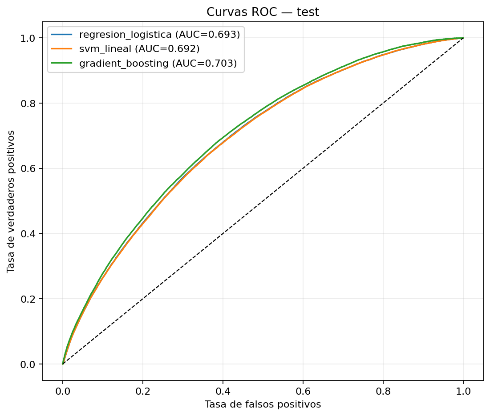

*Figura 25. Curvas ROC de los tres modelos finales en test histórico. Fuente: elaboración del Grupo 8; [notebook 10](../notebooks/10_evaluacion_final.ipynb) y métricas finales guardadas.*

El ensamble presenta mayor área global que las referencias lineales. La curva no determina por sí sola el umbral adecuado ni garantiza una mejora de sensibilidad para toda tasa posible de falsos positivos. La diagonal representa puntuaciones sin capacidad discriminativa.

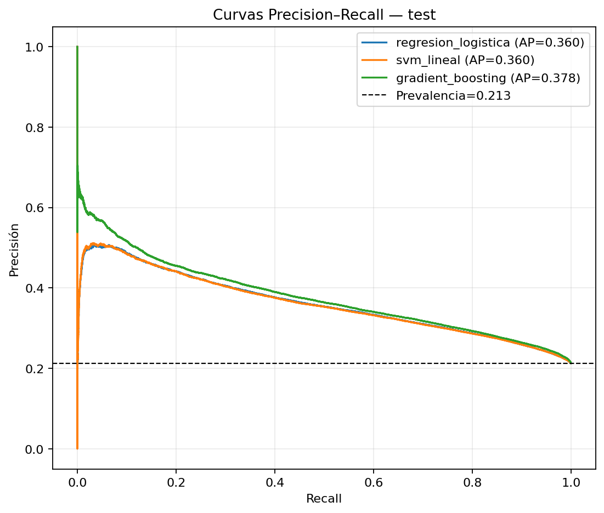

*Figura 26. Curvas Precision–Recall de los modelos finales. Fuente: elaboración del Grupo 8; [evaluación histórica final](../outputs/evaluacion_final/metricas_finales_test.csv), notebook 10.*

AP 0.37791 supera la referencia asociada a prevalencia 0.21282, pero no implica precisión de 37.79% para todos los préstamos ni recall fijo. La curva muestra el intercambio entre capturar más incumplimientos y aumentar falsas alertas. Su utilidad operacional exige fijar una política posterior.

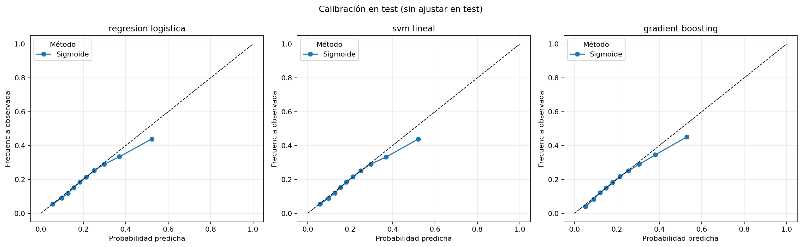

*Figura 27. Calibración de las probabilidades finales en test histórico. Fuente: elaboración del Grupo 8; [notebook 10](../notebooks/10_evaluacion_final.ipynb), curva guardada de calibración.*

Las frecuencias por intervalo permiten evaluar si las probabilidades estimadas son compatibles con lo observado. La calibración aprendida en 2016 no garantiza calibración perfecta en 2017–2018 ni en nuevos periodos. Los extremos pueden tener poca cobertura y deben leerse con más cautela.

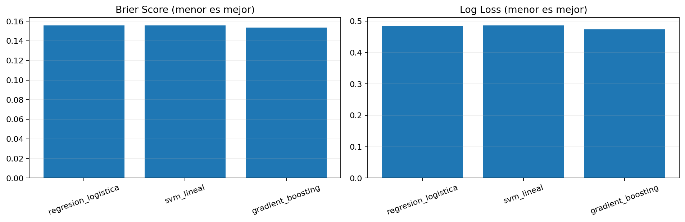

*Figura 28. Comparación final de Brier y Log Loss. Fuente: elaboración del Grupo 8; [métricas finales de test](../outputs/evaluacion_final/metricas_finales_test.csv), notebook 10.*

HistGradientBoosting obtiene menores pérdidas probabilísticas, además de mejor discriminación. Esto respalda su elección entre los tres estimadores evaluados, pero no establece que todas sus probabilidades individuales sean exactas o que cualquier clasificación derivada sea útil.

### 10.4. Incertidumbre y límites de la comparación

El notebook conserva 200 repeticiones bootstrap estratificadas por clase y los siguientes intervalos percentiles del 95%. Se informa el procedimiento realizado, sin ejecutar nuevos remuestreos en esta revisión.

| Modelo | IC ROC-AUC | IC AP | IC Brier | IC Log Loss |
| --- | --- | --- | --- | --- |
| Regresión logística | [0.68964, 0.69513] | [0.35705, 0.36446] | [0.15539, 0.15647] | [0.48337, 0.48684] |
| SVM lineal | [0.68904, 0.69483] | [0.35654, 0.36347] | [0.15542, 0.15645] | [0.48480, 0.48859] |
| HistGradientBoosting | [0.70086, 0.70593] | [0.37463, 0.38223] | [0.15312, 0.15413] | [0.47281, 0.47551] |

Fuente: [intervalos_bootstrap_95.csv](../outputs/evaluacion_final/intervalos_bootstrap_95.csv). Los intervalos describen variación bajo el esquema de remuestreo conservado. No incorporan toda la incertidumbre de seleccionar modelos, años o umbrales ni resuelven la dependencia temporal o una eventual repetición de prestatarios. Aunque el intervalo ROC del ensamble está por encima de los lineales, no sustituye una comparación pareada formal de diferencias, que no se añade como experimento nuevo.

### 10.5. Resultado histórico frente al pipeline reciente

Las métricas anteriores provienen del notebook 10 y sus outputs históricos. El pipeline de [src/run_final.py](../src/run_final.py) entrenó y guardó localmente tres archivos `.joblib` y un `manifest.json`, con 826,604 observaciones para el modelo base y 293,095 para calibración. **La evaluación real posterior de esos modelos sobre los 225,611 préstamos elegibles de 2017–2018 confirmó la reproducción de las métricas históricas a los seis decimales presentados.** Se ejecutó localmente el comando `python -m src.run_final --modo evaluar --modelos models/final_01 --datos accepted_2007_to_2018Q4.csv --conjunto test --confirmar-test`, con calibración sigmoide y prevalencia 0.212822.

La salida persistente está en `outputs/pipeline_final/test_20261117_195412_266845/metricas.csv` y `alcance.json`, archivos locales excluidos de Git. La revisión comparó las cuatro métricas, prevalencia y n de cada modelo con [metricas_finales_test.csv](../outputs/evaluacion_final/metricas_finales_test.csv): los 18 campos numéricos coinciden en ambos CSV. La tabla original conserva su redondeo a cinco decimales; a seis, los ROC-AUC son 0.692591, 0.691777 y 0.703213, y las AP 0.360386, 0.359876 y 0.377905, para logística, SVM y HistGradientBoosting, respectivamente.

Esto acredita reproducibilidad de las métricas agregadas mediante los artefactos guardados; no demuestra identidad de todas las predicciones individuales ni constituye un test nuevo e independiente del desarrollo histórico. Las 19 pruebas sintéticas también finalizaron correctamente según la consola aportada por el usuario (`Ran 19 tests in 6.795s`, `OK`), evidencia local distinta de la evaluación real y no atribuida a GitHub Actions. Durante este cierre documental no se repitieron entrenamiento, pruebas ni evaluación de modelos.

## 11. Interpretación

### 11.1. Qué aporta la estimación

El modelo principal discrimina mejor que una puntuación constante y que los dos candidatos lineales finales. Su ROC-AUC cercano a 0.70 indica ordenamiento útil, pero con considerable superposición de riesgos. La probabilidad estimada se interpreta dentro de la población de préstamos aceptados con los desenlaces considerados. No es una probabilidad de aprobación, una medida de responsabilidad personal ni un pronóstico válido automáticamente para solicitudes rechazadas.

Si un préstamo recibe 0.30, el sistema estima 30% de riesgo bajo su representación y calibración; no basta con comprobar si ese préstamo incumple para decidir que 0.30 fue correcto o incorrecto. Su calidad se estudia en grupos comparables y mediante pérdidas probabilísticas sobre muchos casos. Una media de todas las probabilidades puede describir riesgo agregado, pero no reemplaza el riesgo individual ni la evaluación por segmentos.

La calibración sigmoide mejora pérdidas en la comparación temporal sin resolver cambios futuros de población. La ventaja de HistGradientBoosting consiste en una representación no lineal más flexible que conserva mejor rendimiento agregado en la evidencia disponible. Su costo es menor transparencia que una logística y una interpretación más difícil de cada predicción. No se atribuye a esa flexibilidad un efecto causal ni una mejora uniforme para cada préstamo.

### 11.2. Interpretabilidad disponible

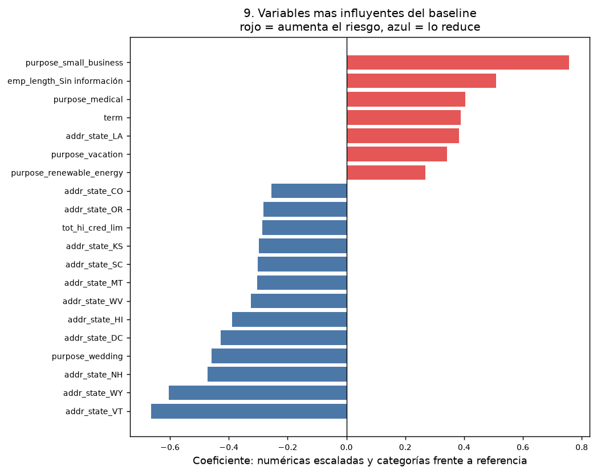

*Figura 29. Coeficientes de la regresión logística inicial. Fuente: elaboración del Grupo 8; [coeficientes_baseline.csv](../outputs/coeficientes_baseline.csv), muestra del notebook 01.*

Los coeficientes corresponden al baseline inicial y a su codificación y escalado. Por ejemplo, la categoría de pequeña empresa presenta un coeficiente positivo en esa referencia. Los signos describen asociaciones condicionadas al modelo; no prueban que modificar una finalidad o un estado de residencia cause cambios en incumplimiento.

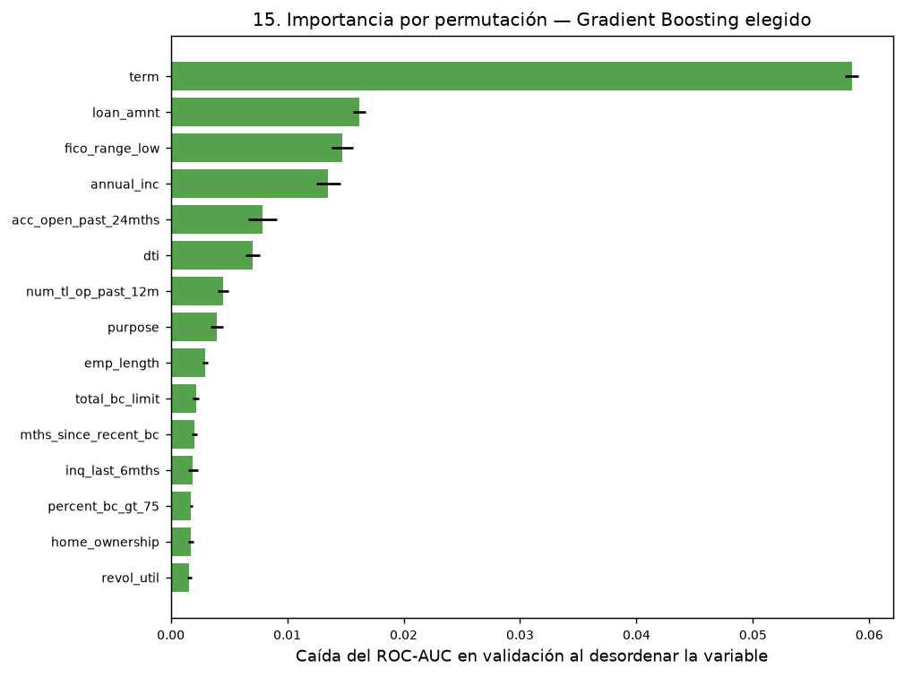

*Figura 30. Importancia por permutación del Gradient Boosting de la muestra. Fuente: elaboración del Grupo 8; [importancia_boosting.csv](../outputs/gradient_boosting_220000/importancia_boosting.csv), experimento de 220,003 préstamos.*

En esta ejecución, plazo, monto, FICO inferior, ingreso anual y cuentas abiertas en los últimos 24 meses figuran entre las señales destacadas. La importancia mide la caída de desempeño al alterar una variable en ese modelo; predictores correlacionados pueden compartir información. Estas importancias no corresponden al HistGradientBoosting final calibrado.

No existe evidencia guardada equivalente que permita presentar aquí una lista definitiva de importancias del modelo final. Se identifica como trabajo futuro, en lugar de reutilizar las del árbol o del ensamble inicial con otra etiqueta. También se evita eliminar variables solo por correlación bivariada baja: una señal puede aportar información adicional en combinación con otras.

### 11.3. Discriminación no equivale a detección suficiente

Un mejor ROC-AUC no asegura detectar muchos incumplimientos con un umbral arbitrario. En la evaluación final, la mayoría de probabilidades queda por debajo de 0.5 y el recall es bajo. El objetivo probabilístico y el análisis de clasificación se complementan: el primero evalúa riesgos continuos; el segundo muestra qué ocurriría con una regla concreta. No se cambia retroactivamente el objetivo para describir una alerta de alto riesgo como una política ya optimizada.

## 12. Análisis de errores

### 12.1. Matriz de confusión con umbral descriptivo 0.5

El análisis incorporado al notebook 10 emplea las probabilidades históricas guardadas y el criterio `p ≥ 0.5` para marcar incumplimiento. Su implementación reutilizable está en [src/analisis_errores.py](../src/analisis_errores.py). El ejecutor del pipeline también genera `costos_por_umbral.csv`, con una comparación parametrizable de costos (por defecto, 1 por falso positivo y 5 por falso negativo). Este archivo es descriptivo cuando se genera sobre test: no se usa para seleccionar el umbral final ni para afirmar una política de negocio.

| Modelo | TN: pagados bien clasificados | FP: alertas incorrectas | FN: incumplimientos omitidos | TP: incumplimientos detectados |
| --- | --- | --- | --- | --- |
| Regresión logística | 171,964 | 5,632 | 42,779 | 5,236 |
| SVM lineal | 172,031 | 5,565 | 42,871 | 5,144 |
| HistGradientBoosting | 171,137 | 6,459 | 41,746 | 6,269 |

| Modelo | Precisión positiva | Recall | F1 |
| --- | --- | --- | --- |
| Regresión logística | 0.48178 | 0.10905 | 0.17784 |
| SVM lineal | 0.48034 | 0.10713 | 0.17519 |
| HistGradientBoosting | 0.49254 | 0.13056 | 0.20641 |

Fuente: [metricas_globales.csv](../outputs/analisis_errores/metricas_globales.csv). Para HistGradientBoosting, la matriz en su forma habitual es:

| Resultado real / Predicción | Pagado: p < 0.5 | Incobrable: p ≥ 0.5 |
| --- | --- | --- |
| Pagado | 171,137 | 6,459 |
| Incobrable | 41,746 | 6,269 |

Los cuatro conteos suman 225,611 y los positivos reales suman 48,015. La precisión de 49.25% significa que aproximadamente la mitad de las alertas fueron incumplimientos, mientras el recall de 13.06% indica que se detectó una fracción pequeña de los incumplimientos existentes. El F1 de 0.20641 resume ese equilibrio al umbral elegido; no existe una regla según la cual F1 deba superar 0.5 para ser mejor que el azar.

### 12.2. Falsos positivos

Los 6,459 falsos positivos del ensamble son préstamos pagados que la regla clasificaría como alto riesgo. Una aplicación de rechazo automático podría negar oportunidades a prestatarios que pagarían, imponer condiciones desfavorables o generar revisiones innecesarias. En este estudio no se calcula un costo monetario ni se aplican decisiones reales. La interpretación debe mantener esa distinción, especialmente cuando se comparan grupos con tamaños y tasas de incumplimiento distintos.

### 12.3. Falsos negativos

Los 41,746 falsos negativos son incumplimientos que la misma regla no detecta: aproximadamente 86.94% de los positivos reales. Este error sería relevante para una entidad expuesta a pérdidas. Reducirlo requeriría cambiar la política de alertas, posiblemente aceptando más falsos positivos. La calibración no decide ese intercambio y el ROC-AUC no lo fija automáticamente. Buscar un umbral adecuado corresponde a una etapa posterior basada en validación y costos, no a modificar test hasta mejorar el recall.

### 12.4. Desempeño por año, plazo, ingresos y tipo de solicitud

La tabla siguiente presenta el modelo principal. Las métricas de las tres familias están disponibles en [metricas_por_segmento.csv](../outputs/analisis_errores/metricas_por_segmento.csv). La segmentación es descriptiva y no equivale a una auditoría de equidad.

| Segmento HGB | n | Incumplimiento % | ROC-AUC | AP | Precisión a 0.5 | Recall a 0.5 |
| --- | --- | --- | --- | --- | --- | --- |
| Año 2017 | 169,300 | 23.1234 | 0.70519 | 0.40758 | 0.53168 | 0.12624 |
| Año 2018 | 56,311 | 15.7465 | 0.69620 | 0.29060 | 0.38654 | 0.14966 |
| Plazo 36 meses | 169,806 | 18.3651 | 0.70265 | 0.33757 | 0.56545 | 0.00997 |
| Plazo 60 meses | 55,805 | 30.1586 | 0.67480 | 0.45685 | 0.48924 | 0.35401 |
| Ingreso anual ≤25,000 | 9,729 | 27.7110 | 0.62856 | 0.38535 | 0.45000 | 0.13019 |
| Ingreso anual 25,000–50,000 | 59,029 | 24.2694 | 0.68425 | 0.39691 | 0.50142 | 0.14749 |
| Ingreso anual 50,000–75,000 | 67,166 | 21.2042 | 0.70223 | 0.37902 | 0.48605 | 0.15166 |
| Ingreso anual 75,000–100,000 | 42,969 | 19.8957 | 0.71591 | 0.37421 | 0.49797 | 0.11498 |
| Ingreso anual >100,000 | 46,718 | 17.5564 | 0.71701 | 0.34380 | 0.50304 | 0.08071 |
| Solicitud individual | 205,498 | 20.9608 | 0.70943 | 0.38095 | 0.50586 | 0.11731 |
| Solicitud conjunta | 20,113 | 24.5662 | 0.64584 | 0.37785 | 0.44396 | 0.24610 |


*Figura 31. Errores y métricas descriptivas por año de test. Fuente: elaboración del Grupo 8; [notebook 10](../notebooks/10_evaluacion_final.ipynb) y métricas por segmento.*

En 2018 disminuyen tanto la prevalencia observada como AP respecto de 2017; ROC-AUC también baja, aunque en menor magnitud. El cambio de AP no se atribuye por completo a deterioro del modelo porque depende de la composición de clases. No se conoce una explicación causal única del cambio.


*Figura 32. Detección de incumplimientos según plazo. Fuente: elaboración del Grupo 8; [metricas_por_segmento.csv](../outputs/analisis_errores/metricas_por_segmento.csv), notebook 10.*

El ensamble detecta aproximadamente 1.00% de los incumplimientos en préstamos de 36 meses y 35.40% en los de 60 meses, usando el mismo umbral. El mayor recall a 60 meses no implica mejor ordenamiento: su ROC-AUC es menor. Se requieren análisis de cobertura, calibración por segmento y costos antes de plantear políticas diferenciadas.

### 12.5. Segmentos difíciles y alcance

Los ingresos de hasta 25,000 muestran ROC-AUC 0.62856, inferior al de los tramos más altos; las solicitudes conjuntas muestran 0.64584 frente a 0.70943 de las individuales. Son focos de revisión, no pruebas de que el ingreso o el tipo de solicitud causen el error. Cambian el tamaño, la cobertura y la composición de cada grupo. Tampoco se calculan intervalos por segmento que permitan afirmar la significación de todas las diferencias.

El plazo ilustra por qué conviene separar ranking y clasificación: el modelo casi no supera 0.5 en positivos de 36 meses, aun cuando su ROC-AUC es mayor que para 60 meses. Una política única podría tener consecuencias muy distintas por grupo. Estos resultados no autorizan elegir umbrales por grupo sobre test; sirven para formular una investigación posterior con datos de desarrollo y criterios explícitos.

## 13. Riesgos éticos, sesgos y limitaciones

### 13.1. Selección, seguimiento y cobertura

**Solo préstamos aceptados.** La selección previa de Lending Club limita las conclusiones. El modelo aprende sobre personas que recibieron crédito bajo políticas históricas; no estima cómo habrían pagado solicitantes rechazados ni identifica una política óptima de aprobación.

**Solo desenlaces seleccionados.** Excluir activos evita etiquetas falsas, pero condiciona el análisis a préstamos que ya terminaron de una de las dos formas. En préstamos recientes pueden quedar más pagos anticipados o incumplimientos rápidos. Las tasas observadas, la calibración y las comparaciones por año pueden verse afectadas por este seguimiento desigual.

**Momento desconocido de la etiqueta.** Un corte por originación no garantiza que el desenlace ya estuviera disponible en la fecha de entrenamiento simulada. No se dispone aquí de una auditoría completa de disponibilidad de etiquetas que permita afirmar una evaluación estrictamente prospectiva. El problema requiere revisar fechas de corte y maduración de 36/60 meses.

**Disponibilidad histórica.** Algunos campos aparecen en años posteriores. Medianas e indicadores pueden reflejar el periodo de recopilación además del perfil del solicitante. La selección por corte evita aprender estadísticas futuras, pero no elimina cambios en la forma de medir los datos. El límite 50% es una decisión de trabajo; no es una ley que garantice información suficiente o ausencia de sesgo.

### 13.2. Riesgos de discriminación y consecuencias

Ingresos, vivienda, ubicación y finalidad pueden asociarse a desigualdades sociales o actuar como señales indirectas de características sensibles. Excluir texto del empleo o `zip_code` no elimina por sí solo esos riesgos. No se documenta una auditoría formal de equidad con atributos sensibles, criterios de justicia y pruebas de incertidumbre; por ello no se afirma que los modelos sean justos.

Los falsos positivos podrían perjudicar acceso al crédito; los falsos negativos pueden generar exposición a pérdidas y decisiones inadecuadas. No existe una única política que minimice ambos simultáneamente sin valorar sus costos. Las predicciones deben mantenerse como apoyo analítico y no como veredictos sobre personas. La documentación no proporciona una autorización de uso operativo.

### 13.3. Incertidumbre y reproducibilidad

El test fue observado en experimentos históricos. Aunque la búsqueda posterior respeta su exclusión, no constituye una evaluación completamente ciega de todo el proceso de investigación. La reutilización de cuatro años de validación para numerosas decisiones también permite adaptar las elecciones a sus particularidades. No se ha efectuado una evaluación externa o prospectiva independiente.

La calibración mejora resultados agregados en periodos concretos; no garantiza coincidencia por individuo, segmento o año futuro. Los intervalos bootstrap no cubren todas las fuentes de incertidumbre. En la sensibilidad, los identificadores vacíos impiden interpretar el agrupamiento por prestatario como verificado. Tampoco se investigan aquí duplicados personales sin un identificador fiable.

Finalmente, se conservan diferencias de procedencia entre outputs preliminares, muestras y etapas completas. El informe identifica esas diferencias sin alterar los resultados originales. La evaluación real de los modelos serializados confirmó las métricas históricas, pero esa coincidencia no elimina los sesgos de selección, la falta de fechas individuales de maduración ni la consulta previa del test. Las pruebas sintéticas verifican contratos de software y son evidencia distinta de la reproducción de métricas reales; ninguna de ellas establece por sí sola validez crediticia operativa o prospectiva.

## 14. Trabajo futuro

Las siguientes actividades **no forman parte de resultados ejecutados en este informe**:

1. **Consolidar la trazabilidad de la validación realizada.** Conservar los registros completos de consola de las pruebas y la evaluación, junto con versiones, huellas de datos y artefactos. La coincidencia de métricas ya se comprobó; una eventual auditoría de identidad de predicciones fila a fila requeriría su propio protocolo y no se presenta como ejecutada.
2. **Auditar maduración y fechas de etiqueta.** Definir una fecha de corte verificable y un horizonte predictivo uniforme, o una estrategia de seguimiento que contemple préstamos sin desenlace. Rehacer una validación temporal con etiquetas disponibles en cada fecha resolvería una limitación distinta de separar por originación.
3. **Obtener una evaluación independiente.** Utilizar periodos o fuentes no consultados, con alcance de población documentado. La comprobación prospectiva debe conservar decisiones metodológicas fijadas antes de observar resultados.
4. **Revisar la elección entre 50% y 75%.** Contrastar el pequeño beneficio medio y su concentración temporal con cobertura, estabilidad de variables y costos de imputación. No basta con afirmar que el umbral conservador ya fue el ganador.
5. **Interpretar el modelo final.** El código ya ofrece `calcular_importancias_permutacion` en [src/etapas_finales.py](../src/etapas_finales.py), que calcula la caída de ROC-AUC al permutar cada variable original sin reentrenar. Falta ejecutar esta función sobre una muestra de desarrollo fijada y documentar estabilidad, redundancia y explicaciones de predicciones; las importancias iniciales no sustituyen ese análisis.
6. **Evaluar equidad y políticas de alertas.** Definir atributos y poblaciones pertinentes, métricas de error y calibración por segmento, costos de falsos positivos/negativos y restricciones operativas. Escoger umbrales con desarrollo y congelarlos antes de una evaluación independiente.
7. **Vigilar cambios de distribución y calibración.** Diseñar controles de faltantes, categorías nuevas, mezcla de plazos, probabilidades y resultados observados; definir cuándo revisar o recalibrar. No se presenta como desplegado un sistema de seguimiento.
8. **Explorar características adicionales de manera controlada.** Razones cuota/ingreso, nuevos agregados del historial e interacciones requieren una evaluación temporal propia, disponibilidad al origen y una comparación de costo y estabilidad. No se incluyen como mejoras ya demostradas.

## 15. Instrucciones de reproducción

### 15.1. Entorno, datos y carpetas

El proyecto contiene notebooks de investigación, módulos reutilizables en `src/`, resultados en `outputs/`, documentación en `reports/`, pruebas en `tests/` y artefactos locales en `models/`. El archivo fuente no se distribuye por Git. Debe obtenerse de la fuente indicada en la sección 3 y ubicarse como `accepted_2007_to_2018Q4.csv` en la raíz, o utilizar una ruta explícita admitida por el programa. La raíz se localiza según [src/config.py](../src/config.py).

[requirements.txt](../requirements.txt) documenta las dependencias utilizadas con Python 3.12: pandas 3.0.3, NumPy 2.4.6, scikit-learn 1.8.0, Matplotlib 3.11.0, seaborn 0.13.2, ipykernel 7.2.0, nbformat 5.11.1, nbclient 0.11.0, psutil 7.2.2 y joblib 1.5.3, además de JupyterLab. El manifiesto de los artefactos locales recientes registra otro intérprete, Python 3.14, y las versiones concretas de sus bibliotecas. La reproducción de un artefacto existente exige respetar esas versiones; instalar requisitos no garantiza por sí mismo igualdad con cualquier ejecución histórica.

La rama predeterminada de GitHub sigue siendo `main`, que todavía no contiene los diez notebooks oficiales ni el pipeline completo de esta entrega. Por ello, mientras no se integre la versión final, hay que cambiar explícitamente a **`docs/entrega-final`** después de clonar. Esto se comprobó contra el estado remoto durante esta revisión; no se modificó `main`.

Desde una copia nueva del repositorio, en PowerShell, clonar la rama de entrega y preparar el entorno:

```powershell
git clone https://github.com/Josu31506/Proyecto-ML-Grupo8.git
cd Proyecto-ML-Grupo8
git switch docs/entrega-final
py -3.12 -m venv .venv
.\.venv\Scripts\Activate.ps1
python -m pip install -r requirements.txt
```

A continuación, obtener manualmente el archivo de préstamos aceptados desde la [fuente de Kaggle](https://www.kaggle.com/datasets/wordsforthewise/lending-club), verificando las condiciones descritas en la sección 3.1. Colocar el CSV descomprimido en la raíz, como `accepted_2007_to_2018Q4.csv`, para utilizar literalmente los comandos de evaluación mostrados más adelante. También se admite `accepted_2007_to_2018Q4.csv.gz` en `data/raw/`, sin descomprimir, según [data/README.md](../data/README.md) y el localizador del código; en ese caso debe indicarse esa ruta real mediante `--datos` al evaluar. Si la fuente continúa inaccesible, será necesario disponer de la copia académica previamente obtenida o restablecer una fuente autorizada verificable; estos comandos no resuelven por sí solos la falta del archivo.

Antes de entrenar, ejecutar las pruebas:

```powershell
python -m unittest discover -s tests -v
```

Para trabajar además con los notebooks, registrar el kernel y abrir JupyterLab:

```powershell
python -m ipykernel install --user --name lending-club-grupo8
python -m jupyter lab
```

Debe seleccionarse el kernel del entorno creado. El dataset completo y las matrices densas del ensamble necesitan memoria adicional a la ocupación del CSV; no se publica una garantía universal de RAM o tiempo. Las mediciones existentes dependen del equipo y carga de trabajo. Para leer el informe y las figuras no es necesario ejecutar entrenamientos.

### 15.2. Orden y dependencias de los diez notebooks

| Orden y archivo | Propósito | Dependencias y alcance |
| --- | --- | --- |
| 01. [01_exploracion_inicial_baseline.ipynb](../notebooks/01_exploracion_inicial_baseline.ipynb) | Exploración de la muestra y baseline | Regenerable desde el CSV; utiliza src y genera resultados de la muestra. |
| 02. [02_arbol_decision.ipynb](../notebooks/02_arbol_decision.ipynb) | Árbol y regularización | Requiere la misma población y preparación inicial; muestra resultados históricos y búsqueda del árbol. |
| 03. [03_gradient_boosting.ipynb](../notebooks/03_gradient_boosting.ipynb) | Ensamble inicial y versión 220,003 | Distinguir outputs preliminares de la subcarpeta gradient_boosting_220000; el experimento homogéneo ya fue ejecutado. |
| 04. [04_exploracion_completa.ipynb](../notebooks/04_exploracion_completa.ipynb) | Lectura restringida y EDA completo | Requiere CSV y tipos auditados; parte del código no tiene salida completa guardada. No confundir código presente con figura ejecutada. |
| 05. [05_entrenamiento_busqueda_inicial.ipynb](../notebooks/05_entrenamiento_busqueda_inicial.ipynb) | Primeros modelos y búsqueda con 26 | Contiene controles de ejecución y tablas previas; regenerar implica ajustar modelos, no solo abrirlo. |
| 06. [06_comparacion_variables_imputacion.ipynb](../notebooks/06_comparacion_variables_imputacion.ipynb) | Conjuntos, indicadores y estrategias | El reporte oficial lee CSV precalculados; activar controles específicos permite regenerar en outputs/reproducciones. |
| 07. [07_umbrales_sensibilidad.ipynb](../notebooks/07_umbrales_sensibilidad.ipynb) | Umbrales y cobertura temporal | Lee evidencia guardada de umbrales y sensibilidad; algunas regeneraciones requieren datos y predicciones locales. |
| 08. [08_optimizacion_final.ipynb](../notebooks/08_optimizacion_final.ipynb) | Búsqueda aleatoria final | Depende de la regla temporal al 50%, datos y configuración; la búsqueda histórica ya está conservada. |
| 09. [09_calibracion.ipynb](../notebooks/09_calibracion.ipynb) | Comparación de calibradores | Utiliza parámetros seleccionados y periodos separados; conserva métricas y predicciones locales de validación. |
| 10. [10_evaluacion_final.ipynb](../notebooks/10_evaluacion_final.ipynb) | Test histórico y análisis de errores | Requiere artefactos o predicciones históricas según la sección; no corresponde a un notebook 12. |

Los notebooks 06–07 ejecutados como lectores verifican presentación de tablas y figuras existentes, no nuevos ajustes. Según [notebooks/README.md](../notebooks/README.md), los controles de regeneración de 05–07 escriben en `outputs/reproducciones/` para conservar evidencia histórica. No se activan todos los controles automáticamente ni se considera que abrir un notebook reproduzca sus experimentos.

Los archivos de predicciones comprimidas de validación y test pueden estar presentes solo localmente y quedar excluidos de Git por tamaño o política del repositorio. Son necesarios para rehacer algunas curvas, remuestreos y errores por segmentos. Las figuras y tablas conservadas permiten revisar los resultados sin ellos, pero no reconstruir cada cálculo fila por fila. Debe consultarse [outputs/README.md](../outputs/README.md) para distinguir evidencia publicada y dependencias locales.

### 15.3. Entrenar y guardar el pipeline final

El comando existente es:

```powershell
python -m src.run_final --modo entrenar --salida models/final_01
```

Este modo comprueba que la configuración de código coincida con las configuraciones finales guardadas, carga desarrollo hasta 2016, entrena cada base hasta 2015, calibra en 2016 y guarda los tres modelos. No evalúa test. La carpeta de salida debe ser nueva: si `models/final_01` ya existe, hay que usar otra como `models/final_02`; no se sobrescriben artefactos existentes.

La salida contiene `regresion_logistica.joblib`, `svm_lineal.joblib`, `gradient_boosting.joblib` y `manifest.json`. Cada objeto guarda selección, imputación, codificación, escalado, estimador y calibrador, de modo que inferencia no vuelva a calcular medianas. El manifiesto incluye parámetros, periodos, versiones y huellas SHA-256. Los `.joblib` no se incluyen en GitHub y deben regenerarse localmente o suministrarse por un canal controlado. La carga comprueba versiones de scikit-learn, NumPy, pandas, SciPy y joblib; no basta con renombrar un archivo de modelo incompatible.

El entrenamiento indicado ya finalizó satisfactoriamente y sus tres artefactos se utilizaron en la evaluación local documentada en 10.5. El campo `test_evaluado_en_esta_ejecucion: false` del manifiesto describe el modo de entrenamiento, que no evalúa test automáticamente; el modo de evaluación posterior genera su propia carpeta de resultados sin reescribir ese manifiesto.

### 15.4. Evaluar explícitamente

```powershell
python -m src.run_final --modo evaluar --modelos models/final_01 --datos accepted_2007_to_2018Q4.csv --conjunto test --confirmar-test
```

El programa exige modelos y datos explícitos y requiere `--confirmar-test` para test. Filtra el periodo y los estados elegibles, conserva el preprocesamiento aprendido y crea una carpeta nueva en `outputs/pipeline_final/` salvo salida especificada. Allí guarda métricas, predicciones comprimidas, auditoría de estados, clasificación a 0.5, errores por segmento, figuras y una declaración de alcance. No modifica la configuración seleccionada ni ejecuta otra búsqueda.

El modo `--conjunto validacion` utiliza 2016, pero ese año ya ajustó la calibración definitiva; su evaluación es descriptiva, no validación independiente de ese calibrador. El comando de test mostrado ya se ejecutó localmente y sus métricas guardadas coinciden con la referencia histórica, como se documenta en 10.5. Se conserva para reproducir el procedimiento de forma deliberada; no se volvió a ejecutar durante esta actualización documental ni debe usarse para seleccionar modelos.

### 15.5. Predecir préstamos nuevos

```powershell
python -m src.run_final --modo predecir --modelos models/final_01 --datos nuevos_prestamos.csv
```

La inferencia carga el modelo principal indicado en el manifiesto y escribe por defecto un CSV nuevo en `outputs/predicciones/`. Devuelve `fila_entrada` y `probabilidad_charged_off`. La entrada debe respetar los nombres originales, columnas y tipos requeridos por el esquema guardado; las etiquetas `loan_status` y `default` no son requisitos para predecir. Las fechas deben respetar el formato previsto por el cargador. No se entrega como resultado una aprobación ni se reajustan transformaciones con los préstamos nuevos.

El argumento `--salida` permite señalar un archivo nuevo en este modo. No se sobrescribe una predicción anterior. Debe verificarse el orden de las filas y la correspondencia con el préstamo real antes de asociar resultados. Los renombres españoles utilizados en figuras no sustituyen el contrato de entrada del pipeline.

### 15.6. Pruebas y alcance de reproducción

El comando de pruebas se presenta en 15.1, antes del entrenamiento. Las pruebas de [tests/](../tests/) comprueban preparación e integración y el comportamiento del pipeline con datos sintéticos. El usuario aportó el resultado local `Ran 19 tests in 6.795s`, seguido de `OK`: las 19 pruebas finalizaron satisfactoriamente. No se atribuye esa ejecución a GitHub Actions ni se afirma que sus datos sintéticos midan desempeño real de Lending Club.

La evaluación real del pipeline sí dispone de CSV y registro de alcance locales, contrastados con los outputs históricos en 10.5. Se verificó la coincidencia de las métricas de los tres modelos sobre 225,611 observaciones, con calibración sigmoide; las imágenes y resultados históricos permanecen intactos. Esta revisión documental no repitió entrenamientos, pruebas ni evaluación. La reproducción numérica es distinta de reconstruir todas las búsquedas y figuras y no convierte el test histórico en una validación prospectiva independiente.

---

**Anexo A. Evidencia visual complementaria**

Se incluyen las correlaciones restantes y gráficos diagnósticos que amplían el cuerpo sin repetir sus conclusiones principales. La numeración continúa la del informe. Los títulos internos antiguos de algunas imágenes no alteran la numeración de sus pies actuales.

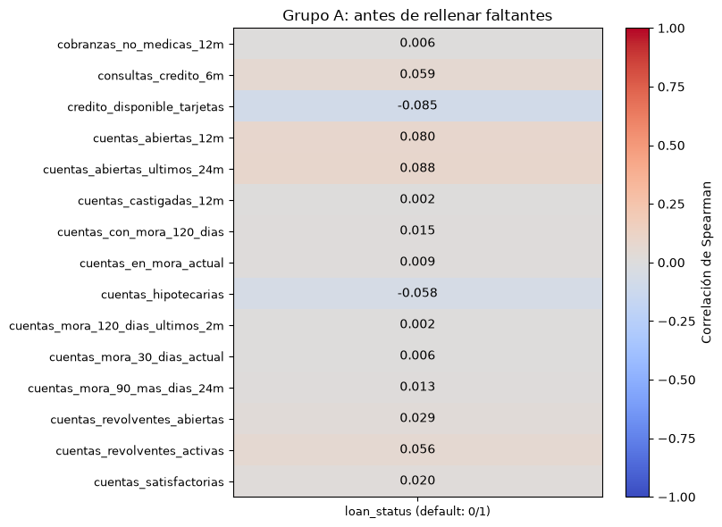

*Figura 33. Grupo A: correlación con el objetivo antes de imputar. Fuente: elaboración del Grupo 8; [notebook 01](../notebooks/01_exploracion_inicial_baseline.ipynb), correlación numérica en entrenamiento de la muestra.*

El grupo A reúne principalmente conteos de cuentas, consultas, moras y disponibilidad de crédito. Antes de imputar, las cuentas abiertas en los últimos 24 meses presentan correlación 0.088 y el crédito disponible en tarjetas, −0.085; las cobranzas no médicas y las cuentas castigadas recientes se sitúan mucho más cerca de cero. Son asociaciones bivariadas calculadas con los pares observados de cada campo, no contribuciones independientes al modelo.


*Figura 34. Grupo A: correlación con el objetivo después de imputar. Fuente: elaboración del Grupo 8; [notebook 01](../notebooks/01_exploracion_inicial_baseline.ipynb), correlación numérica en entrenamiento de la muestra.*

Al completar faltantes, las cuentas abiertas en los últimos 24 meses pasan de 0.088 a 0.083 y las abiertas en los últimos 12 meses, de 0.080 a 0.072. El crédito disponible en tarjetas cambia de −0.085 a −0.079; en contraste, las consultas de crédito a seis meses permanecen en 0.059 a la precisión mostrada. Los cambios son pequeños en esta escala y no uniformes: las cuentas con mora de 120 días aumentan de 0.015 a 0.018. La imputación no conserva necesariamente los rangos ni todos los coeficientes.

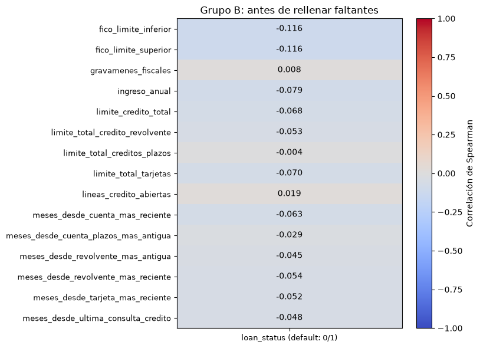

*Figura 35. Grupo B: correlación con el objetivo antes de imputar. Fuente: elaboración del Grupo 8; [notebook 01](../notebooks/01_exploracion_inicial_baseline.ipynb), correlación numérica en entrenamiento de la muestra.*

El grupo B compara FICO, ingreso anual, límites de crédito y antigüedad de cuentas. Los dos extremos del intervalo FICO presentan la misma correlación redondeada, −0.116, e ingreso anual muestra −0.079. Esta semejanza entre los dos FICO sugiere revisar su posible redundancia, aunque correlacionarse de forma parecida con el objetivo no demuestra por sí solo que sean intercambiables. Los gravámenes fiscales, con 0.008, muestran una asociación bivariada pequeña en esta muestra.

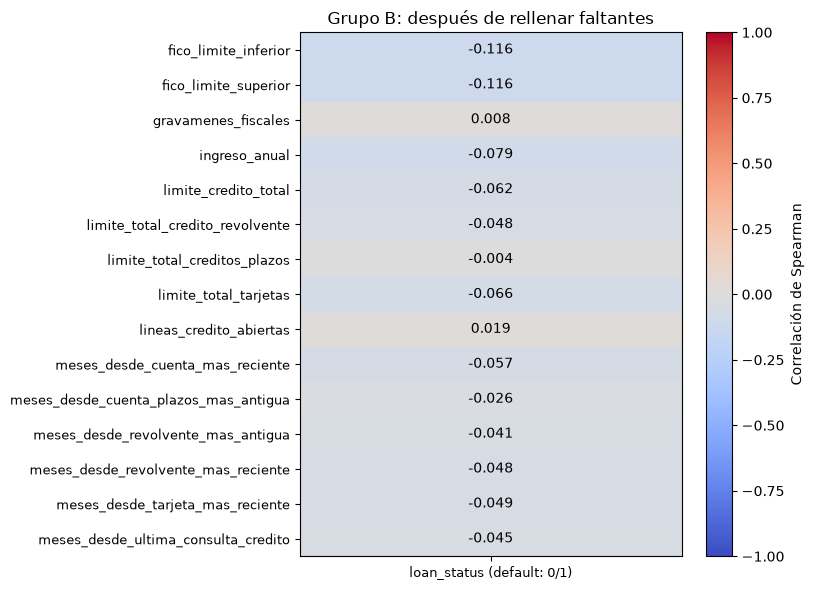

*Figura 36. Grupo B: correlación con el objetivo después de imputar. Fuente: elaboración del Grupo 8; [notebook 01](../notebooks/01_exploracion_inicial_baseline.ipynb), correlación numérica en entrenamiento de la muestra.*

Después de imputar, FICO inferior y superior conservan −0.116 e ingreso anual mantiene −0.079 a tres decimales. Otros campos se acercan ligeramente a cero: el límite de crédito total pasa de −0.068 a −0.062 y los meses desde la cuenta más reciente, de −0.063 a −0.057. La dirección general de estas asociaciones se mantiene, pero los empates creados por la mediana modifican algunos valores. La comparación no permite atribuir una reducción causal del incumplimiento a aumentar ingresos o límites.

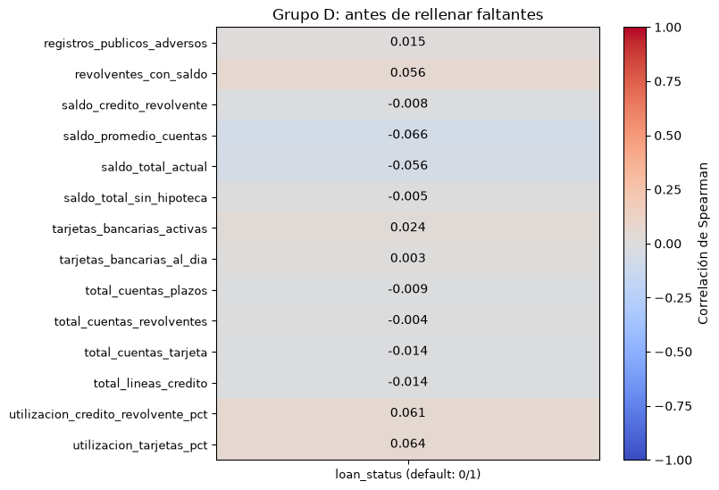

*Figura 37. Grupo D: correlación con el objetivo antes de imputar. Fuente: elaboración del Grupo 8; [notebook 01](../notebooks/01_exploracion_inicial_baseline.ipynb), correlación numérica en entrenamiento de la muestra.*

El grupo D reúne saldos, utilización de crédito y cantidades de cuentas. Antes de imputar, la utilización de tarjetas tiene correlación 0.064 y la utilización revolvente, 0.061; el saldo promedio de cuentas presenta −0.066. En cambio, el saldo total sin hipoteca (−0.005) y el número total de cuentas revolventes (−0.004) están próximos a cero. Esta heterogeneidad distingue medidas de utilización y magnitudes de saldo, sin probar que una familia sea siempre superior como predictor.

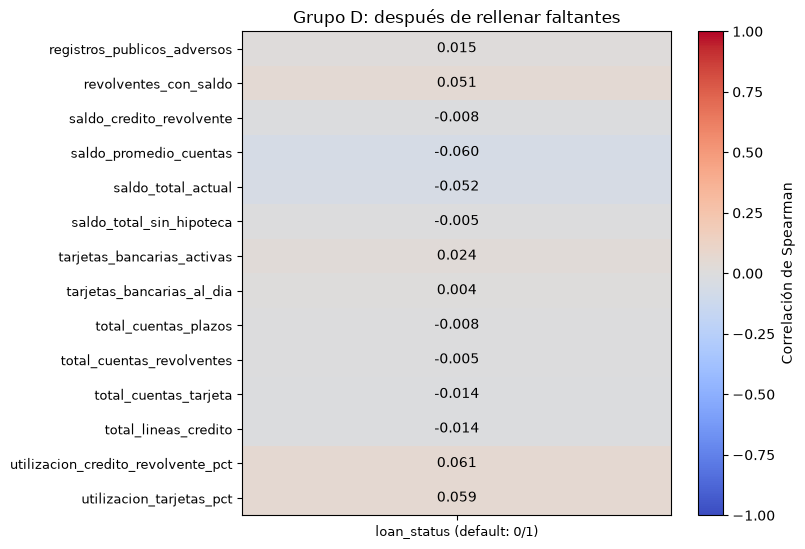

*Figura 38. Grupo D: correlación con el objetivo después de imputar. Fuente: elaboración del Grupo 8; [notebook 01](../notebooks/01_exploracion_inicial_baseline.ipynb), correlación numérica en entrenamiento de la muestra.*

La utilización de tarjetas pasa de 0.064 a 0.059 y el saldo promedio de cuentas, de −0.066 a −0.060; las cuentas revolventes con saldo cambian de 0.056 a 0.051. La utilización revolvente permanece en 0.061 a la precisión de la imagen y los registros públicos adversos conservan 0.015. La similitud visual de ambos mapas indica cambios limitados en estas asociaciones, no igualdad de las distribuciones ni ausencia de efecto en un modelo multivariado. No se utiliza este diagnóstico para eliminar automáticamente variables cercanas a cero.


*Figura 39. Mediana, indicadores y tratamiento nativo de ausentes. Fuente: elaboración del Grupo 8; [notebook 06](../notebooks/06_comparacion_variables_imputacion.ipynb) y [comparación de imputación](../outputs/comparacion_imputacion/resumen_promedios_y_variabilidad.csv).*

Las diferencias de discriminación son pequeñas entre estas estrategias con los parámetros fijados. El manejo nativo de ausentes es una capacidad del ensamble, no una justificación para dejar vacíos en todos los estimadores. El resultado respalda simplificar la configuración adoptada sin declarar ganador universal.

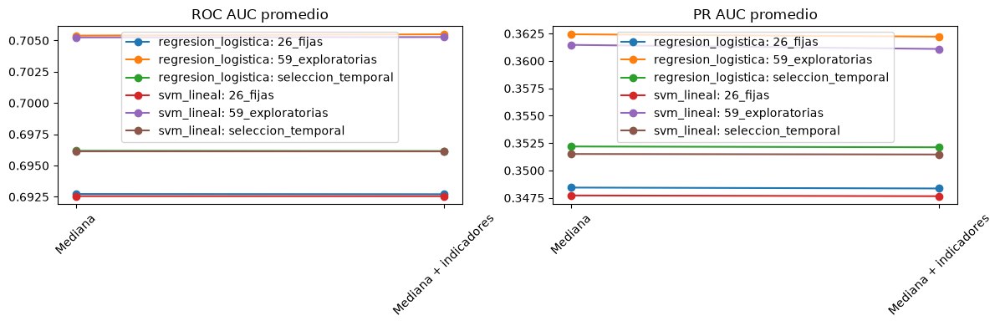

*Figura 40. Estrategias de faltantes en los modelos lineales. Fuente: elaboración del Grupo 8; [notebook 06](../notebooks/06_comparacion_variables_imputacion.ipynb) y [comparación lineal](../outputs/comparacion_lineales/resumen_promedios_y_variabilidad.csv).*

La ampliación de características y los indicadores tienen efectos distintos. Las pequeñas diferencias con indicadores no son uniformemente favorables en ROC-AUC y AP. Se conserva la mediana sola en el flujo adoptado, sin afirmar que los indicadores nunca puedan aportar información.

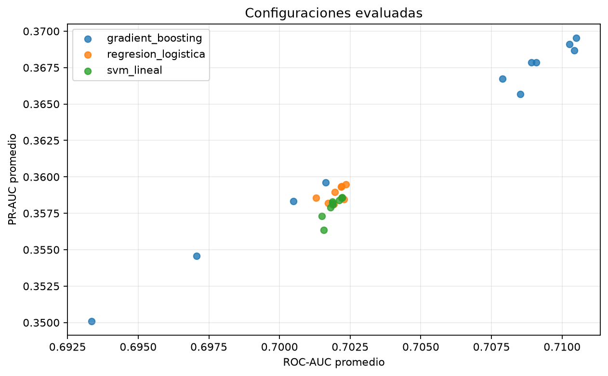

*Figura 41. Relación entre ROC-AUC y AP de las configuraciones evaluadas. Fuente: elaboración del Grupo 8; [notebook 08](../notebooks/08_optimizacion_final.ipynb), espacio aleatorio final.*

Cada punto representa una configuración evaluada con los cortes fijados. La figura muestra compromisos y proximidad de alternativas, no una cobertura exhaustiva de todos los hiperparámetros posibles. La elección sigue ROC-AUC, AP complementaria y revisión temporal.

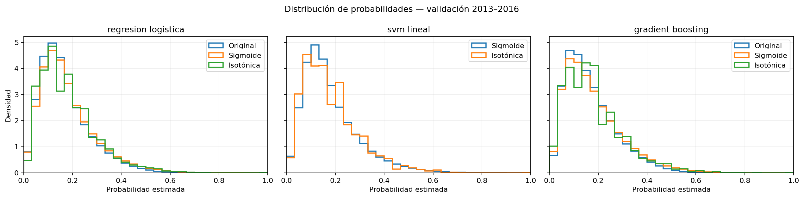

*Figura 42. Distribución de probabilidades en la comparación de calibración. Fuente: elaboración del Grupo 8; [notebook 09](../notebooks/09_calibracion.ipynb), predicciones de validación.*

La calibración modifica la escala de riesgo y puede concentrar estimaciones por debajo de 0.5 sin eliminar la capacidad de ordenamiento. Por eso un umbral fijo puede producir bajo recall aun con ROC-AUC superior a 0.5. La figura no sustituye curvas de calibración ni pérdidas probabilísticas.

---

**Anexo B. Inventario y trazabilidad de figuras**

El [inventario completo de figuras](figures/README.md) relaciona cada archivo incorporado con su número y sección, identifica los anexos y explica por qué otras imágenes disponibles no se insertaron. Las figuras existentes en `outputs/` se copiaron sin retirar los originales necesarios para notebooks. Las imágenes incrustadas sin archivo equivalente se extrajeron de sus salidas guardadas, sin ejecutar celdas. No se generaron nuevos resultados gráficos de los modelos.

La documentación utiliza los diez nombres oficiales, ubica el análisis de errores en el notebook 10, reconoce los artefactos serializados y separa el boosting homogéneo ya ejecutado del preliminar de 5,002 observaciones. También explicita las limitaciones del umbral 50%, de los identificadores faltantes para remuestreo y de la comparación entre búsqueda y calibración. Las rutas de las fuentes permiten revisar estas precisiones sin alterar sus outputs.

Las fuentes documentales que respaldan las cifras son [auditoría](../outputs/auditoria.json), [baseline](../outputs/metrics.json), [árbol](../outputs/metrics_arbol.json), [boosting homogéneo](../outputs/gradient_boosting_220000/metrics_boosting.json), [comparaciones temporales](../outputs/comparacion_variables_temporal/resumen_promedios_y_variabilidad.csv), [umbrales](../outputs/comparacion_umbrales_faltantes/resumen_promedios_y_variabilidad.csv), [optimización](../outputs/optimizacion_final/configuracion_reproducible.json), [calibración](../outputs/calibracion_probabilidades/metricas_promedio.csv), [test](../outputs/evaluacion_final/metricas_finales_test.csv) y [errores](../outputs/analisis_errores/metricas_globales.csv). Cada una tiene su población y diseño; no se corrigen cifras históricas para hacerlas coincidir entre etapas.

---

**Referencias bibliográficas**

Las referencias externas sustentan definiciones y criterios generales; las cifras y decisiones particulares se respaldan en los archivos del proyecto enlazados en cada sección. Se consulta la documentación de scikit-learn 1.8 para corresponder a la versión fijada, sin equiparar los ejemplos genéricos de la biblioteca con ejecuciones realizadas en el proyecto.

- Grupo 8, UTEC. (s. f.). *Proyecto de predicción de incumplimiento de préstamos: notebooks, código y resultados experimentales* [Repositorio de código y datos derivados]. [Índice del proyecto](../README.md).
- scikit-learn developers. (s. f.-a). *average_precision_score*. En *scikit-learn 1.8 API reference*. [Definición de Average Precision](https://scikit-learn.org/1.8/modules/generated/sklearn.metrics.average_precision_score.html).
- scikit-learn developers. (s. f.-b). *Cross-validation: Evaluating estimator performance*. En *scikit-learn 1.8 User Guide*. [Validación y selección temporal](https://scikit-learn.org/1.8/modules/cross_validation.html).
- scikit-learn developers. (s. f.-c). *Probability calibration*. En *scikit-learn 1.8 User Guide*. [Calibración de probabilidades](https://scikit-learn.org/1.8/modules/calibration.html).
- scikit-learn developers. (s. f.-d). *RandomizedSearchCV*. En *scikit-learn 1.8 API reference*. [Búsqueda aleatoria de hiperparámetros](https://scikit-learn.org/1.8/modules/generated/sklearn.model_selection.RandomizedSearchCV.html).
- wordsforthewise. (s. f.). *All Lending Club loan data* [Conjunto de datos; fuente de descarga documentada en el proyecto]. Kaggle. [Página de procedencia](https://www.kaggle.com/datasets/wordsforthewise/lending-club). Consulta del 17 de noviembre de 2026: licencia y condiciones de reutilización no verificables en la fuente primaria accesible; véase la sección 3.1 y [la documentación local de procedencia](../data/README.md).
