# Informe final — Predicción de incumplimiento de préstamos personales de Lending Club

**Curso:** Machine Learning, UTEC. **Grupo:** 8.

**Integrantes:** Gavino Navarrete Adrian Piero; Hernández Yataco, Josué Renzo; Rojas Cruz, José Alvaro; Sanchez Dominguez, Matias Sebastian.

## 1. Resumen ejecutivo

El proyecto estima el riesgo individual de que un préstamo personal aceptado por Lending Club termine declarado incobrable, frente a pagarse por completo. Cada observación corresponde a un préstamo y la respuesta se codifica como `Fully Paid = 0` y `Charged Off = 1`. Se utiliza información del solicitante, su historial crediticio y las condiciones conocidas al otorgamiento; se excluyen pagos, recuperaciones y otros campos posteriores que permitirían anticipar artificialmente el resultado.

El archivo original contiene 2,260,701 registros y 151 columnas. La población binaria comprende 1,345,310 préstamos originados entre 2007 y 2018 con alguno de los dos desenlaces seleccionados. El análisis utiliza el conjunto de desarrollo completo anterior a 2017. Se compararon una referencia de clase mayoritaria, regresiones logísticas, árboles de decisión, SVM lineal y distintas configuraciones de HistGradientBoosting. La selección de variables y de hiperparámetros evolucionó hacia cuatro cortes temporales expansivos, con imputación y transformaciones ajustadas exclusivamente en el entrenamiento de cada corte.

La configuración final admite variables con hasta 50% de faltantes en su entrenamiento, imputa numéricas con su mediana y categóricas con «Sin información», sin indicadores numéricos adicionales. El ajuste definitivo utiliza 826,604 préstamos de 2007–2015 y reserva 293,095 de 2016 para calibración sigmoide. En los 225,611 préstamos elegibles de 2017–2018, **HistGradientBoosting obtuvo el mejor desempeño de los tres modelos finales**: ROC-AUC 0.70321, Average Precision 0.37791, Brier 0.15364 y Log Loss 0.47428. Estos resultados corresponden a la evaluación histórica del notebook 11.

El resultado es útil como comparación académica de estimadores de riesgo, pero no valida una política de concesión de crédito. Solo se observan préstamos aceptados con desenlace final seleccionado; el seguimiento de los préstamos recientes es desigual y el test ya había sido consultado en etapas históricas. Además, con umbral descriptivo 0.5, el modelo principal detecta solo 13.06% de los incumplimientos. La evaluación local posterior de los tres modelos serializados reprodujo las métricas históricas a los seis decimales mostrados; se contrastaron sus CSV guardados, sin repetir la evaluación en esta revisión. No se afirma preparación para decisiones crediticias reales.

## 2. Descripción del problema

### 2.1. Pregunta predictiva y alcance

> Dado un préstamo que Lending Club acaba de aprobar, y usando únicamente la información disponible el día del desembolso, ¿qué probabilidad hay de que termine declarado incobrable (`Charged Off`) en lugar de pagarse por completo (`Fully Paid`)?

El incumplimiento crediticio implica que no se recupera el pago conforme a las obligaciones del préstamo. En este trabajo, la etiqueta concreta es la declaración contable `Charged Off`; no se equiparan automáticamente atraso, periodo de gracia e incobrabilidad. Anticipar ese desenlace puede ayudar a ordenar préstamos por riesgo, revisar exposiciones y priorizar análisis, siempre dentro de la población estudiada.

La tarea es una clasificación binaria supervisada. Su salida principal es una estimación individual entre 0 y 1, no el ROC-AUC ni un promedio de incumplimientos del conjunto. Por ejemplo, una estimación de 0.30 representa un riesgo estimado de 30% para ese préstamo bajo las condiciones del modelo. No demuestra que ese cliente incumplirá ni permite conocer de antemano la probabilidad individual «verdadera». La calibración evalúa si, entre préstamos con estimaciones semejantes, las frecuencias observadas son compatibles con ellas.

### 2.2. Información y decisión

Predecir riesgo de préstamos otorgados es distinto de decidir a quién aprobar. No se dispone del pago hipotético de solicitudes rechazadas. Convertir una estimación en una alerta exige además un umbral y una valoración de los costos de error. Por ello se distingue entre discriminación, calidad de probabilidades y clasificación a un umbral específico. La formulación corresponde al horizonte «hasta el desenlace observado», no a incumplimiento dentro de un plazo uniforme de doce meses.

## 3. Descripción del dataset

### 3.1. Fuente, unidad y población

Se utiliza el archivo `accepted_2007_to_2018Q4.csv`, distribuido en [Lending Club Loan Data, de wordsforthewise](https://www.kaggle.com/datasets/wordsforthewise/lending-club). El conjunto contiene información de préstamos aceptados; no se incorpora el archivo de solicitudes rechazadas. La descarga y el diccionario disponible se describen en [data/README.md](../data/README.md). La auditoría de referencia es [outputs/auditoria.json](../outputs/auditoria.json).

La publicación de descarga está identificada por el usuario **wordsforthewise** en Kaggle, mientras que Lending Club es la entidad de procedencia de los préstamos. [data/README.md](../data/README.md) documenta la procedencia y la obtención, pero no contiene una licencia ni condiciones específicas de reutilización.

En consecuencia, no se afirma que el conjunto sea de dominio público ni se le asigna CC0, Creative Commons u otra licencia a partir de referencias de terceros. No fue posible confirmar restricciones o permisos específicos de esa publicación. En este proyecto se utiliza una copia obtenida previamente para investigación y evaluación académica del curso; ese propósito no sustituye la verificación de las condiciones de uso. Los datos originales no se redistribuyen en GitHub. Antes de una nueva descarga, redistribución o uso distinto debe verificarse la licencia y conservarse una evidencia accesible de ella. La referencia bibliográfica identifica la fuente y esta limitación de acceso.

| Característica | Valor y significado |
| --- | --- |
| Registros originales | 2,260,701 |
| Columnas originales | 151 |
| Unidad de observación | Un préstamo aceptado |
| Periodo de originación analizado | 2007–2018 |
| Población binaria elegible | 1,345,310 préstamos |
| Pagados por completo | 1,076,751 |
| Declarados incobrables | 268,559 |
| Desarrollo hasta 2016 | 1,119,699 préstamos elegibles |
| Test histórico 2017–2018 | 225,611 préstamos elegibles |

Las 151 columnas originales no equivalen a 151 predictores. Existen identificadores, texto, campos posteriores al préstamo, fechas auxiliares y la propia etiqueta. En la lectura restringida de exploración completa se consideran 97 columnas: 95 candidatas predictoras y dos auxiliares (`loan_status` e `issue_d`). Los recuentos posteriores de variables se refieren a características originales antes de One-Hot Encoding; las columnas transformadas pueden ser muchas más.

### 3.2. Estados incluidos y excluidos

| Estado original | Registros | Uso |
| --- | --- | --- |
| Fully Paid | 1,076,751 | Incluir; clase 0 |
| Charged Off | 268,559 | Incluir; clase 1 |
| Current | 878,317 | Excluir; sin desenlace final seleccionado |
| Late (31-120 days) | 21,467 | Excluir; atraso no equivale a Charged Off |
| In Grace Period | 8,436 | Excluir; periodo de gracia |
| Late (16-30 days) | 4,349 | Excluir; atraso |
| Does not meet the credit policy. Status:Fully Paid | 1,988 | Excluir; estado histórico distinto |
| Does not meet the credit policy. Status:Charged Off | 761 | Excluir; estado histórico distinto |
| Default | 40 | Excluir; no recodificar sin justificación |
| Sin estado | 33 | Excluir; sin etiqueta elegible |


*Figura 1. Distribución de los dos desenlaces en toda la población elegible. Fuente: elaboración propia; [notebook 04](../notebooks/04_exploracion_completa.ipynb).*

Aproximadamente cuatro de cada cinco préstamos elegibles fueron pagados y uno terminó incobrable. El desbalance motiva utilizar ROC-AUC y Average Precision en lugar de juzgar el modelo únicamente por accuracy.

### 3.3. Tipos de información y distribución temporal

Las variables numéricas incluyen montos monetarios, porcentajes, cantidades de cuentas, meses transcurridos y puntuaciones FICO. Las categóricas representan, entre otras, vivienda, finalidad, verificación de ingresos, antigüedad laboral y estado de residencia. Las fechas permiten reconocer el periodo de originación y la antigüedad de la información. Un faltante no es otra variable de respuesta: indica ausencia de un valor y requiere tratamiento según el tipo y su disponibilidad histórica.

El volumen de préstamos no es uniforme entre años. El desarrollo completo contiene 93,153 préstamos hasta 2012, 134,804 de 2013, 223,102 de 2014, 375,545 de 2015 y 293,095 de 2016. En el test histórico hay 169,300 de 2017 y 56,311 de 2018.

## 4. Limpieza y preparación de datos

### 4.1. Filtrado de observaciones y revisión de campos

Se conservan únicamente las dos etiquetas finales y se construye `default`. No se convierten préstamos activos en ejemplos negativos ni atrasos en positivos. Tampoco se eliminan todas las filas con algún faltante, pues eso reduciría la población de forma selectiva. Las conversiones de fechas esperadas y del plazo se realizan de forma explícita; no se documenta como aplicada una eliminación general de registros por «fecha inválida».

### 4.2. Prevención de información posterior al otorgamiento

La exclusión conceptual precede a las comparaciones predictivas. Se retiran campos que describen el comportamiento del mismo préstamo después del desembolso. Un modelo que emplease recuperaciones o pagos acumulados podría reconocer un desenlace ya ocurrido, pero no resolvería la pregunta planteada.

| Familia retirada | Ejemplos reales | Motivo |
| --- | --- | --- |
| Pagos y recuperaciones | `total_pymnt`, `total_rec_prncp`, `total_rec_int`, `recoveries`, `collection_recovery_fee` | Se acumulan durante o después del préstamo |
| Saldo pendiente del préstamo | `out_prncp`, `out_prncp_inv` | Estado posterior del capital del mismo préstamo |
| Últimos pagos y consultas | `last_pymnt_d`, `last_pymnt_amnt`, `next_pymnt_d`, `last_credit_pull_d` | Información actualizada después del origen |
| FICO actualizado | `last_fico_range_low`, `last_fico_range_high` | No equivale al FICO al otorgamiento |
| Dificultades y acuerdos | `hardship_*`, `deferral_term`, `payment_plan_start_date`, `debt_settlement_*`, `settlement_*`, `pymnt_plan` | Planes o acuerdos asociados a la evolución posterior |

La distinción se refiere al tiempo del evento. Por ejemplo, `tot_cur_bal` resume cuentas del historial crediticio disponible en el origen y no se confunde automáticamente con `out_prncp`, saldo actualizado del préstamo que se intenta predecir. El diccionario y las listas de exclusión del código son necesarios para resolver casos particulares; no se excluye una columna solo por contener la palabra «saldo».

Se excluyen identificadores (id, member_id, url), variables de texto libre (desc, title, emp_title), zip_code y policy_code, por criterios de relevancia, complejidad y prevención de sesgos. En particular, se excluye zip_code para reducir el riesgo de discriminación geográfica indirecta, dado que la ubicación residencial puede estar asociada con características socioeconómicas de determinados grupos de población. Asimismo, se prescinde del texto libre, que podría contener información sensible o introducir sesgos difíciles de controlar. Estas exclusiones buscan favorecer un modelo más responsable, aunque no garantizan la ausencia de discriminación, pues otras variables pueden actuar como indicadores indirectos de características protegidas. Por su parte, loan_status se utiliza exclusivamente para construir la variable objetivo y issue_d para establecer las particiones temporales, sin incorporarse como predictoras.

### 4.3. Lectura, tipos y memoria

La exploración completa, desarrollada en el [notebook 04](../notebooks/04_exploracion_completa.ipynb), prepara tipos verificados y carga de una vez las columnas seleccionadas. El ahorro de memoria consiste en evitar campos innecesarios y representar de forma más compacta los enteros y categorías, manteniendo los decimales que requieren `float64`. Los enteros solo se reducen si sus valores caben en el rango del tipo; las categorías almacenan códigos junto con un vocabulario. Estas optimizaciones permiten reducir el espacio ocupado por los datos, aunque no implican necesariamente una lectura más rápida debido al costo de conversión y procesamiento.

Para evaluar la eficiencia de carga, se compararon dos métodos: **lectura directa** y **lectura por bloques**. Según los resultados registrados en [benchmark_memoria](../outputs/benchmark_memoria), la lectura por bloques redujo el pico promedio de memoria durante la carga de **1.79 GiB a 0.95 GiB**, aproximadamente un **47 % menos**, considerando dos ejecuciones por método. Sin embargo, el pico de memoria del proceso completo fue prácticamente igual: alrededor de **2.94 GiB** en ambos casos, debido principalmente a la preparación de las matrices utilizadas para el entrenamiento.

Los resultados de [comparacion_carga](../outputs/comparacion_carga), con tres repeticiones por método, muestran que la lectura directa tardó en promedio **46.90 segundos**, frente a **52.40 segundos** de la lectura por bloques. Por tanto, procesar el archivo por fragmentos permitió reducir el consumo máximo de memoria durante la carga, pero no mejoró el tiempo promedio de ejecución en estas pruebas.

La lectura por bloques también fue útil en auditorías que recorren el archivo sin conservarlo completo. No obstante, concatenar todos los bloques sigue necesitando memoria para la tabla final y puede añadir un pico transitorio. El cargador del pipeline final, a diferencia de la lectura directa del [notebook 04](../notebooks/04_exploracion_completa.ipynb), recorre bloques de 100,000 filas, conserva los préstamos elegibles del periodo y finalmente concatena sus partes. Por tanto, su conjunto de desarrollo termina almacenado en memoria; no es un algoritmo de entrenamiento externo que evite almacenar la tabla completa.

Estos resultados corresponden a experimentos de eficiencia computacional, no a pruebas de calidad predictiva. Las comparaciones verificaron la consistencia de los datos procesados, sin evidenciar cambios en las métricas predictivas atribuibles al método de lectura. Finalmente, renombrar columnas para tablas y gráficos mejora su interpretación, mientras que las interfaces reutilizables y el diccionario conservan la correspondencia con los nombres originales.

### 4.4. Evolución de la selección de características

La selección de características fue una decisión central del proyecto, debido a la elevada proporción de valores faltantes en determinadas variables y a los cambios en su disponibilidad a lo largo del tiempo. Antes de establecer un conjunto definitivo de predictores, se analizó la distribución de faltantes, su relación con los periodos de recopilación y el efecto de distintos umbrales de selección sobre el desempeño de los modelos.

La ausencia de datos puede responder a distintas características de los campos. Las variables hardship_* describen situaciones de dificultad financiera que solo se presentan en determinados préstamos y, además, corresponden a información posterior al otorgamiento, por lo que deben excluirse para evitar data leakage. Por su parte, las variables sec_app_* están asociadas a solicitudes conjuntas y presentan una cobertura especialmente limitada.


*Figura 2. Disponibilidad de variables a través de los años. Fuente: elaboración propia; [notebook 08](../notebooks/08_umbrales_sensibilidad.ipynb) y [disponibilidad anual](../outputs/analisis_sensibilidad_faltantes/disponibilidad_anual_variables.csv).*

La Figura 2 presenta un mapa de calor que evidencia cómo la disponibilidad de las variables crediticias cambia considerablemente entre 2007 y 2016. Muchas características, como avg_cur_bal, bc_util y num_actv_bc_tl, presentan una disponibilidad prácticamente nula antes de 2012, aumentan su cobertura durante ese año y alcanzan porcentajes cercanos al 100 % desde 2013. Este comportamiento sugiere cambios en la recopilación y disponibilidad de información crediticia a lo largo del tiempo.

Sin embargo, no todas las variables siguen este patrón. Algunas relacionadas con antecedentes de morosidad, como mths_since_last_delinq, mantienen porcentajes de observación variables, ya que su ausencia también puede estar relacionada con la inexistencia de determinados eventos crediticios, y no necesariamente con problemas en la recopilación de datos.

Estas diferencias tienen implicaciones directas para el modelado, puesto que una variable disponible en años recientes no necesariamente podía utilizarse en los periodos iniciales de entrenamiento. Por ello, el proyecto calcula la proporción de valores faltantes exclusivamente sobre los datos de entrenamiento de cada corte temporal, evitando seleccionar características o estimar valores de imputación a partir de información de años posteriores.

La preparación de las características también consideró la representación temporal de la información crediticia. En particular, se transformó earliest_cr_line, que registra la fecha de apertura de la primera línea de crédito, en la variable meses_desde_earliest_cr_line, calculada como la diferencia en meses respecto a la fecha de otorgamiento (issue_d). Esta transformación permite expresar la antigüedad del historial crediticio mediante una característica interpretable, evitando incorporar directamente una fecha absoluta como predictora. Por su parte, issue_d se utiliza para establecer las particiones temporales del análisis.

Posteriormente, al ampliar el análisis a la población elegible completa, se identificó que la disponibilidad de las características dependía considerablemente del periodo considerado. Por ejemplo, aplicar un límite del 10 % de faltantes utilizando información hasta 2012 permitió seleccionar 26 variables, mientras que extender el periodo hasta 2016 permitió identificar 59. Sin embargo, este último conjunto se consideró exploratorio, dado que incorporaba información sobre la cobertura de años posteriores a algunos cortes de validación.

Por ello, se evaluaron estrategias que recalculaban la selección de variables exclusivamente con los datos de entrenamiento de cada corte temporal, así como distintos umbrales máximos de faltantes. La siguiente tabla resume la evolución de estos criterios y los conjuntos de características obtenidos.

| Etapa | Regla y población de selección | Características originales | Alcance |
| --- | --- | --- | --- |
| Conjunto fijo restrictivo | Hasta 10% de faltantes en entrenamiento hasta 2012 | 26 | Disponible desde el primer corte |
| Conjunto fijo ampliado | Hasta 10% en desarrollo hasta 2016 | 59 | Exploratorio: conoce cobertura de años posteriores |
| Selección temporal al 10% | Regla recalculada solo en entrenamiento de cada corte | 26 / 26 / 26 / 57 | Comparación temporal |
| Selección temporal al 50% | Regla recalculada solo en entrenamiento de cada corte | 26 / 60 / 60 / 60 | Configuración adoptada |
| Ajuste final | Regla de 50% en entrenamiento 2007–2015 | 60; 136 columnas transformadas | Antes de calibrar en 2016 |

La regla se fija con entrenamiento y se aplica sin redescubrir columnas en validación. Los porcentajes se calculan sobre la población elegible de ese periodo. Por tanto, la variación de 26 a 60 columnas entre cortes es una consecuencia documentada de la selección temporal, no una mezcla de observaciones. Una columna sin datos no tiene una mediana estimable en ese entrenamiento y no se rescata usando años posteriores.

En [comparacion_variables_temporal](../outputs/comparacion_variables_temporal/resumen_promedios_y_variabilidad.csv), con los mismos hiperparámetros de Gradient Boosting, las 26 variables sin indicadores alcanzaron ROC-AUC medio 0.699985 y AP 0.355088; mientras que el conjunto exploratorio de 59 variables obtuvo 0.713069 y 0.371702, respectivamente. Por su parte, la selección estrictamente temporal con un umbral del 10 % registró un ROC-AUC de 0.703295 y una AP de 0.359341. Aunque el conjunto de 59 variables presentó el mejor desempeño, su selección consideró información sobre la disponibilidad de características hasta 2016, por lo que no constituye una alternativa temporalmente válida para todos los cortes anteriores.


*Figura 3. Comparación de conjuntos y de indicadores de faltantes. Fuente: elaboración propia; [notebook 07](../notebooks/07_comparacion_variables_imputacion.ipynb), [comparación temporal de conjuntos](../outputs/comparacion_variables_temporal/resumen_promedios_y_variabilidad.csv).*

La Figura 3 muestra que, en las configuraciones evaluadas, la ampliación del conjunto de características se asoció con diferencias de rendimiento mayores que la incorporación de indicadores de valores faltantes. Estos indicadores produjeron variaciones pequeñas, sin una mejora consistente en ROC-AUC ni en Average Precision (AP). Las barras de error representan la desviación estándar de las métricas entre los cuatro años de validación, por lo que reflejan variabilidad temporal y no intervalos de confianza.

Si bien el conjunto exploratorio de 59 variables obtuvo los mejores resultados promedio, su selección consideró la disponibilidad de información hasta 2016, lo que limita su validez para los cortes temporales anteriores. En consecuencia, los experimentos sugieren que la selección y disponibilidad de características tuvieron mayor influencia sobre el rendimiento observado que los indicadores de ausencia, sin que ello permita descartar su utilidad en otras configuraciones.

Una vez evaluado el efecto de los distintos conjuntos de características y de los indicadores de ausencia, se analizó cómo influía el porcentaje máximo de valores faltantes permitido en la selección de variables. Para ello, se compararon umbrales del 10 %, 30 %, 50 % y 75 % mediante validación temporal, utilizando regresión logística, SVM lineal e HistGradientBoosting. La siguiente tabla presenta los resultados promedio de ROC-AUC y Average Precision (AP), junto con la desviación estándar del ROC-AUC entre los años de validación.

| Modelo | Umbral de faltantes | ROC-AUC medio | AP media | Desviación ROC-AUC |
| --- | --- | --- | --- | --- |
| HistGradientBoosting | 10% | 0.703295 | 0.359341 | 0.021337 |
| HistGradientBoosting | 30% | 0.710493 | 0.368658 | 0.025920 |
| HistGradientBoosting | 50% | 0.710428 | 0.368693 | 0.025910 |
| HistGradientBoosting | 75% | 0.713506 | 0.372133 | 0.020252 |
| Logística | 10% | 0.696181 | 0.352192 | 0.019305 |
| Logística | 30% | 0.702225 | 0.359342 | 0.023864 |
| Logística | 50% | 0.702187 | 0.359320 | 0.023857 |
| Logística | 75% | 0.705483 | 0.362564 | 0.018185 |
| SVM lineal | 10% | 0.696135 | 0.351507 | 0.019515 |
| SVM lineal | 30% | 0.702213 | 0.358569 | 0.024140 |
| SVM lineal | 50% | 0.702212 | 0.358570 | 0.024140 |
| SVM lineal | 75% | 0.705374 | 0.361687 | 0.018694 |

Fuente: [resumen de umbrales](../outputs/comparacion_umbrales_faltantes/resumen_promedios_y_variabilidad.csv); desviaciones calculadas según la agregación conservada en dicha tabla.

Los resultados muestran que el umbral del 75 % obtuvo el mayor ROC-AUC promedio para los tres modelos evaluados. En HistGradientBoosting también presentó la menor desviación estándar entre años, con un ROC-AUC medio de 0.713506 frente a 0.710428 del umbral del 50 %. No obstante, estas métricas agregadas no permiten determinar si la ventaja se mantiene en todos los periodos de validación. Por ello, a continuación se examinan las diferencias de rendimiento, la cantidad de variables seleccionadas y su comportamiento temporal.

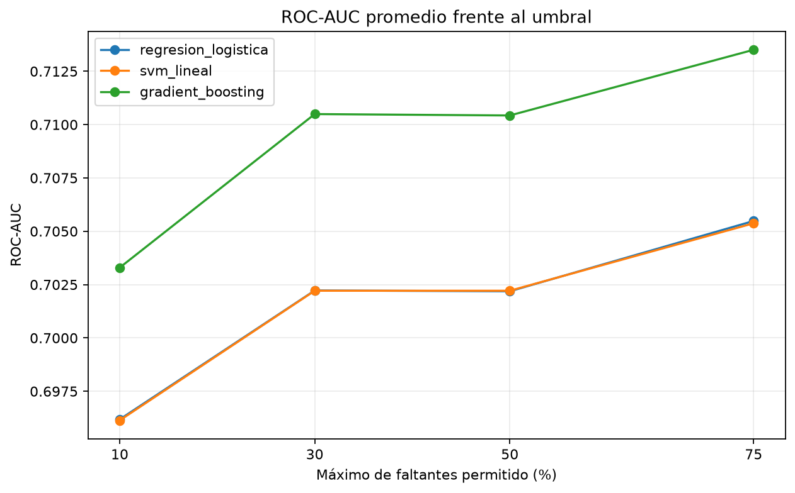

*Figura 4. ROC-AUC medio según el límite de faltantes. Fuente: elaboración propia; [notebook 08](../notebooks/08_umbrales_sensibilidad.ipynb) y [comparación de umbrales](../outputs/comparacion_umbrales_faltantes/resumen_promedios_y_variabilidad.csv).*

La Figura 4 muestra cómo varía el ROC-AUC promedio de los tres modelos al modificar el porcentaje máximo de valores faltantes permitido para seleccionar características. Se observa una mejora al pasar del 10 % al 30 %, seguida de resultados prácticamente iguales entre el 30 % y el 50 %. El umbral del 75 % alcanza el mayor ROC-AUC promedio en los tres modelos, aunque las diferencias respecto al 50 % son reducidas.

Estos resultados indican que permitir la incorporación de características con mayor proporción de faltantes puede mejorar el rendimiento predictivo, pero no garantiza una mejora proporcional o constante. Por ello, la elección del umbral final no debe basarse únicamente en el ROC-AUC promedio, sino también en la disponibilidad temporal de las variables y en la consistencia de las mejoras entre los distintos periodos de validación.


*Figura 5. Número de variables admitidas por corte y umbral. Fuente: elaboración propia; [conteo de variables](../outputs/comparacion_umbrales_faltantes/conteo_variables_por_corte_y_umbral.csv), [notebook 08](../notebooks/08_umbrales_sensibilidad.ipynb) y [comparación de umbrales](../outputs/comparacion_umbrales_faltantes/resumen_promedios_y_variabilidad.csv).*

La Figura 5 evidencia que un mismo umbral de faltantes no produce necesariamente la misma cantidad de características en todos los periodos de entrenamiento. Con el umbral del 50 %, se seleccionan 26 variables para la validación de 2013 y 60 para cada uno de los tres años posteriores. Este incremento refleja los cambios en la disponibilidad histórica de la información crediticia.

Asimismo, se observa que el umbral del 75 % permite seleccionar 61 variables en 2013, frente a las 26 admitidas con el 50 %. Sin embargo, esta diferencia se reduce considerablemente en los periodos posteriores, cuando ambos criterios seleccionan conjuntos de tamaños similares. Por tanto, el efecto de aumentar el umbral depende del periodo de entrenamiento y de la cobertura de las características disponibles, lo que justifica analizar las mejoras predictivas por año y no únicamente mediante promedios generales.

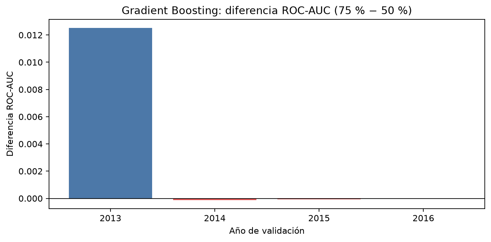

*Figura 6. Cambio anual de ROC-AUC al pasar de 50% a 75%. Fuente: elaboración propia; [diferencias anuales](../outputs/analisis_sensibilidad_faltantes/metricas_anuales_50_vs_75.csv), [notebook 08](../notebooks/08_umbrales_sensibilidad.ipynb) y [comparación de umbrales](../outputs/comparacion_umbrales_faltantes/resumen_promedios_y_variabilidad.csv).*

La Figura 6 muestra que la ventaja del umbral del 75 % sobre el 50 % en Gradient Boosting se concentra principalmente en la validación de 2013, donde se registra un incremento de ROC-AUC de 0.012523. En contraste, durante 2014, 2015 y 2016 las diferencias son prácticamente nulas y ligeramente favorables al umbral del 50 %.

Este comportamiento es coherente con la Figura 5: en 2013, el umbral del 75 % incorpora 35 características adicionales respecto al 50 %, mientras que en los años posteriores la diferencia se reduce a entre una y tres variables. Aunque esta relación ayuda a interpretar la concentración de la mejora, no permite atribuirle una causalidad exclusiva.

En conjunto, los resultados indican que el aumento del umbral hasta el 75 % no produjo una mejora sostenida del ROC-AUC en todos los periodos. Por ello, la adopción del 50 % se mantiene como una decisión metodológica conservadora, orientada a limitar la proporción de información ausente sin sacrificar gran parte del rendimiento observado. No obstante, estos experimentos no demuestran que ambos umbrales sean estadísticamente equivalentes ni que el 50 % sea óptimo.

### 4.5. Imputación y preprocesamiento definitivo

Una vez seleccionadas las características, se aplicó un proceso de imputación y transformación para preparar los datos utilizados por los modelos. En cada corte temporal, los valores faltantes de las variables numéricas se reemplazan por la mediana calculada exclusivamente con el conjunto de entrenamiento. Esa misma mediana se utiliza posteriormente en validación, evitando incorporar información de periodos futuros.

En las variables categóricas, los valores ausentes se sustituyen por «Sin información» y posteriormente se aplica One-Hot Encoding, eliminando una categoría de referencia y permitiendo procesar categorías desconocidas. El vocabulario se aprende únicamente con los datos de entrenamiento. Sin embargo, una categoría no observada anteriormente puede representarse mediante ceros en las columnas codificadas, lo que dificulta distinguirla de la categoría de referencia.

El preprocesamiento también incluye escalado numérico, cuyos parámetros se calculan sobre entrenamiento. Para la regresión logística y SVM lineal se utiliza una representación compatible con matrices dispersas, evitando centrar los valores cuando esto eliminaría dicha propiedad. En HistGradientBoosting se construye una matriz densa. Aunque los modelos basados en árboles no requieren escalado para establecer sus particiones, se conserva esta transformación porque forma parte de la implementación evaluada.

En la configuración final se seleccionaron 60 características antes de la codificación, compuestas por 54 numéricas y seis categóricas: emp_length, home_ownership, verification_status, purpose, addr_state y application_type. Después del preprocesamiento, estas características generan 136 columnas transformadas. Esta diferencia se debe principalmente a la expansión de las variables categóricas mediante One-Hot Encoding. Entre las características numéricas se incluye la antigüedad del historial crediticio, derivada previamente de earliest_cr_line.

Durante el desarrollo también se comparó la imputación por mediana con la incorporación de indicadores binarios de ausencia y, para HistGradientBoosting, con el manejo nativo de valores faltantes. Las diferencias de rendimiento fueron pequeñas o inconsistentes en los experimentos registrados, por lo que el preprocesamiento final no incorpora indicadores adicionales. Las principales reglas y transformaciones se encuentran documentadas en features.py, modelado.py y etapas_finales.py.

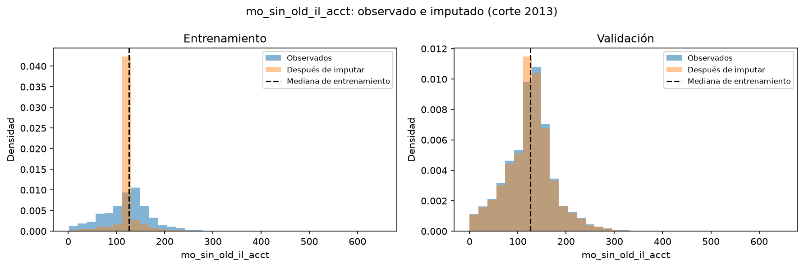

*Figura 7. Distribución observada e imputada de la antigüedad de crédito a plazos. Fuente: elaboración propia; [resumen del efecto de imputación](../outputs/analisis_sensibilidad_faltantes/resumen_efecto_imputacion.csv), [notebook 08](../notebooks/08_umbrales_sensibilidad.ipynb).*

La Figura 7 presenta un ejemplo del efecto de la imputación por mediana sobre mo_sin_old_il_acct, variable que representa los meses transcurridos desde la apertura de la cuenta de crédito a plazos más antigua. Para el corte de validación de 2013, el conjunto de entrenamiento presentó un 73.75 % de valores faltantes, mientras que en validación esta proporción fue de apenas 3.68 %. La mediana calculada exclusivamente con entrenamiento fue de 126 meses y se aplicó a ambos conjuntos.

En el panel de entrenamiento se observa una marcada concentración de valores imputados alrededor de la mediana. De acuerdo con el resumen cuantitativo, después de completar los faltantes, aproximadamente el 74.05 % de los registros de entrenamiento presentan ese valor. En contraste, la distribución de validación experimenta una modificación mucho menor, debido a su baja proporción de datos faltantes: aproximadamente el 4.81 % de sus registros quedan con el valor de la mediana después de imputar.

Esta diferencia evidencia que la imputación por mediana completa los registros, pero no reconstruye la variabilidad de los valores originalmente ausentes. Asimismo, muestra cómo un cambio en la cobertura temporal puede producir efectos de imputación muy diferentes entre entrenamiento y validación.

La variable se presenta como un caso diagnóstico del análisis de sensibilidad: su proporción de faltantes en el primer entrenamiento superaba el umbral del 50 %, aunque permitía evaluarla bajo el criterio alternativo del 75 %. Por tanto, la figura ilustra las consecuencias de admitir características con elevada ausencia histórica, sin demostrar por sí sola una mejora o deterioro del rendimiento predictivo.

## 5. Análisis exploratorio

La distribución global de la variable objetivo ya se presentó en la Figura 1, por lo que no se repite en esta sección. A continuación, se analizan las relaciones entre las características crediticias y el incumplimiento, así como los cambios en sus distribuciones después de la imputación descriptiva.

Los resultados proceden del notebook 04 de exploración completa. Las correlaciones y los diagramas de caja se calcularon sobre los 1,119,699 préstamos elegibles del conjunto de desarrollo hasta 2016, utilizando las 26 características seleccionadas mediante el criterio inicial de cobertura histórica, de las cuales 20 son numéricas. Por tanto, este análisis no incluye el conjunto de prueba de 2017–2018 ni representa todas las características disponibles en el dataset.

### 5.1. Correlación de las variables numéricas con el incumplimiento

Para identificar asociaciones individuales entre las características numéricas y el incumplimiento, se calculó el coeficiente de correlación de Spearman respecto a la variable objetivo default (0 = Fully Paid; 1 = Charged Off). Las 20 variables numéricas se organizaron en cuatro grupos para facilitar su visualización.

Cada figura compara las correlaciones antes y después de completar los valores faltantes mediante una imputación descriptiva. Antes de imputar, cada coeficiente se calcula utilizando los registros con valores observados para la variable correspondiente; después, se utilizan los valores completados. La escala común de −1 a 1 permite comparar la dirección e intensidad de las asociaciones sin exagerar visualmente las diferencias.

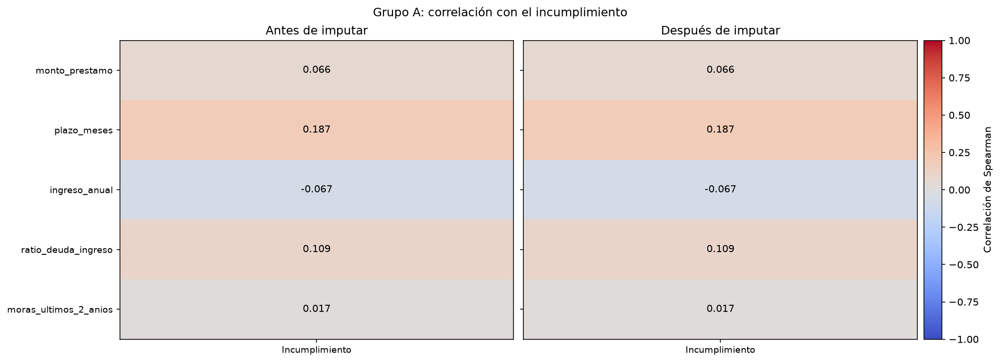

*Figura 8. Grupo A: correlación de Spearman con el incumplimiento antes y después de imputar. Fuente: elaboración propia; [notebook 04](../notebooks/04_exploracion_completa.ipynb), comparación de correlaciones.*


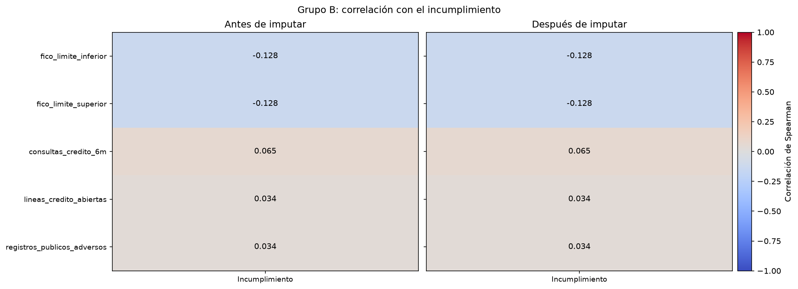

*Figura 9. Grupo B: correlación de Spearman con el incumplimiento antes y después de imputar. Fuente: elaboración propia; [notebook 04](../notebooks/04_exploracion_completa.ipynb).*

Las Figuras 8 y 9 muestran las asociaciones de mayor magnitud entre las características analizadas. El plazo del préstamo (`plazo_meses`) presenta la correlación positiva más elevada (0.187), seguido de la relación deuda/ingreso (`ratio_deuda_ingreso`, 0.109). En sentido contrario, los límites inferior y superior del puntaje FICO presentan correlaciones negativas de −0.128, lo que indica que mayores puntuaciones crediticias tienden a asociarse con una menor frecuencia de incumplimiento.

Aunque estas relaciones son consistentes con la interpretación financiera de las variables, sus coeficientes son relativamente bajos. Por tanto, no deben interpretarse como efectos causales ni como indicadores suficientes para predecir individualmente el desenlace de un préstamo.

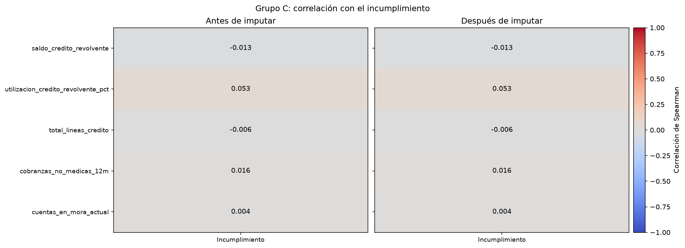

*Figura 10. Grupo C: correlación de Spearman con el incumplimiento antes y después de imputar. Fuente: elaboración propia; [notebook 04](../notebooks/04_exploracion_completa.ipynb), comparación de correlaciones.*

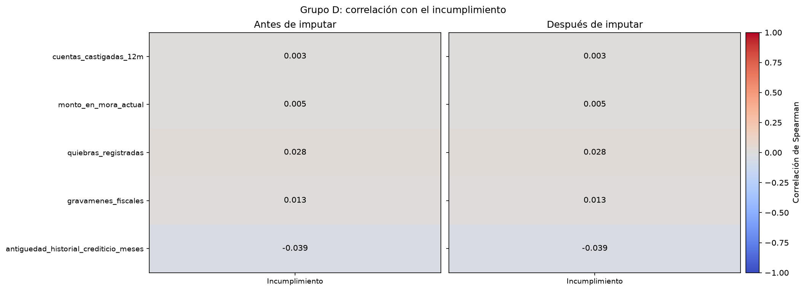

*Figura 11. Grupo D: correlación de Spearman con el incumplimiento antes y después de imputar. Fuente: elaboración propia; [notebook 04](../notebooks/04_exploracion_completa.ipynb), comparación de correlaciones.*

Las Figuras 10 y 11 presentan asociaciones más cercanas a cero. Entre ellas, la utilización del crédito revolvente registra una correlación positiva de 0.053, mientras que la antigüedad del historial crediticio presenta una correlación negativa de −0.039. Las demás características muestran asociaciones de menor magnitud, lo que sugiere relaciones monotónicas individuales débiles con el incumplimiento.

Al comparar los cuatro grupos, se observa que las correlaciones antes y después de la imputación descriptiva presentan diferencias muy pequeñas a la precisión mostrada. Esto sugiere que la imputación no modificó sustancialmente la interpretación general de las asociaciones individuales. Sin embargo, no demuestra que la información ausente haya sido reconstruida correctamente ni que la imputación carezca de efectos sobre modelos multivariados.

En conjunto, los resultados evidencian que ninguna de las características analizadas presenta una correlación monotónica individual especialmente elevada con el incumplimiento. Esto no descarta su utilidad predictiva, ya que los modelos pueden aprovechar relaciones no lineales y combinaciones entre variables que no quedan reflejadas en estos coeficientes.

### 5.2. Diagramas de caja antes y después de imputar

Para complementar el análisis de correlaciones, se examinaron las distribuciones de seis características numéricas: monto del préstamo, ingreso anual, relación deuda/ingreso, saldo del crédito revolvente, límite inferior del puntaje FICO y porcentaje de utilización del crédito revolvente.

Se compararon sus diagramas de caja antes y después de aplicar la imputación descriptiva por mediana. En esta exploración, las medianas se calcularon sobre los datos de entrenamiento y validación conjuntamente, con el propósito exclusivo de analizar las distribuciones. Este procedimiento no corresponde al preprocesamiento utilizado durante el entrenamiento predictivo, donde las medianas se calculan únicamente con los datos de entrenamiento de cada corte temporal.

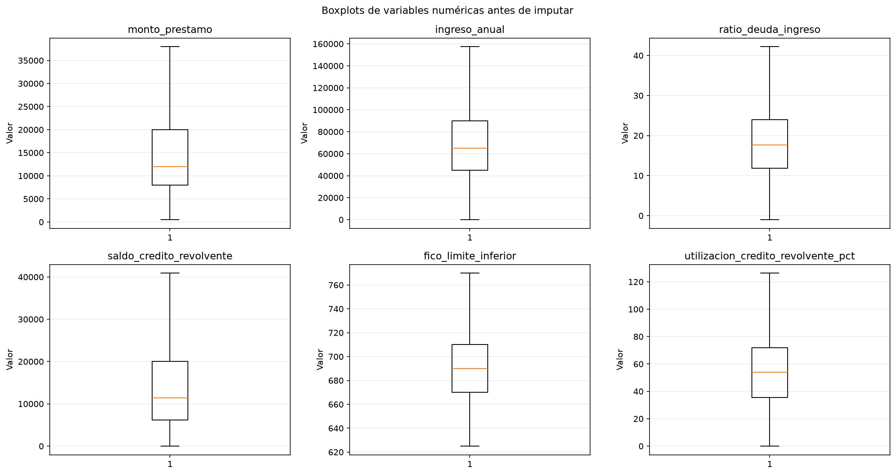

*Figura 12. Distribución de seis variables numéricas del conjunto de desarrollo antes de la imputación descriptiva. Los puntos individuales fuera de los bigotes se ocultan para facilitar la lectura. Fuente: elaboración propia; [notebook 04](../notebooks/04_exploracion_completa.ipynb), diagramas de caja.*


*Figura 13. Las mismas variables después de completar sus faltantes con medianas calculadas sobre entrenamiento y validación. Fuente: elaboración propia; [notebook 04](../notebooks/04_exploracion_completa.ipynb), diagramas de caja.*

Las Figuras 12 y 13 muestran que las medianas y los rangos intercuartílicos de las variables representadas mantienen una apariencia muy similar antes y después de imputar. Esto sugiere que el procedimiento no modificó de manera visualmente importante las principales características de estas distribuciones, aunque pueden existir diferencias que no sean apreciables a la escala utilizada.

Es importante señalar que los diagramas ocultan los valores individuales considerados atípicos para evitar la saturación gráfica. Por tanto, los extremos de los bigotes no representan necesariamente los valores mínimos y máximos observados, y su visualización no demuestra la ausencia de outliers. Asimismo, reemplazar valores faltantes por la mediana no garantiza recuperar la variabilidad original ni corregir posibles errores en los datos.

En conjunto, el análisis exploratorio muestra asociaciones individuales relativamente débiles con el incumplimiento y distribuciones que, para las características representadas, presentan pocos cambios visuales después de la imputación descriptiva. Estos resultados sirven como diagnóstico de los datos, pero no sustituyen la evaluación de las transformaciones y características mediante modelos entrenados y validados temporalmente.

### 5.3. Detección de valores extremos mediante el rango intercuartílico

El notebook también aplica la regla del rango intercuartílico (IQR) a cada variable numérica, antes y después de la imputación descriptiva. Según esa regla, se señalan valores inferiores a `Q1 − 1.5 × IQR` o superiores a `Q3 + 1.5 × IQR`. Entre las variables con mayor proporción señalada figuran el saldo de crédito revolvente (5.81%), las consultas de crédito en los últimos seis meses (5.63%) y el ingreso anual (4.68%). Antes de imputar, esos porcentajes se calculan sobre los valores observados; después, sobre los valores completos.

La regla identifica valores extremos respecto de la distribución, pero no confirma que sean errores. Los diagramas ocultan los puntos individuales fuera de los bigotes, por lo que las figuras no permiten contarlos visualmente; para eso se utiliza la tabla IQR del notebook. **No se eliminaron filas por este diagnóstico**, y no se aplicó un método multivariable para descartar préstamos.

## 6. Estrategia de partición y validación

### 6.1. Separación temporal

El objetivo es comparar cómo se comportan modelos entrenados con préstamos de años anteriores al aplicarlos a un año posterior. Una división aleatoria mezclaría información de periodos con cobertura y condiciones distintas y respondería otra pregunta. Se utiliza validación temporal expansiva: el entrenamiento crece y cada validación corresponde al siguiente año. La aleatoriedad de la búsqueda de hiperparámetros no cambia esta partición. La distinción entre selección y evaluación, así como las precauciones para datos ordenados en el tiempo, se apoya en scikit-learn developers (s. f.-b), [guía de validación cruzada](https://scikit-learn.org/1.8/modules/cross_validation.html).

| Corte | Entrenamiento por originación | n entrenamiento | Validación | n validación |
| --- | --- | --- | --- | --- |
| 1 | 2007–2012 | 93,153 | 2013 | 134,804 |
| 2 | 2007–2013 | 227,957 | 2014 | 223,102 |
| 3 | 2007–2014 | 451,059 | 2015 | 375,545 |
| 4 | 2007–2015 | 826,604 | 2016 | 293,095 |

Fuente: tablas de preparación temporal y [resultados de optimización por corte](../outputs/optimizacion_final/resultados_por_configuracion_y_corte.csv). Cada configuración se compara sobre las mismas observaciones de validación. Dentro de cada corte se estiman desde cero selección de variables, medianas, vocabularios y escaladores. No se calcula una mediana independiente de validación para aplicársela a sí misma. Los valores de ROC-AUC y AP se promedian por separado entre los cuatro años, asignando el mismo peso a cada año de validación. La dispersión entre años describe variación temporal y no constituye un intervalo de confianza del promedio.

### 6.2. Separación para calibración y ajuste definitivo

La calibración requiere datos que no hayan servido para ajustar el modelo base. Esta separación y la interpretación de curvas por frecuencias siguen la [guía de calibración](https://scikit-learn.org/1.8/modules/calibration.html) de scikit-learn developers (s. f.-c). En su comparación temporal se reserva el año inmediatamente anterior a cada validación para aprender la transformación de calibración:

| Validación evaluada | Ajuste base | n base | Ajuste de calibración | n calibración |
| --- | --- | --- | --- | --- |
| 2013 | 2007–2011 | 39,786 | 2012 | 53,367 |
| 2014 | 2007–2012 | 93,153 | 2013 | 134,804 |
| 2015 | 2007–2013 | 227,957 | 2014 | 223,102 |
| 2016 | 2007–2014 | 451,059 | 2015 | 375,545 |

El ajuste definitivo entrena el modelo base y su preprocesamiento con 2007–2015 (826,604), aprende la calibración con 2016 (293,095) y utiliza 2017–2018 (225,611 elegibles) como test histórico. La regla de características final se aprende con 2007–2015, sin seleccionar usando 2016 ni test. El modelo no se reajusta incluyendo 2016 después de calibrar, pues cambiaría el estimador al que se aplicó esa calibración.

### 6.3. Alcance de la evidencia temporal

La división utiliza el año de originación, no una fecha conocida de cierre de cada etiqueta. Un préstamo de 2012 puede alcanzar su desenlace después de 2013; sin auditar esa fecha no se puede afirmar una simulación estricta de toda la información disponible en tiempo real. Además, algunas pruebas iniciales ya reportaron métricas de 2017–2018. La búsqueda posterior no utiliza test para seleccionar configuraciones, pero el periodo no fue completamente desconocido durante toda la investigación. Los resultados finales son retrospectivos y requieren una evaluación externa o prospectiva.

## 7. Baselines

### 7.1. Baselines sobre el conjunto de desarrollo completo

Los modelos de referencia permiten establecer qué rendimiento deben superar los modelos posteriores bajo las mismas condiciones de evaluación. Este experimento utiliza el conjunto de desarrollo completo: **1,119,699 préstamos elegibles otorgados entre 2007 y 2016**, con resultado `Fully Paid` (0) o `Charged Off` (1). Se aplican los cuatro cortes temporales expansivos descritos en la sección 6: entrenamiento 2007–2012 y validación 2013; entrenamiento 2007–2013 y validación 2014; entrenamiento 2007–2014 y validación 2015; y entrenamiento 2007–2015 y validación 2016. Las cifras de esta sección proceden de esas validaciones, sin evaluar el periodo de prueba de 2017 en adelante.

Se emplea la lista fija de **26 características** seleccionadas en la [exploración completa](../notebooks/04_exploracion_completa.ipynb), por tener menos del 10% de faltantes entre los préstamos elegibles hasta 2012. Esta selección prioriza la disponibilidad de información desde el primer corte; no demuestra que las 26 sean las características más predictivas posibles. La lista incluye:

| Tipo de entrada | Características seleccionadas |
| --- | --- |
| Numéricas: préstamo e ingresos | Monto del préstamo, plazo en meses, ingreso anual y relación deuda/ingreso. |
| Numéricas: historial, cuentas y saldos | Moras en los últimos dos años, límites inferior y superior FICO, consultas de crédito en seis meses, líneas de crédito abiertas, registros públicos adversos, saldo de crédito revolvente, utilización del crédito revolvente, total de líneas de crédito, cuentas en mora actual, monto en mora actual, cobranzas no médicas en doce meses, cuentas castigadas en doce meses, quiebras registradas y gravámenes fiscales. |
| Categóricas | Antigüedad laboral, tenencia de vivienda, verificación de ingresos, propósito del préstamo, estado de residencia y tipo de solicitud. |
| Fecha transformada | Fecha de la primera línea de crédito, convertida en antigüedad del historial al otorgarse el préstamo. |

Las 26 características de entrada se distinguen de las columnas resultantes de la codificación y de los indicadores de ausencia. En cada corte se calcula la mediana solo con entrenamiento y se utiliza para completar sus variables numéricas y las de validación. Las categorías ausentes se completan con `Sin información`; la codificación One-Hot y el escalado se ajustan también exclusivamente con entrenamiento. Esta preparación se reconstruye para cada corte y no utiliza la copia imputada con fines descriptivos del notebook 04.

Se comparan un clasificador de clase mayoritaria (`DummyClassifier`, estrategia `most_frequent`) y dos variantes de regresión logística regularizada, con `C=1.0`, `solver="lbfgs"`, `max_iter=2000` y semilla 42. Una variante utiliza mediana sola; la otra añade, antes de imputar, un indicador binario por cada variable numérica con faltantes en el entrenamiento del corte. Los indicadores se aplican con las mismas columnas y orden a validación. Las dos variantes conservan las mismas observaciones y los mismos hiperparámetros.

El clasificador mayoritario siempre predice `Fully Paid`. Sus puntuaciones constantes producen ROC-AUC 0.5 y AP igual a la proporción de incumplimientos en cada año. Su exactitud media es **80.62%**, aunque su recall y F1 para `Charged Off` son cero: no detecta ningún incumplimiento. La exactitud elevada refleja el predominio de préstamos pagados.

| Modelo | ROC-AUC medio | Desv. estándar ROC-AUC | AP media | Desv. estándar AP |
| --- | ---: | ---: | ---: | ---: |
| Clase mayoritaria | 0.500000 | 0.000000 | 0.193784 | 0.032181 |
| Regresión logística sin indicadores | 0.692500 | 0.018358 | 0.348090 | 0.064882 |
| Regresión logística con indicadores | 0.692569 | 0.018329 | 0.348197 | 0.064685 |

Los valores son promedios aritméticos de los cuatro años, sin ponderarlos por el tamaño de cada validación. Las desviaciones estándar describen la variación entre años; no son intervalos de confianza. Fuente: [resumen de modelos](../outputs/entrenamiento_26_variables/resumen_modelos_validacion.csv) y [métricas por corte](../outputs/entrenamiento_26_variables/metricas_validacion_temporal.csv). La ejecución está documentada actualmente en el [notebook 06](../notebooks/06_entrenamiento_busqueda_inicial.ipynb), con las funciones de [entrenamiento inicial](../src/entrenamiento_inicial.py) y [modelado](../src/modelado.py).

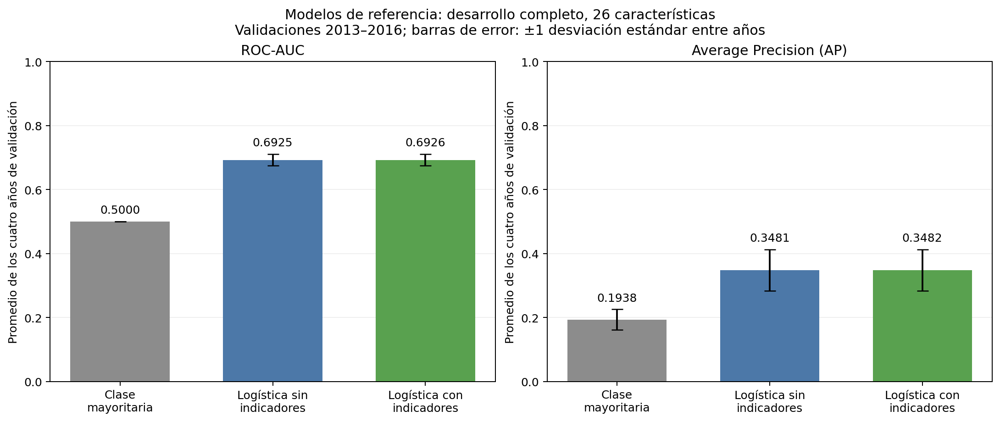

*Figura 14. Promedio y desviación estándar entre las validaciones de 2013 a 2016, con 26 características. Fuente: elaboración propia; [notebook 06](../notebooks/06_entrenamiento_busqueda_inicial.ipynb) y [resultados de los baselines](../outputs/entrenamiento_26_variables/resumen_modelos_validacion.csv).*


La Figura 14 muestra que ambas variantes de regresión logística superan al clasificador de clase mayoritaria en ROC-AUC y Average Precision. Sin embargo, sus rendimientos promedio son prácticamente idénticos, por lo que incorporar indicadores de valores faltantes no produjo una mejora relevante en esta etapa. Las barras de error representan una desviación estándar entre los cuatro años de validación, no intervalos de confianza. La AP presenta una mayor desviación estándar numérica que ROC-AUC, lo que debe interpretarse considerando que la proporción de incumplimientos también cambia entre años. En consecuencia, los resultados evidencian capacidad discriminativa superior a la referencia trivial, pero no permiten establecer una ventaja significativa entre las dos variantes logísticas.

### 7.2. Interpretación de los baselines

La regresión logística supera la referencia constante en ambas métricas. Sin indicadores, el ROC-AUC medio pasa de 0.500000 a 0.692500 y la AP de 0.193784 a 0.348090. Esto muestra capacidad para ordenar los préstamos según su riesgo de incumplimiento, aunque persiste un solapamiento considerable entre las puntuaciones de las dos clases.

ROC-AUC resume la capacidad de asignar mayor puntuación a un préstamo incumplido que a uno pagado al comparar pares de ambas clases. Average Precision resume la relación entre precisión y cobertura de los incumplimientos a distintos niveles de riesgo, y depende de la proporción de esa clase. Por ello, sus valores no se interpretan como porcentajes de aciertos ni como probabilidades individuales. En los CSV, AP aparece bajo el nombre `pr_auc`; corresponde a Average Precision. La diferencia de escala entre ROC-AUC y AP no implica que una métrica contradiga a la otra.

Añadir indicadores aumenta el ROC-AUC medio en **0.000069** y la AP media en **0.000107**. Son diferencias muy pequeñas y no acreditan una mejora estadísticamente significativa. La Figura 14 muestra resultados prácticamente iguales entre las variantes; las barras representan variación anual, no una prueba estadística de su diferencia.

| Año de validación | ROC-AUC sin indicadores | ROC-AUC con indicadores | AP sin indicadores | AP con indicadores |
| --- | ---: | ---: | ---: | ---: |
| 2013 | 0.668978 | 0.669081 | 0.261834 | 0.262247 |
| 2014 | 0.694840 | 0.694958 | 0.334621 | 0.334667 |
| 2015 | 0.713768 | 0.713793 | 0.393766 | 0.393845 |
| 2016 | 0.692416 | 0.692445 | 0.402140 | 0.402031 |

Fuente: [métricas de validación temporal](../outputs/entrenamiento_26_variables/metricas_validacion_temporal.csv).

El ROC-AUC de la regresión logística sin indicadores varía entre 0.668978 en 2013 y 0.713768 en 2015, con una desviación estándar de 0.018358. Por su parte, la AP oscila entre 0.261834 y 0.402140, con una desviación estándar de 0.064882. Esta variabilidad debe interpretarse considerando también los cambios en la proporción de incumplimientos, que aumenta del 15.60 % en la validación de 2013 al 23.28 % en la de 2016. La incorporación de indicadores produce mejoras mínimas de ROC-AUC en los cuatro años, mientras que en AP la diferencia resulta ligeramente negativa en 2016. Por tanto, no se observa una mejora relevante y uniforme asociada a este tratamiento.

Estos modelos presentan limitaciones. La regresión logística representa una combinación lineal de características en la escala de los **log-odds del incumplimiento**, por lo que no captura automáticamente relaciones no lineales ni interacciones complejas entre variables. Asimismo, el criterio restrictivo de selección de características puede excluir información predictiva útil, mientras que las probabilidades estimadas requieren una evaluación específica de calibración antes de considerarse fiables.

Además, una mayor capacidad para ordenar los préstamos según su riesgo no garantiza una detección adecuada de los incumplimientos con un umbral fijo. Al utilizar un umbral de 0.5, la regresión logística sin indicadores alcanza un recall medio de apenas **1.92 %**, lo que evidencia que identifica una proporción reducida de los préstamos incumplidos. Este umbral se empleó como referencia descriptiva y no fue optimizado en el experimento. En conjunto, los resultados establecen un punto de partida reproducible para evaluar modelos más complejos en la sección 8, manteniendo la validación temporal como criterio de comparación. No obstante, estos resultados constituyen evidencia retrospectiva y no garantizan el mismo comportamiento en préstamos futuros.


## 8. Modelos entrenados

Después de establecer los baselines, se evaluaron diferentes algoritmos de clasificación para determinar si modelos con mayor capacidad de representación podían mejorar la predicción del incumplimiento.

La comparación inicial utilizó el conjunto de desarrollo completo de 2007–2016, las 26 características seleccionadas mediante el criterio de cobertura histórica y los cuatro cortes de validación temporal descritos en la sección 6. Se entrenaron regresión logística, árbol de decisión, SVM lineal e HistGradientBoosting.

Para comparar las familias bajo condiciones equivalentes, la siguiente tabla presenta los resultados con imputación por mediana y sin indicadores adicionales de valores faltantes.

| Modelo | ROC-AUC medio | AP media |
| --- | ---: | ---: |
| Regresión logística | 0.692500 | 0.348090 |
| Árbol de decisión | 0.670851 | 0.320136 |
| SVM lineal | 0.691645 | 0.346396 |
| HistGradientBoosting | 0.695357 | 0.350897 |

*Fuente: elaboración propia; [resultados de entrenamiento con 26 características](../outputs/entrenamiento_26_variables/resumen_modelos_validacion.csv) y [notebook 06](../notebooks/06_entrenamiento_busqueda_inicial.ipynb).*

Los valores corresponden a promedios aritméticos de las validaciones de 2013 a 2016, no a métricas calculadas sobre el conjunto de prueba. Esta comparación permite analizar diferencias entre algoritmos bajo una misma selección de características y estrategia temporal.

### 8.1. Regresión logística

La regresión logística se utilizó como modelo lineal de referencia y se mantuvo como una de las tres familias evaluadas en las etapas finales. Su funcionamiento consiste en aprender una combinación lineal de características en la escala de los log-odds del incumplimiento, transformada posteriormente en una probabilidad mediante la función logística.

El modelo incorpora regularización controlada por el hiperparámetro `C`, escalado de variables numéricas y codificación de características categóricas. Su principal ventaja es que permite examinar los coeficientes del modelo y ofrece una referencia de complejidad relativamente baja.

En la comparación inicial con 26 características obtuvo un ROC-AUC medio de 0.692500 y una AP media de 0.348090. Estos resultados superaron al clasificador de clase mayoritaria, aunque también evidenciaron limitaciones para detectar incumplimientos cuando se utilizó un umbral fijo de 0.5, como se explicó en la sección 7.

Aunque la regresión logística no representa automáticamente relaciones no lineales ni interacciones complejas, su rendimiento y capacidad de interpretación justificaron conservarla durante la optimización y calibración posteriores.

### 8.2. Árbol de decisión

El árbol de decisión clasifica las observaciones mediante divisiones sucesivas del espacio de características. Cada división establece una condición sobre una variable y permite formar grupos de préstamos con diferentes distribuciones de incumplimiento.

A diferencia de la regresión logística, este algoritmo puede representar relaciones no lineales e interacciones mediante sus particiones. Sin embargo, un árbol excesivamente complejo puede ajustarse a particularidades del entrenamiento y presentar dificultades para generalizar.

Para controlar su complejidad, la configuración inicial del conjunto completo utilizó restricciones como `max_depth=6` y `min_samples_leaf=0.005`, que limitan la profundidad y exigen una proporción mínima de observaciones por hoja.

En las cuatro validaciones temporales, el árbol obtuvo un ROC-AUC medio de 0.670851 y una AP media de 0.320136. Ambos valores fueron inferiores a los de la regresión logística comparable, por lo que el árbol individual no ofreció una mejora predictiva en esta etapa.

Este resultado no significa que las relaciones no lineales carezcan de utilidad. Un árbol individual tiene limitaciones de representación y estabilidad, mientras que los métodos de ensamble pueden combinar múltiples árboles para construir funciones predictivas más flexibles.

Por ello, el árbol de decisión se conservó como referencia experimental, pero no fue incluido entre las tres familias seleccionadas para la calibración final.

### 8.3. HistGradientBoosting

HistGradientBoosting es un método de ensamble que construye árboles de manera secuencial. Cada nueva etapa busca mejorar la función predictiva desarrollada por las anteriores, permitiendo modelar relaciones no lineales e interacciones entre características.

A diferencia de un árbol individual, el ensamble combina múltiples estructuras de partición. Su implementación utiliza histogramas para agrupar valores numéricos y reducir el costo computacional asociado con la búsqueda de divisiones.

En la comparación inicial con 26 características, HistGradientBoosting obtuvo un ROC-AUC medio de 0.695357 y una AP media de 0.350897, alcanzando los mejores promedios entre las cuatro familias evaluadas.

No obstante, la ventaja respecto a la regresión logística fue reducida: aproximadamente 0.00286 puntos de ROC-AUC y 0.00281 de AP. Estas diferencias no permiten afirmar por sí solas una superioridad estadísticamente significativa.

Los resultados justificaron continuar evaluando este algoritmo con diferentes configuraciones y conjuntos de características, sin considerar que el rendimiento inicial garantizara un mejor comportamiento en todos los periodos.

Posteriormente, HistGradientBoosting se mantuvo como candidato principal en la búsqueda de hiperparámetros, el análisis de calibración y la evaluación histórica final.

### 8.4. SVM lineal

La máquina de vectores de soporte lineal (SVM) busca un hiperplano de separación entre las clases mediante un criterio de margen regularizado. En este proyecto se utilizó `LinearSVC`, que constituye una alternativa lineal a la regresión logística.

La regularización se controla mediante el hiperparámetro `C`. A diferencia de la regresión logística, `LinearSVC` no proporciona probabilidades directamente mediante `predict_proba`, sino puntuaciones continuas obtenidas con `decision_function`.

Estas puntuaciones permiten evaluar la capacidad de ordenamiento mediante ROC-AUC y Average Precision, pero no deben interpretarse directamente como probabilidades de incumplimiento.

En la comparación inicial con 26 características, la SVM lineal obtuvo un ROC-AUC medio de 0.691645 y una AP media de 0.346396, resultados próximos a los de la regresión logística y ligeramente inferiores a los de HistGradientBoosting.

La similitud entre ambos modelos lineales muestra que, bajo la representación inicial utilizada, sus capacidades discriminativas fueron comparables. Sin embargo, estos resultados no permiten concluir que ambos algoritmos produzcan las mismas puntuaciones, decisiones o probabilidades.

La SVM lineal se mantuvo como candidata final para analizar si una función de margen, combinada con calibración posterior, podía ofrecer un comportamiento competitivo frente a la regresión logística y el ensamble.

### 8.5. Comparación de las familias y candidatos finales

La primera comparación sobre el conjunto completo permitió identificar diferencias entre las familias de modelos. HistGradientBoosting obtuvo los mejores promedios de ROC-AUC y AP, seguido por la regresión logística y la SVM lineal, mientras que el árbol individual presentó un rendimiento inferior.

Sin embargo, esta etapa utilizaba una selección restrictiva de 26 características, establecida a partir de su disponibilidad histórica. Por ello, los resultados no representaban necesariamente el máximo rendimiento alcanzable por cada algoritmo.

Las etapas posteriores ampliaron el análisis de características y evaluaron distintos umbrales de valores faltantes. Finalmente, se adoptó un criterio de selección de hasta el 50 % de faltantes en el entrenamiento de cada corte, junto con la optimización de hiperparámetros.

Las tres familias seleccionadas para la evaluación final fueron:

- Regresión logística.
- SVM lineal.
- HistGradientBoosting.

La siguiente tabla resume los resultados de las configuraciones seleccionadas mediante validación temporal y su posterior evaluación histórica calibrada.

| Modelo | ROC-AUC medio en validación temporal | ROC-AUC test calibrado | AP test calibrada | Brier Score test |
| --- | ---: | ---: | ---: | ---: |
| Regresión logística | 0.702351 | 0.692591 | 0.360386 | 0.155911 |
| SVM lineal | 0.702212 | 0.691777 | 0.359876 | 0.155972 |
| HistGradientBoosting | 0.710493 | 0.703213 | 0.377905 | 0.153642 |

*Fuente: elaboración propia; [optimización final](../outputs/optimizacion_final/resumen_todas_configuraciones.csv) y [evaluación histórica final](../outputs/evaluacion_final/metricas_finales_test.csv).*

Es importante distinguir las dos etapas de esta tabla. Los valores medios de validación temporal corresponden a la búsqueda de configuraciones sobre los cuatro cortes de 2013–2016, mientras que las métricas del test corresponden al ajuste definitivo de cada modelo con los préstamos de 2007–2015, calibración en 2016 y evaluación sobre 225,611 préstamos elegibles de 2017–2018.

En el ajuste definitivo se seleccionaron 60 características originales, transformadas en 136 columnas después del preprocesamiento. Estas cifras no deben confundirse con las 26 características utilizadas en el experimento inicial sobre el desarrollo completo. La selección de variables se ajustó con el entrenamiento correspondiente y no incorporó observaciones futuras para determinar las características de cada corte.

Los tres modelos finales utilizaron calibración sigmoide. HistGradientBoosting obtuvo el mayor ROC-AUC y AP en el test histórico, además del menor Brier Score entre las alternativas presentadas. Estos resultados respaldan su elección como modelo principal dentro de las configuraciones evaluadas.

No obstante, el rendimiento final depende conjuntamente de la selección de características, el preprocesamiento, los hiperparámetros y la calibración. Por tanto, las diferencias entre las etapas no pueden atribuirse exclusivamente al algoritmo utilizado.

En conjunto, esta comparación muestra la evolución desde modelos de referencia con una representación restrictiva hasta tres candidatos optimizados. La sección 9 detalla el procedimiento de búsqueda de hiperparámetros, mientras que las secciones posteriores desarrollan la calibración, la evaluación final y la interpretación de los resultados.


## 9. Búsqueda de hiperparámetros

La búsqueda de hiperparámetros tuvo como objetivo identificar configuraciones que mejoraran la capacidad discriminativa de los modelos, manteniendo una evaluación temporal consistente. A diferencia del entrenamiento de referencia, esta etapa exploró diferentes niveles de regularización y complejidad para las tres familias seleccionadas: regresión logística, SVM lineal e HistGradientBoosting.

El procedimiento se desarrolló en dos fases. Primero, se realizó una búsqueda aleatoria utilizando las 26 características seleccionadas en la exploración completa. Posteriormente, tras evaluar diferentes criterios de disponibilidad de variables, se ejecutó una optimización definitiva con un umbral máximo del 50 % de faltantes en el entrenamiento de cada corte. Ambas etapas utilizaron los cuatro años de validación de 2013 a 2016, sin utilizar el conjunto de prueba para seleccionar hiperparámetros.

### 9.1. Primera búsqueda aleatoria con 26 características

La primera búsqueda de hiperparámetros se realizó sobre el conjunto de desarrollo completo, utilizando las 26 características seleccionadas mediante el criterio de cobertura histórica hasta 2012. Esta representación permitió comparar configuraciones bajo las mismas condiciones de preprocesamiento y validación temporal empleadas en el entrenamiento de referencia.

Se evaluaron diez configuraciones para cada una de las tres familias de modelos, mediante los cuatro cortes temporales expansivos. En los modelos lineales se exploraron distintos valores de regularización `C` y opciones de ponderación de clases (`class_weight`). Para HistGradientBoosting se evaluaron combinaciones de tasa de aprendizaje (`learning_rate`), número de iteraciones (`max_iter`), número máximo de hojas (`max_leaf_nodes`), mínimo de observaciones por hoja (`min_samples_leaf`) y regularización L2.

Los resultados de las mejores configuraciones encontradas fueron los siguientes:

| Modelo | ROC-AUC de referencia | ROC-AUC optimizado | AP optimizada |
| --- | ---: | ---: | ---: |
| Regresión logística | 0.692500 | 0.692725 | 0.348441 |
| SVM lineal | 0.691645 | 0.692552 | 0.347719 |
| HistGradientBoosting | 0.695357 | 0.699985 | 0.355088 |

*Fuente: elaboración propia; [comparación de configuraciones](../outputs/hiperparametros_randomized_26_variables/comparacion_con_originales.csv) y [mejores hiperparámetros](../outputs/hiperparametros_randomized_26_variables/mejores_parametros_por_modelo.csv).*

HistGradientBoosting obtuvo el mayor ROC-AUC medio (0.699985) y la mayor AP media (0.355088). Su configuración seleccionada utilizó `learning_rate=0.0811844`, `max_iter=182`, `max_leaf_nodes=31`, `min_samples_leaf=46` y `l2_regularization=0.328775`. Frente a su configuración inicial, el ROC-AUC medio aumentó aproximadamente 0.00463, mientras que las mejoras de regresión logística y SVM lineal fueron menores.

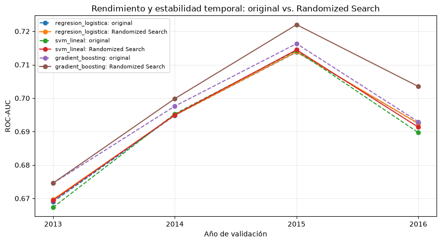

*Figura 15. Comparación del ROC-AUC por año de validación entre las configuraciones originales y las seleccionadas mediante búsqueda aleatoria con 26 características. Fuente: elaboración propia; [notebook 06](../notebooks/06_entrenamiento_busqueda_inicial.ipynb) y [resultados de la búsqueda inicial](../outputs/hiperparametros_randomized_26_variables/comparacion_por_anio.csv).*

La Figura 15 muestra que el rendimiento varía entre años, incluso después de seleccionar nuevos hiperparámetros. HistGradientBoosting presenta una mejora especialmente visible en 2016, mientras que las diferencias entre las configuraciones originales y optimizadas de los modelos lineales son reducidas. Asimismo, las tres familias alcanzan sus mayores ROC-AUC en 2015 dentro de esta comparación.

Estos resultados muestran que la búsqueda aleatoria permitió mejorar el rendimiento de algunas configuraciones, pero no eliminó las diferencias temporales. Además, la utilización de solo 26 características restringía la información disponible para los modelos.

Por ello, esta primera búsqueda se utilizó como referencia para los análisis posteriores de selección e imputación de variables, manteniendo configuraciones constantes cuando era necesario aislar el efecto del preprocesamiento.

### 9.2. Optimización final con un umbral del 50 % de faltantes

Después de comparar diferentes umbrales de disponibilidad de características, se adoptó un límite del 50 % de valores faltantes, calculado exclusivamente con el entrenamiento de cada corte temporal. Este criterio permitió incorporar características adicionales respecto al conjunto inicial de 26 variables, sin utilizar la disponibilidad de información de los años de validación para decidir cuáles conservar.

La selección de características se reajustó en cada corte, por lo que el número de variables utilizadas podía cambiar según el periodo de entrenamiento. En esta etapa se obtuvo un promedio de 51.5 características originales por corte, frente a las 26 características fijas empleadas en la búsqueda anterior.

La optimización definitiva utilizó `ParameterSampler` para generar configuraciones y evaluarlas explícitamente sobre los cuatro cortes temporales. Este procedimiento sigue el principio de exploración aleatoria del espacio de hiperparámetros descrito en la documentación de [RandomizedSearchCV](https://scikit-learn.org/1.8/modules/generated/sklearn.model_selection.RandomizedSearchCV.html), aunque la evaluación temporal se implementó de manera explícita.

Se evaluaron ocho configuraciones aleatorias para regresión logística, ocho para SVM lineal y diez para HistGradientBoosting. Además, se incorporó una configuración de referencia por familia, obteniéndose **29 configuraciones y 116 evaluaciones configuración–corte**.

Para los modelos lineales se exploraron diferentes valores de `C`, políticas de ponderación de clases y tolerancias de convergencia. En HistGradientBoosting se evaluaron combinaciones de tasa de aprendizaje, iteraciones, número máximo de hojas, mínimo de observaciones por hoja y regularización L2. Los valores efectivamente evaluados se encuentran documentados en los archivos de resultados.

El criterio principal de selección fue el **ROC-AUC medio de los cuatro años de validación**. Como medidas complementarias se analizaron Average Precision (AP) y la desviación estándar entre años, sin combinarlas mediante una ponderación arbitraria. Todas las transformaciones del preprocesamiento se ajustaron exclusivamente sobre el entrenamiento correspondiente.

Las configuraciones seleccionadas fueron las siguientes:

| Modelo | Hiperparámetros seleccionados | ROC-AUC medio | AP media | Desv. ROC-AUC |
| --- | --- | ---: | ---: | ---: |
| Regresión logística | `C=0.031489`; `class_weight=None`; `tol=0.00008662` | 0.702351 | 0.359482 | 0.023706 |
| SVM lineal | `C=0.010054`; `class_weight=balanced`; `tol=0.0001` | 0.702212 | 0.358570 | 0.024140 |
| HistGradientBoosting | `learning_rate=0.052791`; `max_iter=200`; `max_leaf_nodes=25`; `min_samples_leaf=31`; `L2=9.149846` | 0.710493 | 0.369530 | 0.024566 |

*Fuente: elaboración propia; [resumen de configuraciones](../outputs/optimizacion_final/resumen_todas_configuraciones.csv) y [configuración reproducible](../outputs/optimizacion_final/configuracion_reproducible.json).*

La ejecución conservó la semilla 42 y las opciones de implementación correspondientes a cada familia: regresión logística con `solver="lbfgs"`, SVM lineal con `dual="auto"` e HistGradientBoosting con `early_stopping=False`. Esta última decisión evitó introducir una partición interna aleatoria para la parada temprana del ensamble.

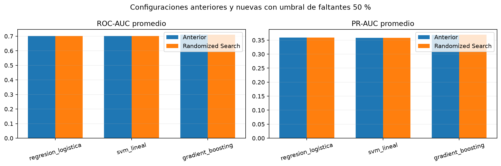

*Figura 16. Comparación del rendimiento de las configuraciones de referencia y las seleccionadas mediante la optimización final. Fuente: elaboración propia; [notebook 09](../notebooks/09_optimizacion_final.ipynb) y [comparación de configuraciones](../outputs/optimizacion_final/comparacion_anterior_vs_mejor.csv).*

La Figura 16 muestra que la optimización final produjo mejoras pequeñas respecto a las configuraciones de referencia evaluadas bajo el mismo esquema del 50 % de faltantes. En regresión logística, el ROC-AUC medio aumentó 0.000164; en SVM lineal se mantuvo la configuración anterior; y en HistGradientBoosting aumentó 0.000065, acompañado de una mejora de 0.000837 en AP.

Estos incrementos indican que las configuraciones seleccionadas ofrecieron el mayor ROC-AUC medio dentro del espacio evaluado, pero no constituyen evidencia de una mejora estadísticamente significativa ni garantizan beneficios operativos. Asimismo, los resultados no permiten atribuir las diferencias respecto a la primera búsqueda exclusivamente a los hiperparámetros, ya que también cambió el criterio de selección de características.

Para examinar la estabilidad temporal, se compararon las métricas de las configuraciones elegidas en cada año de validación:

| Año de validación | ROC logística | AP logística | ROC SVM | AP SVM | ROC HGB | AP HGB |
| --- | ---: | ---: | ---: | ---: | ---: | ---: |
| 2013 | 0.670098 | 0.263533 | 0.669406 | 0.262263 | 0.676775 | 0.268515 |
| 2014 | 0.705529 | 0.348549 | 0.705886 | 0.347800 | 0.714561 | 0.358909 |
| 2015 | 0.727206 | 0.408467 | 0.727597 | 0.408145 | 0.735746 | 0.420613 |
| 2016 | 0.706573 | 0.417378 | 0.705960 | 0.416071 | 0.714891 | 0.430082 |

*Fuente: elaboración propia; [comparación por año](../outputs/optimizacion_final/comparacion_por_anio.csv).*

HistGradientBoosting obtuvo el mayor ROC-AUC y la mayor AP entre las tres familias en cada uno de los cuatro años. Sin embargo, el rendimiento no fue uniforme temporalmente: 2013 presentó los menores ROC-AUC y 2015 los mayores para todas las familias.

La AP aumentó entre los años representados, pero esta evolución debe interpretarse considerando los cambios en la prevalencia de incumplimiento. Por tanto, no corresponde atribuirla exclusivamente a una mejora de la capacidad predictiva.


*Figura 17. Comparación del ROC-AUC anual entre las configuraciones anteriores y las seleccionadas en la optimización final. Fuente: elaboración propia; [notebook 09](../notebooks/09_optimizacion_final.ipynb) y [resultados por configuración y corte](../outputs/optimizacion_final/resultados_por_configuracion_y_corte.csv).*

La Figura 17 permite observar que la diferencia entre configuraciones es reducida en los modelos lineales. En regresión logística, la configuración seleccionada mejora ligeramente el ROC-AUC en tres años y empeora mínimamente en 2016. En SVM lineal, la configuración anterior se conserva como la mejor evaluada.

Para HistGradientBoosting, la configuración seleccionada mejora frente a su referencia en 2013 y 2014, pero presenta un rendimiento ligeramente inferior en 2015 y 2016. Esto muestra que el incremento del ROC-AUC promedio no equivale a una mejora en todos los periodos.

En conjunto, la optimización permitió seleccionar configuraciones reproducibles mediante una evaluación temporal común, sin eliminar la variabilidad entre cohortes. Además, el uso reiterado de los mismos cuatro años para tomar decisiones de modelado puede favorecer cierta adaptación a las particularidades de esos periodos.

Por ello, las configuraciones seleccionadas se sometieron posteriormente a calibración y evaluación histórica final, manteniendo separado el periodo de prueba de 2017–2018 durante la búsqueda de hiperparámetros. Los resultados de esta etapa justifican las configuraciones adoptadas, pero no demuestran que sean óptimas fuera del espacio explorado ni garantizan su rendimiento en préstamos futuros.


## 10. Evaluación final

La evaluación final tuvo como objetivo comparar la capacidad discriminativa y la calidad de las probabilidades estimadas por las tres familias seleccionadas: regresión logística, SVM lineal e HistGradientBoosting.

El procedimiento se desarrolló en dos etapas. Primero, se compararon diferentes métodos de calibración utilizando cortes temporales dentro del conjunto de desarrollo. Posteriormente, se entrenaron los modelos definitivos con préstamos de 2007–2015, se ajustaron sus calibradores con datos de 2016 y se evaluaron sobre los préstamos elegibles de 2017–2018.

Esta separación permite examinar tanto la capacidad de ordenar préstamos según su riesgo como la correspondencia entre las probabilidades estimadas y las frecuencias observadas de incumplimiento.

### 10.1. Calibración de probabilidades antes del test

La capacidad discriminativa y la calibración son propiedades diferentes de un modelo predictivo. Un modelo puede ordenar adecuadamente los préstamos según su riesgo y, al mismo tiempo, producir probabilidades sistemáticamente superiores o inferiores a las frecuencias reales de incumplimiento.

Por esta razón, se compararon tres alternativas de salida: probabilidades originales, calibración sigmoide y calibración isotónica. Para regresión logística e HistGradientBoosting se analizaron las probabilidades originales y sus transformaciones; para SVM lineal se calibraron directamente las puntuaciones producidas por `decision_function`, ya que estas no constituyen probabilidades.

La calibración sigmoide ajusta una transformación logística utilizando las puntuaciones del modelo base y las etiquetas observadas en el periodo reservado para calibración. Cuando el modelo genera probabilidades, se aplica previamente una transformación logit con recorte numérico para evitar valores infinitos. En el caso de SVM lineal se utiliza directamente el margen de decisión.

La implementación utiliza `LogisticRegression` como calibrador, con `C=10^6`, `solver="lbfgs"`, `max_iter=2000` y semilla 42. Por su parte, la calibración isotónica aprende una transformación monótona no decreciente, sin imponer una forma logística.

Ambos métodos se ajustaron exclusivamente con datos del periodo de calibración, separado del entrenamiento del modelo base y del año utilizado para evaluar su rendimiento. De esta manera, no se emplearon las etiquetas de evaluación para ajustar las probabilidades.

Las métricas promedio obtenidas en los cuatro cortes temporales fueron las siguientes:

| Modelo y método | ROC-AUC medio | AP media | Brier medio | Log Loss media |
| --- | ---: | ---: | ---: | ---: |
| Logística original | 0.691642 | 0.345394 | 0.144876 | 0.457012 |
| Logística sigmoide | 0.691642 | 0.345388 | 0.144101 | 0.454808 |
| Logística isotónica | 0.691446 | 0.341137 | 0.144083 | 0.456016 |
| SVM sigmoide | 0.691406 | 0.344455 | 0.144141 | 0.454732 |
| SVM isotónica | 0.691128 | 0.340055 | 0.144112 | 0.456202 |
| HGB original | 0.697364 | 0.351983 | 0.144124 | 0.453391 |
| HGB sigmoide | 0.697364 | 0.351983 | 0.143129 | 0.450972 |
| HGB isotónica | 0.697100 | 0.347297 | 0.143202 | 0.452296 |

*Fuente: elaboración propia; [métricas promedio de calibración](../outputs/calibracion_probabilidades/metricas_promedio.csv).*

La selección del método se realizó mediante una regla reproducible. Primero, se conservaron las alternativas cuyo Brier Score se encontraba como máximo 0.001 por encima del mínimo y cuyo ROC-AUC no descendía más de 0.005 respecto al máximo. Entre las alternativas admisibles se seleccionó aquella con menor Log Loss.

Este procedimiento favoreció la **calibración sigmoide en las tres familias**. Aunque la regresión isotónica obtuvo valores de Brier ligeramente inferiores en algunos modelos, estas diferencias fueron reducidas y no compensaron sus resultados según el criterio conjunto establecido.

La transformación sigmoide mantuvo prácticamente inalterado el ROC-AUC, porque conserva el orden de las puntuaciones cuando es estrictamente creciente. En cambio, la calibración isotónica puede producir empates entre observaciones y modificar ligeramente métricas de ordenamiento como ROC-AUC y Average Precision.

Es importante señalar que el ROC-AUC medio de HistGradientBoosting en esta comparación (0.697364) no debe interpretarse directamente como un deterioro respecto al 0.710493 obtenido en la búsqueda de hiperparámetros. Los procedimientos utilizan diferentes conjuntos de entrenamiento: en los experimentos de calibración, el modelo base se entrena con los años anteriores al periodo reservado para calibrar. Por tanto, las diferencias entre ambas etapas no representan exclusivamente el efecto de aplicar calibración.

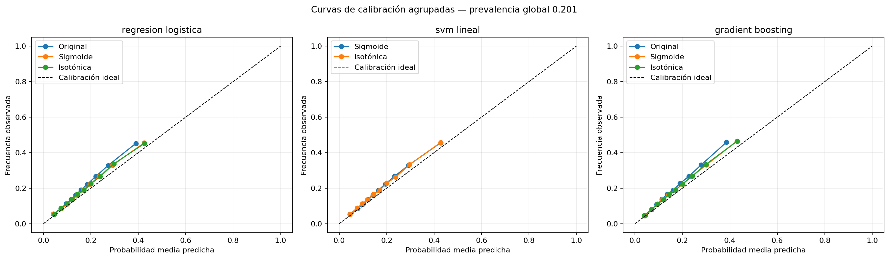

*Figura 18. Comparación de la correspondencia entre probabilidades estimadas y frecuencias observadas durante la evaluación temporal de los métodos de calibración. Fuente: elaboración propia; [notebook 10](../notebooks/10_calibracion.ipynb) y [métricas por modelo, método y año](../outputs/calibracion_probabilidades/metricas_por_modelo_metodo_anio.csv).*

Las curvas de calibración permiten examinar si las probabilidades estimadas coinciden aproximadamente con las frecuencias observadas de incumplimiento. La diagonal representa una correspondencia ideal entre ambas cantidades, mientras que las desviaciones indican diferencias entre riesgo predicho y frecuencia observada en los grupos representados.

Sin embargo, su interpretación depende de la cantidad de observaciones y del método utilizado para agrupar las probabilidades. Por ello, las curvas se analizaron conjuntamente con Brier Score y Log Loss, evitando seleccionar un calibrador únicamente por su apariencia gráfica.

### 10.2. Métricas de evaluación

La evaluación final considera métricas de discriminación y de calidad probabilística. Esta distinción es necesaria porque un modelo puede distinguir adecuadamente entre préstamos pagados e incumplidos sin producir probabilidades suficientemente precisas para su utilización directa.

**ROC-AUC** resume la capacidad discriminativa del modelo a través de diferentes umbrales de clasificación. Puede interpretarse como la probabilidad de que un préstamo incumplido reciba una puntuación mayor que uno pagado, considerando también el tratamiento de los empates. No representa el porcentaje de clasificaciones correctas ni la probabilidad individual de incumplimiento.

**Average Precision (AP)** resume el comportamiento de la precisión a diferentes niveles de recall. Se calcula mediante la suma de los incrementos de recall ponderados por la precisión correspondiente, por lo que no debe confundirse automáticamente con el área trapezoidal de una curva Precision-Recall. Su interpretación es especialmente relevante cuando la clase positiva es minoritaria y debe considerar la prevalencia del incumplimiento.

La definición empleada corresponde a la [documentación de Average Precision de scikit-learn](https://scikit-learn.org/1.8/modules/generated/sklearn.metrics.average_precision_score.html). En los archivos de resultados del proyecto esta métrica aparece identificada como `PR_AUC`.

Para evaluar la calidad de las probabilidades se utilizan dos métricas adicionales:

- **Brier Score:** promedio de las diferencias cuadráticas entre las probabilidades estimadas y las etiquetas reales, calculado como `(p - y)^2`.
- **Log Loss:** pérdida logarítmica que penaliza las probabilidades asignadas al resultado observado, especialmente cuando el modelo produce predicciones muy confiadas pero incorrectas.

En ambas métricas, los valores menores indican un mejor resultado.

Estas medidas evalúan la calidad probabilística en conjunto, no únicamente la calibración aislada. Su valor también depende de la capacidad del modelo para distinguir distintos niveles de riesgo. Por ello, se interpretan conjuntamente con las curvas de calibración, ROC-AUC y Average Precision.

### 10.3. Evaluación histórica final sobre 2017–2018

Después de seleccionar los hiperparámetros y el método de calibración, se realizó el ajuste definitivo de los tres modelos.

El modelo base y su preprocesamiento se entrenaron utilizando **826,604 préstamos elegibles de 2007–2015**. Posteriormente, se ajustó la calibración sigmoide con **293,095 préstamos de 2016**, sin volver a entrenar el modelo base con ese periodo.

Finalmente, los modelos calibrados se evaluaron sobre **225,611 préstamos elegibles de 2017–2018**, distribuidos de la siguiente manera:

- 177,596 préstamos `Fully Paid` (78.72 %).
- 48,015 préstamos `Charged Off` (21.28 %).

La prevalencia exacta de incumplimiento fue 0.212822. Esta población incluye únicamente préstamos con alguno de los dos desenlaces definidos; no representa todos los préstamos originados en esos años. Los estados excluidos se documentan en la [auditoría del conjunto de prueba](../outputs/evaluacion_final/auditoria_estados_test.csv).

Los tres modelos utilizaron las mismas 60 características originales, que dieron lugar a 136 columnas después del preprocesamiento. Asimismo, compartieron el método de calibración sigmoide, lo que permite comparar sus resultados bajo un procedimiento final común.

Las métricas obtenidas fueron las siguientes:

| Modelo | ROC-AUC ↑ | Average Precision ↑ | Brier Score ↓ | Log Loss ↓ |
| --- | ---: | ---: | ---: | ---: |
| Regresión logística | 0.692591 | 0.360386 | 0.155911 | 0.485014 |
| SVM lineal | 0.691777 | 0.359876 | 0.155972 | 0.486804 |
| HistGradientBoosting | 0.703213 | 0.377905 | 0.153642 | 0.474278 |

*Fuente: elaboración propia; [métricas finales del conjunto de prueba](../outputs/evaluacion_final/metricas_finales_test.csv).*

HistGradientBoosting presentó los mejores resultados entre las tres alternativas evaluadas. Respecto a la regresión logística, aumentó el ROC-AUC en aproximadamente 0.01062 y Average Precision en 0.01752. Asimismo, redujo Brier Score en 0.00227 y Log Loss en 0.01074.

Estas diferencias corresponden a valores absolutos de las métricas y no deben interpretarse como incrementos equivalentes en el porcentaje de incumplimientos detectados ni como una cuantificación directa de beneficios económicos.

La SVM lineal presentó resultados muy próximos a la regresión logística, aunque ligeramente inferiores en las cuatro métricas.

#### Capacidad discriminativa: curva ROC


*Figura 19. Comparación de las curvas ROC de regresión logística, SVM lineal e HistGradientBoosting en el conjunto de prueba histórico de 2017–2018. Fuente: elaboración propia; [notebook 11](../notebooks/11_evaluacion_final.ipynb) y [métricas finales](../outputs/evaluacion_final/metricas_finales_test.csv).*

La Figura 19 muestra que los tres modelos presentan curvas ROC superiores a la diagonal de referencia, correspondiente a una clasificación sin capacidad discriminativa.

HistGradientBoosting obtiene el mayor ROC-AUC (0.703213), seguido por regresión logística (0.692591) y SVM lineal (0.691777). Las curvas de los dos modelos lineales son muy próximas, mientras que el ensamble presenta una ventaja moderada en la discriminación global.

No obstante, el mayor ROC-AUC no implica que el ensamble sea superior para todas las tasas posibles de falsos positivos. La elección de un umbral de clasificación requiere considerar las consecuencias de las decisiones y no puede determinarse únicamente a partir del área bajo la curva.

#### Recuperación de incumplimientos: curva Precision-Recall


*Figura 20. Comparación de precisión y recall de los modelos finales sobre los préstamos elegibles de 2017–2018. La línea horizontal representa la prevalencia de incumplimiento del conjunto de prueba. Fuente: elaboración propia; [notebook 11](../notebooks/11_evaluacion_final.ipynb) y [métricas finales](../outputs/evaluacion_final/metricas_finales_test.csv).*

La Figura 20 muestra que HistGradientBoosting también presenta una ventaja en Average Precision, alcanzando 0.377905 frente a aproximadamente 0.360 de las alternativas lineales.

La línea horizontal indica la prevalencia de incumplimiento del conjunto de prueba, aproximadamente 21.28 %, que constituye la referencia para una puntuación sin capacidad de ordenamiento.

Las curvas muestran que es posible concentrar una mayor proporción de incumplimientos entre los préstamos que reciben puntuaciones elevadas. Sin embargo, conforme aumenta el recall, generalmente disminuye la precisión, debido a que se incorporan más préstamos pagados entre los clasificados como riesgosos.

Por tanto, una AP de 0.377905 no significa que el modelo tenga una precisión constante del 37.79 % ni que detecte esa proporción de incumplimientos. Se trata de una medida agregada calculada sobre diferentes niveles de recall.

#### Calibración de las probabilidades finales


*Figura 21. Comparación entre las probabilidades medias estimadas y las frecuencias observadas de incumplimiento en el conjunto de prueba, después de aplicar calibración sigmoide ajustada exclusivamente con datos de 2016. Fuente: elaboración propia; [notebook 11](../notebooks/11_evaluacion_final.ipynb).*

La Figura 21 permite evaluar si las probabilidades estimadas por los modelos calibrados corresponden aproximadamente a las frecuencias observadas de incumplimiento.

En los intervalos de riesgo bajo y medio, las curvas de los tres modelos se mantienen relativamente próximas a la diagonal de calibración ideal. Sin embargo, en los grupos con mayores probabilidades estimadas se observan desviaciones más pronunciadas: la frecuencia de incumplimiento registrada resulta inferior al riesgo medio predicho.

Este comportamiento sugiere una tendencia a sobreestimar el riesgo en los intervalos superiores representados. Por tanto, aunque la calibración sigmoide mejora el tratamiento probabilístico de los modelos en el procedimiento seleccionado, no garantiza probabilidades perfectamente calibradas en el conjunto de prueba.

Además, los intervalos de riesgo elevado pueden contener menos observaciones y presentar mayor incertidumbre. Sin información adicional sobre sus tamaños, no corresponde afirmar que las desviaciones observadas sean igualmente precisas en todos los grupos.

#### Comparación de la calidad probabilística


*Figura 22. Comparación de Brier Score y Log Loss de los tres modelos calibrados sobre el conjunto de prueba histórico. En ambas métricas, los valores menores indican mejores resultados. Fuente: elaboración propia; [notebook 11](../notebooks/11_evaluacion_final.ipynb) y [métricas finales](../outputs/evaluacion_final/metricas_finales_test.csv).*

La Figura 22 muestra que HistGradientBoosting obtuvo el menor Brier Score (0.153642) y la menor Log Loss (0.474278), superando ligeramente a los modelos lineales en ambas medidas.

Estos resultados complementan las curvas ROC y Precision-Recall, ya que indican que el ensamble no solo ofrece una mejor discriminación global, sino también menores pérdidas probabilísticas bajo las métricas seleccionadas.

Sin embargo, las diferencias deben interpretarse según su magnitud y no permiten concluir que todas las probabilidades individuales del ensamble sean exactas. La calidad de las predicciones también puede variar entre segmentos de población y periodos temporales.

En conjunto, los resultados respaldan la elección de HistGradientBoosting como modelo principal **entre las tres configuraciones finales evaluadas**, sin establecer que sea universalmente superior a otros algoritmos o que su utilización garantice decisiones crediticias óptimas.

### 10.4. Incertidumbre y límites de la comparación

Para complementar las métricas puntuales se calcularon intervalos percentiles del 95 % mediante 200 repeticiones bootstrap, siguiendo el esquema de remuestreo estratificado por clase documentado para esta evaluación.

Los intervalos registrados fueron los siguientes:

| Modelo | IC 95 % ROC-AUC | IC 95 % AP | IC 95 % Brier | IC 95 % Log Loss |
| --- | --- | --- | --- | --- |
| Regresión logística | [0.68964, 0.69513] | [0.35705, 0.36446] | [0.15539, 0.15647] | [0.48337, 0.48684] |
| SVM lineal | [0.68904, 0.69483] | [0.35654, 0.36347] | [0.15542, 0.15645] | [0.48480, 0.48859] |
| HistGradientBoosting | [0.70086, 0.70593] | [0.37463, 0.38223] | [0.15312, 0.15413] | [0.47281, 0.47551] |

*Fuente: elaboración propia; [intervalos bootstrap del 95 %](../outputs/evaluacion_final/intervalos_bootstrap_95.csv).*

Los intervalos permiten describir la variabilidad de las métricas bajo el procedimiento de remuestreo aplicado al conjunto de prueba. Sin embargo, no incorporan todas las fuentes posibles de incertidumbre, como la selección previa de características, hiperparámetros y métodos de calibración.

Tampoco resuelven la dependencia temporal entre préstamos ni una posible repetición de prestatarios, por lo que no deben interpretarse como garantías de rendimiento sobre nuevas cohortes.

Aunque los intervalos de ROC-AUC de HistGradientBoosting se sitúan por encima de los correspondientes a los modelos lineales, esta observación no sustituye un análisis inferencial pareado de las diferencias entre modelos. En esta etapa se reportan los intervalos disponibles, sin incorporar pruebas estadísticas adicionales que no hayan sido ejecutadas.

Asimismo, debe recordarse que el periodo de prueba 2017–2018 había sido examinado durante algunos experimentos preliminares del proyecto. Aunque la optimización definitiva no utilizó sus métricas para seleccionar configuraciones, el conjunto no permaneció completamente desconocido durante toda la investigación.

Por estas razones, los resultados representan una evaluación histórica retrospectiva sobre préstamos con desenlace conocido y no una validación prospectiva independiente.

### 10.5. Reproducción de la evaluación mediante el pipeline final

Los resultados anteriores corresponden a las métricas históricas conservadas durante la evaluación del notebook 11.

Adicionalmente, el proyecto incorpora un pipeline reproducible mediante [run_final.py](../src/run_final.py), que permite entrenar, guardar y evaluar los modelos con sus transformaciones y calibradores correspondientes.

Según la ejecución local documentada, se generaron tres modelos serializados en archivos `.joblib` y un archivo `manifest.json`, utilizando 826,604 observaciones para ajustar los modelos base y 293,095 para calibración.

Posteriormente, se evaluaron los artefactos guardados sobre los 225,611 préstamos elegibles de 2017–2018 mediante el siguiente comando:

```bash
python -m src.run_final --modo evaluar --modelos models/final_01 --datos accepted_2007_to_2018Q4.csv --conjunto test --confirmar-test
```

El registro local documenta la generación de resultados en:

`outputs/pipeline_final/test_20261117_195412_266845/metricas.csv`

y del archivo de alcance:

`outputs/pipeline_final/test_20261117_195412_266845/alcance.json`

Estos archivos locales no están incluidos en el repositorio por las reglas de exclusión configuradas para las salidas del pipeline.

Según la comparación registrada durante esa ejecución, las métricas agregadas reproducidas coincidieron con los valores del archivo [metricas_finales_test.csv](../outputs/evaluacion_final/metricas_finales_test.csv) a seis decimales.

Los resultados reproducidos fueron:

| Modelo | ROC-AUC reproducido | AP reproducida |
| --- | ---: | ---: |
| Regresión logística | 0.692591 | 0.360386 |
| SVM lineal | 0.691777 | 0.359876 |
| HistGradientBoosting | 0.703213 | 0.377905 |

*Fuente: elaboración propia; registro de evaluación local del pipeline final y [métricas históricas conservadas](../outputs/evaluacion_final/metricas_finales_test.csv).*

La coincidencia documentada de las métricas agregadas constituye evidencia de reproducibilidad numérica mediante los artefactos guardados. Sin embargo, no demuestra necesariamente la identidad de todas las predicciones individuales ni representa una evaluación independiente adicional sobre préstamos nuevos.

También se reportó la ejecución satisfactoria de 19 pruebas sintéticas del pipeline, con el resultado `OK` en la consola local. Estas pruebas verifican comportamientos implementados en el código, pero no sustituyen la evaluación predictiva con datos reales.

En conjunto, la evaluación final muestra que HistGradientBoosting obtuvo el mejor rendimiento entre las tres familias seleccionadas, tanto en discriminación como en calidad probabilística. No obstante, la existencia de desviaciones de calibración, las limitaciones del conjunto de datos y el carácter retrospectivo de la evaluación justifican interpretar los resultados con cautela.

El desempeño obtenido permite identificar al ensamble como el candidato principal para análisis posteriores, pero su aplicación operativa requeriría validación prospectiva, seguimiento de cambios temporales y evaluación de las consecuencias de las decisiones basadas en sus probabilidades.


## 11. Interpretación

### 11.1. Alcance de las predicciones

El modelo principal, HistGradientBoosting, presentó el mejor rendimiento entre las tres familias evaluadas en el conjunto de prueba histórico de 2017–2018. Su ROC-AUC de 0.703213 indica una capacidad discriminativa superior a la referencia aleatoria y a los modelos lineales considerados, aunque todavía existe un solapamiento considerable entre las puntuaciones de los préstamos pagados e incumplidos.

El modelo produce una probabilidad estimada de incumplimiento para cada préstamo, condicionada a las características utilizadas durante el entrenamiento y al procedimiento de calibración aplicado. Estas probabilidades deben interpretarse dentro del contexto de la población estudiada: préstamos aceptados por Lending Club, originados en los periodos analizados y con desenlace registrado como `Fully Paid` o `Charged Off`.

Por tanto, una predicción no representa la probabilidad de aprobación de una solicitud, una medida de responsabilidad individual ni una estimación automáticamente aplicable a préstamos rechazados, activos o pertenecientes a poblaciones diferentes.

Por ejemplo, si un préstamo recibe una probabilidad estimada de 0.30, el modelo le asigna un riesgo de incumplimiento del 30 % bajo su representación y calibración. Esto no significa que pueda comprobarse la exactitud de esa probabilidad observando únicamente el desenlace individual del préstamo. Su calidad debe evaluarse sobre grupos de observaciones y mediante métricas probabilísticas, como Brier Score y Log Loss.

La calibración sigmoide permitió mejorar las pérdidas probabilísticas en las comparaciones temporales y fue seleccionada para los tres modelos finales. Sin embargo, los resultados de la sección 10 muestran que las probabilidades no coinciden perfectamente con las frecuencias observadas en todos los intervalos de riesgo.

En particular, las curvas de calibración del conjunto de prueba presentan desviaciones en los intervalos superiores, donde las frecuencias observadas son menores que las probabilidades medias estimadas. Esto indica que la calibración aprendida con datos de 2016 no garantiza una correspondencia exacta en los préstamos de 2017–2018.

En consecuencia, las probabilidades del modelo constituyen estimaciones de riesgo cuya utilidad depende de su discriminación, calibración y estabilidad temporal. Su aplicación a nuevas cohortes requeriría comprobar nuevamente estas propiedades.

### 11.2. Interpretabilidad de los modelos

La interpretación de un modelo predictivo requiere distinguir entre su capacidad para realizar predicciones y la posibilidad de explicar qué características contribuyen a ellas.

La regresión logística ofrece una estructura relativamente interpretable, dado que sus coeficientes representan asociaciones condicionadas a las demás características en la escala de los log-odds del incumplimiento. Sin embargo, su interpretación depende del preprocesamiento aplicado, incluyendo el escalado numérico, la codificación de categorías, los niveles de referencia y la regularización.

Por ello, los coeficientes de variables transformadas no deben compararse indiscriminadamente ni interpretarse como efectos causales. Una asociación positiva o negativa dentro del modelo tampoco demuestra que modificar una característica produzca directamente un cambio en la probabilidad de incumplimiento.

HistGradientBoosting presenta mayor flexibilidad para representar relaciones no lineales e interacciones entre características. Esta capacidad contribuye a explicar por qué puede obtener un rendimiento superior al de los modelos lineales, aunque también dificulta interpretar directamente la contribución de cada variable a una predicción.

Existen técnicas de interpretabilidad que podrían utilizarse para estudiar el comportamiento del ensamble, como la importancia por permutación y los valores SHAP. La importancia por permutación cuantifica cuánto disminuye una métrica predictiva cuando se altera una característica, mientras que SHAP permite atribuir contribuciones a las características para predicciones concretas bajo supuestos específicos.

No obstante, estas técnicas presentan limitaciones. Cuando existen variables correlacionadas, alterar una de ellas puede no reflejar toda la información que aporta al modelo. Asimismo, una explicación predictiva no equivale necesariamente a identificar una relación causal.

**En los resultados conservados de la evaluación definitiva no se dispone de un análisis equivalente de importancia de variables o de explicaciones individuales del HistGradientBoosting final.** Por tanto, no se presenta una clasificación definitiva de sus características más influyentes ni se reutilizan resultados obtenidos con modelos entrenados sobre otras muestras.

Las correlaciones exploratorias de la sección 5 permiten identificar asociaciones individuales entre características e incumplimiento, pero tampoco deben interpretarse como medidas de importancia del modelo final. Una variable con correlación bivariada reducida puede aportar información predictiva cuando se combina con otras características.

En consecuencia, la evidencia disponible permite comparar el rendimiento y la calidad probabilística de los modelos, pero no identificar de manera concluyente qué variables explican las predicciones del ensamble definitivo. Este análisis constituye una línea de trabajo futuro necesaria para mejorar la transparencia del sistema.

### 11.3. Discriminación y utilidad de las decisiones

Una mayor capacidad discriminativa no garantiza que un modelo identifique adecuadamente los incumplimientos cuando se utiliza un umbral fijo de clasificación.

ROC-AUC y Average Precision evalúan la capacidad de ordenar préstamos según sus puntuaciones, mientras que métricas como precisión, recall y F1 describen las decisiones resultantes de aplicar un umbral específico.

En el análisis de errores del conjunto de prueba se utilizó un umbral descriptivo de 0.5. Bajo esta regla, HistGradientBoosting alcanzó un recall de 0.13056, equivalente a detectar aproximadamente el **13.06 % de los incumplimientos observados**. Esto significa que, aunque el modelo obtuvo el mejor ROC-AUC entre las alternativas finales, una proporción importante de préstamos incumplidos permaneció por debajo de dicho umbral.

Al mismo tiempo, reducir el umbral para identificar más incumplimientos podría incrementar la cantidad de falsos positivos, es decir, préstamos pagados que serían clasificados como riesgosos.

Por tanto, el rendimiento del modelo como estimador probabilístico debe distinguirse de su utilidad como sistema de clasificación o apoyo a decisiones crediticias. Una probabilidad estimada no determina por sí sola qué acción debería adoptar una entidad financiera.

La elección de un umbral operativo requeriría definir explícitamente los costos y consecuencias de los falsos positivos y falsos negativos, así como evaluar diferentes políticas utilizando datos de validación. No corresponde seleccionar retrospectivamente un umbral sobre el conjunto de prueba para maximizar una métrica.

La sección 12 profundiza en este problema mediante matrices de confusión y análisis del desempeño por segmentos.

En conjunto, los resultados muestran que HistGradientBoosting constituye la mejor alternativa predictiva entre los modelos finales evaluados, pero su superioridad en métricas agregadas no garantiza decisiones óptimas para todos los préstamos ni un comportamiento uniforme entre grupos.

La interpretación de sus resultados debe considerar las limitaciones de la calibración, la ausencia de explicaciones específicas del modelo final, las diferencias temporales y los posibles efectos de aplicar sus predicciones en decisiones reales. Estos aspectos son relevantes para valorar su utilización responsable y orientar las mejoras futuras del proyecto.


## 12. Análisis de errores

El análisis de errores complementa las métricas de discriminación y calidad probabilística presentadas en la sección 10. Su objetivo es identificar cómo se comportan los modelos al convertir sus probabilidades estimadas en decisiones binarias y examinar si ese comportamiento varía entre segmentos de préstamos.

Para este análisis se utilizaron las probabilidades calibradas de los 225,611 préstamos elegibles del conjunto de prueba histórico de 2017–2018. No se entrenaron nuevos modelos ni se ajustaron sus parámetros utilizando las etiquetas de prueba.

### 12.1. Matrices de confusión con umbral descriptivo de 0.5

Se aplicó un umbral fijo de clasificación de `p >= 0.5`, de modo que los préstamos con una probabilidad estimada de incumplimiento igual o superior a 0.5 se clasifican como `Charged Off`, mientras que los restantes se clasifican como `Fully Paid`.

Este umbral se utiliza exclusivamente con fines descriptivos. **No fue seleccionado mediante una optimización de costos o de métricas de clasificación**, por lo que sus resultados no deben interpretarse como los de una política crediticia definitiva.

Las matrices de confusión se calcularon a partir de las probabilidades finales guardadas. La implementación del procedimiento se encuentra en [analisis_errores.py](../src/analisis_errores.py).

| Modelo | Verdaderos negativos (TN) | Falsos positivos (FP) | Falsos negativos (FN) | Verdaderos positivos (TP) |
| --- | ---: | ---: | ---: | ---: |
| Regresión logística | 171,964 | 5,632 | 42,779 | 5,236 |
| SVM lineal | 172,031 | 5,565 | 42,871 | 5,144 |
| HistGradientBoosting | 171,137 | 6,459 | 41,746 | 6,269 |

*Fuente: elaboración propia; [métricas globales del análisis de errores](../outputs/analisis_errores/metricas_globales.csv).*

Los verdaderos negativos corresponden a préstamos pagados correctamente clasificados, mientras que los verdaderos positivos representan incumplimientos detectados. Por su parte, los falsos positivos son préstamos pagados clasificados como incumplidos, y los falsos negativos corresponden a incumplimientos que el modelo no identificó mediante el umbral establecido.

Las métricas de clasificación derivadas de estas matrices fueron las siguientes:

| Modelo | Precisión | Recall | F1 |
| --- | ---: | ---: | ---: |
| Regresión logística | 0.48178 | 0.10905 | 0.17784 |
| SVM lineal | 0.48034 | 0.10713 | 0.17519 |
| HistGradientBoosting | 0.49254 | 0.13056 | 0.20641 |

*Fuente: elaboración propia; [métricas globales del análisis de errores](../outputs/analisis_errores/metricas_globales.csv).*

HistGradientBoosting obtuvo la mayor precisión, recall y F1 entre los tres modelos bajo el umbral de 0.5. Sin embargo, su recall de **0.13056** indica que únicamente detectó aproximadamente el **13.06 % de los 48,015 incumplimientos observados**.

Su precisión de 0.49254 significa que aproximadamente el 49.25 % de los préstamos clasificados como incumplidos efectivamente pertenecían a esa clase. En consecuencia, cerca de la mitad de las alertas positivas correspondieron a préstamos que finalmente fueron pagados.

El F1 de 0.20641 resume el equilibrio entre precisión y recall en este umbral, pero no debe interpretarse como un porcentaje de aciertos ni compararse con un valor universal que determine si el modelo es adecuado.

Estos resultados muestran que el mejor desempeño discriminativo de HistGradientBoosting no se traduce automáticamente en una detección elevada de incumplimientos al utilizar un umbral fijo de 0.5.

### 12.2. Análisis de falsos positivos

Los falsos positivos corresponden a préstamos que terminaron como `Fully Paid`, pero recibieron una probabilidad de incumplimiento igual o superior a 0.5.

HistGradientBoosting produjo **6,459 falsos positivos**, frente a 5,632 de regresión logística y 5,565 de SVM lineal.

En una posible aplicación crediticia, estas clasificaciones podrían generar alertas innecesarias o contribuir a decisiones desfavorables para solicitantes que finalmente cumplirían sus obligaciones. Por ejemplo, una política de rechazo automático podría restringir el acceso al crédito de personas que habrían pagado sus préstamos.

Sin embargo, el presente proyecto no implementó decisiones crediticias reales ni estimó los costos económicos de estos errores. Por tanto, las consecuencias descritas son escenarios potenciales y no efectos observados durante el experimento.

La evaluación de los falsos positivos debe considerar tanto su cantidad como la proporción de préstamos pagados que fueron clasificados incorrectamente, especialmente al comparar grupos con tamaños y prevalencias diferentes.

### 12.3. Análisis de falsos negativos

Los falsos negativos representan préstamos que terminaron como `Charged Off`, pero cuya probabilidad estimada fue inferior a 0.5.

En HistGradientBoosting se registraron **41,746 falsos negativos**, equivalentes aproximadamente al **86.94 % de los incumplimientos reales** del conjunto de prueba.

Esta proporción evidencia una limitación importante del umbral descriptivo utilizado. Aunque el modelo permite ordenar los préstamos según sus puntuaciones de riesgo, la mayoría de los incumplimientos no alcanza el valor necesario para recibir una clasificación positiva.

En un contexto de gestión de riesgo crediticio, los falsos negativos podrían representar exposiciones no identificadas por una política de alertas. Reducir esta cantidad requeriría modificar el umbral de decisión o evaluar estrategias adicionales, posiblemente a costa de incrementar los falsos positivos.

No obstante, **la calibración de probabilidades no determina por sí sola el umbral óptimo**, y un ROC-AUC elevado tampoco garantiza un recall elevado para cualquier umbral particular.

La elección de una regla operativa debería considerar los costos de ambos tipos de error y realizarse utilizando datos de validación. No corresponde modificar el umbral sobre el conjunto de prueba con el objetivo de mejorar retrospectivamente las métricas.

### 12.4. Desempeño por año, plazo, ingresos y tipo de solicitud

Además de las métricas globales, se analizó el comportamiento de HistGradientBoosting en diferentes segmentos del conjunto de prueba.

Este procedimiento permite identificar grupos en los que el modelo presenta mayores dificultades de discriminación o diferencias importantes en las clasificaciones producidas por el umbral de 0.5.

Los resultados del modelo principal fueron los siguientes:

| Segmento | n | Incumplimiento (%) | ROC-AUC | AP | Precisión a 0.5 | Recall a 0.5 |
| --- | ---: | ---: | ---: | ---: | ---: | ---: |
| Año 2017 | 169,300 | 23.1234 | 0.70519 | 0.40758 | 0.53168 | 0.12624 |
| Año 2018 | 56,311 | 15.7465 | 0.69620 | 0.29060 | 0.38654 | 0.14966 |
| Plazo 36 meses | 169,806 | 18.3651 | 0.70265 | 0.33757 | 0.56545 | 0.00997 |
| Plazo 60 meses | 55,805 | 30.1586 | 0.67480 | 0.45685 | 0.48924 | 0.35401 |
| Ingreso anual ≤25,000 | 9,729 | 27.7110 | 0.62856 | 0.38535 | 0.45000 | 0.13019 |
| Ingreso anual 25,000–50,000 | 59,029 | 24.2694 | 0.68425 | 0.39691 | 0.50142 | 0.14749 |
| Ingreso anual 50,000–75,000 | 67,166 | 21.2042 | 0.70223 | 0.37902 | 0.48605 | 0.15166 |
| Ingreso anual 75,000–100,000 | 42,969 | 19.8957 | 0.71591 | 0.37421 | 0.49797 | 0.11498 |
| Ingreso anual >100,000 | 46,718 | 17.5564 | 0.71701 | 0.34380 | 0.50304 | 0.08071 |
| Solicitud individual | 205,498 | 20.9608 | 0.70943 | 0.38095 | 0.50586 | 0.11731 |
| Solicitud conjunta | 20,113 | 24.5662 | 0.64584 | 0.37785 | 0.44396 | 0.24610 |

*Fuente: elaboración propia; [métricas de evaluación por segmento](../outputs/analisis_errores/metricas_por_segmento.csv).*

Las métricas muestran diferencias relevantes entre grupos, tanto en capacidad discriminativa como en detección de incumplimientos mediante el umbral fijo. Sin embargo, cada segmento presenta tamaños y prevalencias particulares, por lo que no corresponde atribuir estas diferencias exclusivamente a cambios en el comportamiento del modelo.

#### Diferencias entre 2017 y 2018

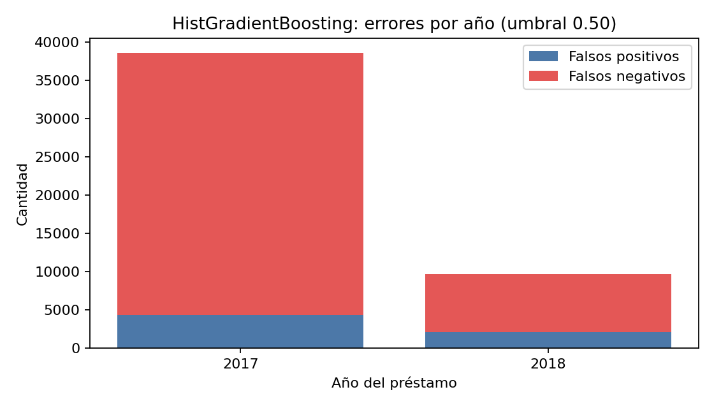

*Figura 23. Cantidad de falsos positivos y falsos negativos de HistGradientBoosting por año de originación, utilizando un umbral descriptivo de 0.5. Fuente: elaboración propia; [notebook 11](../notebooks/11_evaluacion_final.ipynb) y [métricas por segmento](../outputs/analisis_errores/metricas_por_segmento.csv).*

La Figura 23 muestra una mayor cantidad absoluta de errores en 2017. En ese año se registraron 4,353 falsos positivos y 34,206 falsos negativos, mientras que en 2018 se observaron 2,106 falsos positivos y 7,540 falsos negativos.

Sin embargo, esta diferencia debe interpretarse considerando que el conjunto de 2017 contiene 169,300 préstamos elegibles, frente a 56,311 en 2018. Por tanto, la mayor cantidad de errores en 2017 no demuestra por sí sola un peor comportamiento del modelo.

Al analizar las métricas normalizadas se observa que el ROC-AUC disminuye de 0.70519 en 2017 a 0.69620 en 2018, mientras que Average Precision pasa de 0.40758 a 0.29060.

Esta reducción de AP debe interpretarse junto con la disminución de la prevalencia de incumplimiento, que pasa de 23.12 % a 15.75 %. La composición de clases influye en Average Precision, por lo que no se puede atribuir toda su variación a un deterioro de la capacidad predictiva.

Por otro lado, el recall aumenta ligeramente de 12.62 % a 14.97 %, a pesar de que el ROC-AUC es menor en 2018. Esto evidencia que las métricas de discriminación global y clasificación con umbral fijo pueden evolucionar de manera diferente entre periodos.

#### Diferencias según el plazo del préstamo

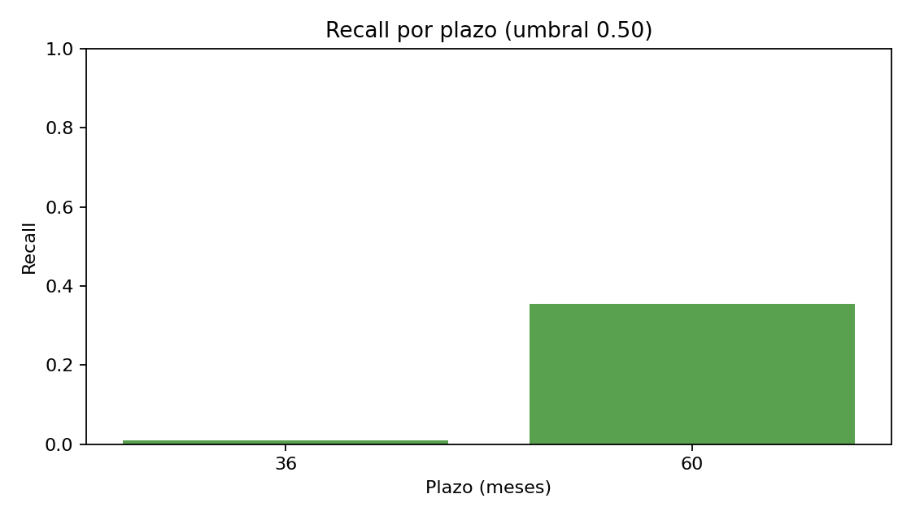

*Figura 24. Comparación del recall de HistGradientBoosting para préstamos de 36 y 60 meses, utilizando un umbral fijo de 0.5. Fuente: elaboración propia; [notebook 11](../notebooks/11_evaluacion_final.ipynb) y [métricas por segmento](../outputs/analisis_errores/metricas_por_segmento.csv).*

La Figura 24 evidencia una diferencia considerable en la detección de incumplimientos según el plazo del préstamo.

Para los préstamos de **36 meses**, el recall es de apenas **0.997 %**, mientras que para los préstamos de **60 meses** alcanza aproximadamente **35.40 %**.

En términos absolutos, HistGradientBoosting identifica 311 incumplimientos entre los préstamos de 36 meses y 5,958 entre los de 60 meses, utilizando el mismo umbral.

Esta diferencia debe analizarse considerando también que la prevalencia de incumplimiento es de 18.37 % en préstamos de 36 meses y de 30.16 % en préstamos de 60 meses.

Además, los préstamos de 36 meses presentan un ROC-AUC de 0.70265, superior al 0.67480 registrado para los de 60 meses. Por tanto, **un mejor ordenamiento dentro de un segmento no implica necesariamente que se detecte una mayor proporción de sus incumplimientos mediante un umbral común**.

El comportamiento observado sugiere que las distribuciones de probabilidades estimadas pueden diferir considerablemente entre ambos plazos. No obstante, para explicar esta diferencia sería necesario examinar directamente dichas distribuciones y la calibración específica de cada segmento.

Los resultados no justifican establecer inmediatamente umbrales diferenciados por plazo. Cualquier política de ese tipo requeriría validación adicional y una evaluación de sus consecuencias.

### 12.5. Segmentos con mayores dificultades y limitaciones

El análisis por ingresos muestra que los préstamos con ingresos anuales de hasta 25,000 presentan un ROC-AUC de 0.62856, inferior al observado en los tramos de ingresos más elevados. En particular, los grupos de ingresos entre 75,000 y 100,000 y superiores a 100,000 alcanzan ROC-AUC de 0.71591 y 0.71701, respectivamente.

Esta diferencia sugiere que la capacidad discriminativa del modelo puede variar según el nivel de ingresos. Sin embargo, no demuestra que el ingreso sea la causa directa de las diferencias de rendimiento. También pueden intervenir cambios en la composición, las características disponibles y el tamaño de cada grupo.

En cuanto al tipo de solicitud, los préstamos individuales presentan un ROC-AUC de 0.70943, frente a 0.64584 de las solicitudes conjuntas. A pesar de ello, el recall con umbral 0.5 resulta mayor para las solicitudes conjuntas (24.61 %) que para las individuales (11.73 %).

Este resultado refuerza la necesidad de distinguir la capacidad de ordenar préstamos dentro de cada grupo y el comportamiento de una regla de clasificación específica.

Las diferencias descritas constituyen señales para una evaluación posterior, pero no permiten afirmar que el modelo discrimine injustamente a determinados grupos ni que exista una relación causal entre las características estudiadas y los errores.

Asimismo, el análisis presenta limitaciones metodológicas:

- No se calcularon intervalos de confianza ni pruebas de comparación específicas para los segmentos.
- No se evaluó la calibración de probabilidades por grupo.
- No se estimaron costos económicos de falsos positivos y falsos negativos.
- No se analizaron formalmente criterios de equidad algorítmica.
- El conjunto de prueba comprende únicamente préstamos con desenlace conocido, lo que limita la generalización de sus resultados.

En consecuencia, las diferencias por año, plazo, ingresos y tipo de solicitud deben interpretarse como resultados descriptivos de una evaluación retrospectiva, no como evidencia suficiente para establecer políticas crediticias diferenciadas.

En conjunto, el análisis de errores muestra que **HistGradientBoosting presenta el mejor rendimiento global entre los modelos finales, pero su capacidad de detección con un umbral fijo de 0.5 es limitada y heterogénea entre segmentos**.

Estos hallazgos justifican futuras evaluaciones de umbrales de decisión, calibración por segmentos, estabilidad temporal y consecuencias de los errores, utilizando información de validación y criterios operativos definidos previamente. Los riesgos asociados a una posible aplicación del modelo se examinan en la sección 13.


## 13. Riesgos éticos, sesgos y limitaciones

El desarrollo de modelos predictivos de incumplimiento crediticio plantea limitaciones que deben considerarse antes de interpretar sus resultados o proponer aplicaciones operativas. Aunque el proyecto implementó selección temporal de características, preprocesamiento ajustado con entrenamiento y evaluación histórica, estas medidas no eliminan todos los sesgos asociados con la población, la disponibilidad de información y las decisiones que podrían derivarse de las predicciones.

### 13.1. Sesgos de selección, seguimiento y disponibilidad de información

**Sesgo de selección de préstamos aceptados.** El conjunto de datos contiene préstamos que fueron aprobados bajo las políticas históricas de Lending Club. Por tanto, el modelo aprende relaciones observadas dentro de esa población y no permite determinar cómo se habrían comportado los solicitantes rechazados.

Esta limitación impide generalizar automáticamente las probabilidades estimadas a todas las personas que solicitan crédito. Asimismo, un buen desempeño predictivo sobre préstamos aceptados no demuestra que el modelo permita establecer una política óptima de aprobación.

**Sesgo por selección de desenlaces conocidos.** El proyecto utiliza únicamente préstamos clasificados como `Fully Paid` o `Charged Off`, excluyendo aquellos que permanecen activos o presentan otros estados. Esta decisión evita asignar etiquetas definitivas a préstamos cuyo resultado todavía no se conoce, pero también condiciona la muestra a los casos que alcanzaron alguno de los dos desenlaces seleccionados.

El problema es especialmente importante en los años recientes, donde los préstamos con desenlace conocido pueden incluir una proporción diferente de pagos anticipados e incumplimientos relativamente rápidos. Como consecuencia, las tasas observadas de incumplimiento, la calibración y las comparaciones temporales pueden estar afectadas por diferencias en el periodo de seguimiento.

La población de prueba de 2017–2018 contiene 225,611 préstamos elegibles, pero no representa la totalidad de los préstamos originados durante esos años. Los estados excluidos se documentan en la [auditoría del conjunto de prueba](../outputs/evaluacion_final/auditoria_estados_test.csv).

**Disponibilidad temporal de las etiquetas.** La partición utilizada en el proyecto se basa en el año de originación del préstamo, pero no verifica individualmente la fecha en la que cada observación alcanzó su desenlace final.

Por ejemplo, un préstamo originado en 2012 podría haber terminado como `Fully Paid` o `Charged Off` después del inicio de la validación de 2013. En ese escenario, su etiqueta no necesariamente habría estado disponible durante el entrenamiento histórico simulado.

Por tanto, aunque la separación temporal evita incorporar directamente características de años posteriores en cada entrenamiento, no garantiza una simulación estrictamente prospectiva. Para resolver esta limitación sería necesario reconstruir la disponibilidad efectiva de las etiquetas y considerar los diferentes periodos de maduración de los préstamos de 36 y 60 meses.

**Cambios en la disponibilidad de características.** El análisis exploratorio identificó diferencias en la cobertura histórica de diversas variables. Algunas características comenzaron a registrarse o estuvieron disponibles con mayor frecuencia en periodos posteriores, por lo que sus patrones de ausencia pueden reflejar cambios en la recopilación de información y no únicamente características de los prestatarios.

La selección de variables según el porcentaje de faltantes del entrenamiento reduce el riesgo de utilizar información estadística procedente de validaciones futuras. Sin embargo, no elimina los cambios en la disponibilidad, definición o distribución de las características entre periodos.

El umbral del 50 % de valores faltantes constituye una decisión metodológica sustentada en los experimentos realizados, pero no garantiza por sí mismo que las características seleccionadas estén libres de sesgos o contengan información suficiente para todos los grupos.

Además, aunque durante el desarrollo se estudiaron indicadores de valores faltantes, el procedimiento definitivo no los incorporó. Esto debe distinguirse de la imputación por mediana utilizada en el preprocesamiento final.

### 13.2. Riesgos de discriminación y consecuencias de las predicciones

Los modelos de riesgo crediticio pueden incorporar características asociadas con desigualdades económicas y sociales. Variables como ingresos, tenencia de vivienda, ubicación geográfica y finalidad del préstamo podrían actuar como indicadores indirectos de condiciones socioeconómicas o características sensibles, aun cuando estas últimas no se incluyan explícitamente.

Por ello, excluir identificadores personales, códigos postales específicos o campos de texto no garantiza automáticamente la ausencia de discriminación.

El análisis de errores de la sección 12 identificó diferencias de rendimiento entre segmentos. Por ejemplo, HistGradientBoosting obtuvo un ROC-AUC de 0.62856 para préstamos con ingresos anuales de hasta 25,000, frente a 0.71701 para ingresos superiores a 100,000. Asimismo, las solicitudes conjuntas presentaron menor capacidad discriminativa que las individuales.

Estas diferencias constituyen señales que requieren investigación adicional, pero no demuestran por sí solas un comportamiento discriminatorio. Los segmentos presentan distintas prevalencias, tamaños y características, y no se realizaron pruebas inferenciales específicas para establecer la significación de todas las diferencias.

El proyecto tampoco incorpora una auditoría formal de equidad algorítmica basada en atributos sensibles, métricas de justicia previamente definidas y análisis de incertidumbre por grupo. En consecuencia, **no es posible afirmar que los modelos sean equitativos o estén libres de discriminación**.

Los errores de clasificación también pueden generar consecuencias diferentes:

- **Falsos positivos:** préstamos que finalmente fueron pagados, pero que el modelo clasifica como incumplidos. En una aplicación real podrían contribuir a rechazos injustificados, condiciones crediticias desfavorables o revisiones innecesarias.
- **Falsos negativos:** préstamos que terminaron en incumplimiento, pero que el modelo no identifica mediante el umbral utilizado. Podrían generar exposición financiera no detectada por una política de alertas.

Estos riesgos evidencian que una mejora en ROC-AUC o Average Precision no garantiza decisiones socialmente adecuadas. La selección de un umbral operativo requiere considerar las consecuencias de ambos tipos de error y definir criterios de decisión independientes de la optimización puramente estadística.

En este proyecto no se implementaron decisiones crediticias reales ni se calcularon sus costos económicos o sociales. Por tanto, las predicciones deben entenderse como resultados de un ejercicio analítico, no como autorizaciones para aprobar o rechazar solicitudes.

Cualquier aplicación posterior requeriría evaluación de equidad, transparencia sobre las limitaciones del modelo, mecanismos de supervisión humana y procedimientos para revisar decisiones potencialmente perjudiciales.

### 13.3. Incertidumbre, reproducibilidad y límites de generalización

**Limitaciones de la validación temporal.** Aunque la búsqueda definitiva de hiperparámetros utilizó únicamente los cortes de validación de 2013–2016, el periodo de prueba 2017–2018 había sido consultado durante experimentos preliminares del proyecto.

Por ello, el test no permaneció completamente desconocido durante todo el proceso de investigación. Además, la reutilización de los mismos cuatro años de validación para diferentes decisiones de modelado puede favorecer cierta adaptación a las particularidades de esos periodos.

En consecuencia, las métricas finales deben interpretarse como evidencia retrospectiva de rendimiento y no como una evaluación completamente ciega, externa o prospectiva.

**Incertidumbre de las métricas.** La evaluación final incorporó intervalos percentiles del 95 % obtenidos mediante 200 repeticiones bootstrap. Estos intervalos describen la variabilidad de las métricas bajo el procedimiento de remuestreo aplicado, pero no incorporan todas las fuentes de incertidumbre.

En particular, no reflejan completamente los efectos de la selección previa de características, la búsqueda de hiperparámetros, la elección del método de calibración ni los posibles cambios en futuras cohortes.

Asimismo, el análisis de sensibilidad intentó utilizar `member_id` como identificador de prestatario para realizar remuestreo agrupado. Sin embargo, el código reemplaza los identificadores ausentes por identificadores únicos de fila. Cuando `member_id` no está disponible, este procedimiento equivale a tratar esas observaciones como unidades individuales y no permite verificar el agrupamiento efectivo por prestatario.

Por tanto, los intervalos obtenidos no deben presentarse como evidencia de que se haya controlado adecuadamente la dependencia entre múltiples préstamos pertenecientes a una misma persona. El procedimiento puede consultarse en [sensibilidad_faltantes.py](../src/sensibilidad_faltantes.py).

**Limitaciones de la calibración.** La calibración sigmoide fue seleccionada por su desempeño agregado durante las evaluaciones temporales. Sin embargo, las curvas del conjunto de prueba muestran desviaciones respecto a la calibración ideal, especialmente en los intervalos superiores de riesgo estimado.

Esto significa que las probabilidades calibradas no necesariamente coinciden con las frecuencias observadas en todos los segmentos. Tampoco existe garantía de que mantengan la misma calidad en años posteriores o ante cambios en la población de solicitantes.

Por ello, la calibración debe considerarse una propiedad que requiere seguimiento y reevaluación, no una corrección definitiva de las probabilidades.

**Alcance de la reproducibilidad.** El proyecto conserva el código, las configuraciones y las métricas necesarias para documentar los experimentos definitivos. Adicionalmente, se reportó una evaluación local de los modelos serializados que reprodujo las métricas históricas agregadas a seis decimales.

Esta coincidencia constituye evidencia de reproducibilidad numérica del procedimiento documentado, pero no demuestra que todas las predicciones individuales sean idénticas ni que el modelo pueda generalizarse automáticamente a poblaciones diferentes.

Las pruebas sintéticas del pipeline verifican aspectos de funcionamiento del software y deben distinguirse de las evaluaciones realizadas con datos reales. Ninguna de estas comprobaciones elimina los sesgos de selección, la incertidumbre temporal de las etiquetas ni la necesidad de validación externa.

En conjunto, las limitaciones identificadas indican que **el rendimiento predictivo observado no equivale a validez operativa o ética para la toma automatizada de decisiones crediticias**.

Los resultados permiten comparar algoritmos, evaluar procedimientos de preparación de datos y estudiar patrones de incumplimiento dentro de la población elegible analizada. Sin embargo, una aplicación real requeriría información temporal más completa, evaluación prospectiva, auditorías de equidad, análisis de costos y mecanismos de supervisión.

Estas necesidades constituyen la base de las propuestas de mejora y trabajo futuro desarrolladas en la sección 14.


## 14. Trabajo futuro

Los resultados obtenidos permiten identificar oportunidades para mejorar la validez temporal, interpretabilidad, estabilidad y aplicabilidad de los modelos desarrollados. Sin embargo, las actividades propuestas a continuación **no forman parte de los experimentos ejecutados ni constituyen mejoras cuyo efecto haya sido demostrado en este informe**.

Las líneas de trabajo futuro se organizan considerando sus dependencias metodológicas: primero, fortalecer la trazabilidad y validez de los datos; posteriormente, ampliar la evaluación y mejorar la interpretación y posible utilización de las predicciones.

### 14.1. Fortalecer la trazabilidad y reproducibilidad

La evaluación local posterior de los tres modelos serializados reprodujo las métricas históricas agregadas a seis decimales.

Se propone conservar registros completos de ejecución, versiones de dependencias, configuraciones, huellas de integridad de los datos y artefactos utilizados. Asimismo, podría implementarse una comparación de predicciones individuales, fila por fila, para verificar que los modelos reproducidos generan resultados equivalentes a los de la ejecución histórica.

Esta última comprobación requeriría un protocolo específico y **no se presenta como una validación ya realizada**.

### 14.2. Auditar la maduración de los préstamos y la disponibilidad de etiquetas

Una de las principales limitaciones del proyecto es que la separación temporal utiliza el año de originación, sin verificar individualmente cuándo estuvo disponible el desenlace definitivo de cada préstamo.

Como mejora, se propone reconstruir la información disponible en cada fecha histórica de entrenamiento y establecer un horizonte predictivo claramente definido.

Esto permitiría estudiar alternativas como horizontes uniformes de observación o métodos que consideren préstamos cuyo desenlace todavía no se ha registrado, teniendo en cuenta las diferencias entre plazos de 36 y 60 meses.

Una evaluación con etiquetas efectivamente disponibles en cada fecha permitiría reducir el riesgo de utilizar información futura. No obstante, seguiría siendo necesario considerar otros problemas, como el sesgo de selección de préstamos aceptados y las diferencias en el seguimiento de las cohortes.

### 14.3. Realizar una evaluación externa o prospectiva

La evaluación final se realizó sobre préstamos elegibles de 2017–2018. Aunque este periodo se mantuvo separado de la optimización definitiva, había sido consultado durante experimentos preliminares.

Por ello, se propone evaluar los modelos sobre nuevos periodos o fuentes de datos que no hayan intervenido en ninguna decisión del desarrollo.

Antes de realizar esa evaluación, deberían fijarse las características, hiperparámetros, métodos de calibración, métricas y criterios de comparación.

Una evaluación prospectiva permitiría examinar si el rendimiento observado se mantiene ante cambios temporales, sin seleccionar retrospectivamente las configuraciones a partir de los nuevos resultados.

### 14.4. Profundizar en la selección de características y los umbrales de faltantes

Durante el proyecto se compararon distintos límites de valores faltantes, incluyendo umbrales del 50 % y 75 %. Aunque el umbral del 75 % produjo un ROC-AUC medio ligeramente superior en algunos experimentos, sus beneficios se concentraron principalmente en determinados cortes temporales, especialmente en 2013.

Se seleccionó el umbral del 50 % como una decisión de compromiso entre rendimiento, disponibilidad histórica y dependencia de imputaciones extensas, sin afirmar que fuera estadísticamente superior en todas las condiciones.

Como trabajo futuro, se propone ampliar el análisis de sensibilidad considerando la estabilidad de las características entre periodos, los cambios en su cobertura y las consecuencias de incorporar variables con altos porcentajes de ausencia.

También sería pertinente evaluar el efecto de diferentes estrategias de imputación sobre el rendimiento y la calibración, manteniendo la selección y el ajuste del preprocesamiento exclusivamente dentro de cada entrenamiento temporal.

### 14.5. Incorporar técnicas de interpretabilidad al modelo definitivo

Aunque el proyecto comparó diferentes familias de modelos, no se realizó un análisis completo de importancia de características ni de explicaciones individuales sobre el HistGradientBoosting final calibrado.

Se propone calcular importancias por permutación utilizando datos de validación y aplicar técnicas de interpretación local, como SHAP, para estudiar la contribución de las características a predicciones específicas.

Estos análisis deberían considerar la correlación entre predictores, la estabilidad de las explicaciones entre periodos y las diferencias entre grupos de préstamos.

Los resultados permitirían comprender mejor qué información utiliza el modelo para producir sus puntuaciones, pero no deberían interpretarse automáticamente como efectos causales de las características sobre el incumplimiento.

### 14.6. Evaluar equidad algorítmica y políticas de decisión

El análisis de errores identificó diferencias de rendimiento entre segmentos definidos por ingresos, plazo y tipo de solicitud. Sin embargo, no se efectuó una auditoría formal de equidad ni se definió una política operativa de clasificación.

Como trabajo futuro, se propone establecer criterios de evaluación por grupos pertinentes, considerando las restricciones legales y de privacidad aplicables al tratamiento de atributos sensibles.

La evaluación podría incorporar diferencias en tasas de error, capacidad discriminativa y calibración, acompañadas de medidas de incertidumbre que permitan interpretar adecuadamente las comparaciones.

Asimismo, sería necesario definir los costos y consecuencias de los falsos positivos y falsos negativos antes de seleccionar un umbral de decisión.

Cualquier umbral o política de alertas debería seleccionarse utilizando datos de desarrollo y mantenerse fijo durante una evaluación posterior independiente, evitando ajustar las decisiones directamente sobre el conjunto de prueba.

### 14.7. Diseñar mecanismos de seguimiento y recalibración

La estabilidad temporal es especialmente importante en modelos de riesgo crediticio, dado que las características de los prestatarios, las condiciones económicas y las políticas de otorgamiento pueden cambiar con el tiempo.

Se propone diseñar un procedimiento de seguimiento que examine periódicamente la distribución de características, los porcentajes de faltantes, la aparición de categorías nuevas, la composición de los plazos y la distribución de las probabilidades estimadas.

Cuando se disponga de desenlaces observados, también deberían evaluarse cambios en ROC-AUC, Average Precision, Brier Score, Log Loss y calibración por segmentos.

Este seguimiento permitiría identificar señales de deterioro y establecer criterios para revisar o recalibrar el modelo. No obstante, **el proyecto no incluye un sistema de monitoreo desplegado ni procedimientos automáticos de recalibración**.

### 14.8. Explorar nuevas características predictivas

Finalmente, se propone evaluar características adicionales que puedan aportar información sobre la capacidad de pago y el historial crediticio de los prestatarios.

Entre las alternativas se encuentran nuevas razones financieras, como relaciones entre cuotas e ingresos, agregados del historial de crédito e interacciones entre características existentes.

Estas variables deberían construirse únicamente con información disponible al momento de originación del préstamo, evitando incorporar características generadas después del otorgamiento o que dependan de su desenlace.

Su utilidad tendría que evaluarse mediante los mismos criterios de validación temporal, considerando no solo posibles mejoras en ROC-AUC y Average Precision, sino también su estabilidad, disponibilidad histórica, interpretabilidad y costo de procesamiento.

La incorporación de nuevas características no debe considerarse beneficiosa únicamente por incrementar la complejidad del modelo.

### Síntesis del trabajo futuro

Las propuestas anteriores buscan abordar limitaciones diferentes y complementarias. La trazabilidad facilita la reproducción de los experimentos; la auditoría temporal y la evaluación independiente permiten fortalecer la validez de los resultados; y los análisis de interpretabilidad, equidad y costos contribuyen a evaluar las consecuencias de una posible aplicación.

Por su parte, el seguimiento de distribuciones, la recalibración y la evaluación de nuevas características permitirían estudiar la evolución del modelo ante cambios en los datos.

En conjunto, estas actividades representan una ruta de mejora para pasar de una evaluación predictiva retrospectiva a un sistema con mayor evidencia de confiabilidad y control. Sin embargo, **ninguna de ellas garantiza por sí sola la eliminación de los sesgos ni autoriza automáticamente el uso del modelo para decisiones crediticias reales**.


## 15. Instrucciones de reproducción

Esta sección describe los requisitos y procedimientos necesarios para preparar el entorno, entrenar los modelos definitivos, reproducir su evaluación y generar predicciones con el pipeline implementado.

El proyecto contiene notebooks de investigación en `notebooks/`, módulos reutilizables en `src/`, resultados experimentales en `outputs/`, documentación en `reports/`, pruebas automatizadas en `tests/` y artefactos de modelos generados localmente en `models/`.

Las instrucciones siguientes corresponden al pipeline final. Su ejecución no implica repetir automáticamente todos los experimentos exploratorios ni las búsquedas de hiperparámetros desarrolladas durante la investigación.

### 15.1. Entorno, datos y dependencias

El conjunto de datos original no se distribuye dentro del repositorio debido a su tamaño y a las condiciones de acceso de la fuente.

Para reproducir el proyecto es necesario obtener el archivo `accepted_2007_to_2018Q4.csv` del conjunto de datos [All Lending Club Loan Data](https://www.kaggle.com/datasets/wordsforthewise/lending-club), cuya procedencia y limitaciones se describen en la sección 3.

El archivo puede colocarse en la raíz del repositorio o en `data/raw/`. También se admite su versión comprimida `.csv.gz`, según las rutas reconocidas por [config.py](../src/config.py).

Las dependencias principales están especificadas en [requirements.txt](../requirements.txt). Entre las versiones utilizadas se encuentran pandas 3.0.3, NumPy 2.4.6, scikit-learn 1.8.0, Matplotlib 3.11.0 y joblib 1.5.3.

El archivo de requisitos está preparado para Python 3.12. Sin embargo, los artefactos finales documentados también registran ejecuciones locales con Python 3.14. Por ello, reproducir los modelos desde cero y cargar artefactos previamente serializados son procedimientos diferentes: los archivos `.joblib` existentes requieren compatibilidad con las versiones registradas durante su creación.

Para preparar un entorno nuevo en Windows mediante PowerShell, se utilizan los siguientes comandos:

```powershell
git clone https://github.com/Josu31506/Proyecto-ML-Grupo8.git
cd Proyecto-ML-Grupo8

py -3.12 -m venv .venv
.\.venv\Scripts\Activate.ps1

python -m pip install -r requirements.txt
```

Después de instalar las dependencias, el archivo de datos debe ubicarse en una de las rutas reconocidas por el proyecto.

Para trabajar con los notebooks también puede registrarse un kernel de Jupyter:

```powershell
python -m ipykernel install --user --name lending-club-grupo8
python -m jupyter lab
```

Debe seleccionarse el kernel correspondiente al entorno creado.

El procesamiento del conjunto completo y el entrenamiento de HistGradientBoosting pueden requerir cantidades importantes de memoria, especialmente durante la transformación de variables y la construcción de matrices densas. Los tiempos de ejecución dependen del equipo y de los recursos disponibles, por lo que no se establece una duración universal.

Para consultar el informe, las figuras y las métricas guardadas no es necesario ejecutar nuevamente los entrenamientos.

### 15.2. Entrenamiento y almacenamiento del pipeline final

El entrenamiento definitivo se ejecuta mediante el módulo [run_final.py](../src/run_final.py), utilizando la configuración seleccionada en las etapas anteriores.

Desde la raíz del repositorio, el comando es:

```powershell
python -m src.run_final --modo entrenar --salida models/final_01
```

El procedimiento comprueba que los parámetros del código sean compatibles con las configuraciones finales almacenadas en el proyecto.

Posteriormente, carga los préstamos elegibles del conjunto de desarrollo hasta 2016 y aplica la siguiente separación:

- **Entrenamiento del modelo base:** préstamos de 2007–2015.
- **Calibración:** préstamos de 2016.
- **Conjunto de prueba:** préstamos de 2017–2018, no evaluados durante el entrenamiento.

Las transformaciones de preprocesamiento se ajustan con los datos del modelo base y se conservan para su posterior aplicación. Esto incluye la selección de características, imputación, codificación categórica y escalado.

El procedimiento utiliza los hiperparámetros definitivos y la calibración sigmoide seleccionados durante la investigación.

Al finalizar, se generan los siguientes archivos:

```text
models/
└── final_01/
    ├── regresion_logistica.joblib
    ├── svm_lineal.joblib
    ├── gradient_boosting.joblib
    └── manifest.json
```

Los archivos `.joblib` contienen los modelos junto con sus transformaciones y calibradores. El manifiesto registra la configuración utilizada, los periodos de entrenamiento, las versiones de dependencias y las huellas SHA-256 de los artefactos.

La carpeta de destino debe ser nueva. Si `models/final_01/` ya existe, debe utilizarse otra ruta, como `models/final_02/`, para evitar sobrescribir artefactos anteriores.

Los modelos serializados no se distribuyen mediante GitHub y deben generarse localmente o proporcionarse por un mecanismo autorizado.

Según la ejecución local documentada en la sección 10.5, el entrenamiento definitivo generó los tres artefactos y permitió reproducir posteriormente las métricas históricas agregadas.

Es importante señalar que **el modo de entrenamiento no evalúa automáticamente el conjunto de prueba**. Esta separación evita que la generación de modelos consulte el test sin una instrucción explícita.

### 15.3. Evaluación del modelo definitivo

La evaluación utiliza los modelos serializados y un archivo de datos proporcionado explícitamente.

El comando para evaluar el conjunto de prueba histórico es:

```powershell
python -m src.run_final --modo evaluar --modelos models/final_01 --datos accepted_2007_to_2018Q4.csv --conjunto test --confirmar-test
```

El argumento `--confirmar-test` es obligatorio para realizar una evaluación sobre 2017–2018. Su finalidad es exigir una decisión explícita antes de consultar ese periodo.

El programa carga los artefactos existentes, aplica las transformaciones previamente aprendidas y calcula las probabilidades calibradas sin volver a entrenar los modelos.

La evaluación genera una carpeta nueva dentro de `outputs/pipeline_final/`, que contiene:

- Métricas de discriminación y calidad probabilística.
- Predicciones individuales comprimidas.
- Auditoría de los estados de préstamo.
- Métricas de clasificación utilizando el umbral descriptivo de 0.5.
- Resultados del análisis de errores por segmentos.
- Figuras de evaluación.
- Archivo de alcance y versiones de ejecución.

Los archivos permiten verificar el procedimiento realizado y comparar las métricas reproducidas con las conservadas en [metricas_finales_test.csv](../outputs/evaluacion_final/metricas_finales_test.csv).

El modo `--conjunto validacion` también está disponible, pero debe interpretarse con cautela: utiliza los préstamos de 2016, que previamente sirvieron para ajustar el calibrador definitivo. Por ello, sus resultados no constituyen una evaluación independiente de la calibración.

Según el registro local descrito en la sección 10.5, la evaluación sobre los 225,611 préstamos elegibles de 2017–2018 reprodujo las métricas históricas agregadas a seis decimales.

Esta coincidencia constituye evidencia de reproducibilidad numérica, pero no representa una nueva validación prospectiva ni elimina las limitaciones temporales y de selección identificadas en el informe.

### 15.4. Generación de predicciones

El pipeline también permite generar probabilidades de incumplimiento para nuevas observaciones, siempre que el archivo de entrada respete el esquema de características requerido.

El comando es:

```powershell
python -m src.run_final --modo predecir --modelos models/final_01 --datos nuevos_prestamos.csv
```

En este modo se carga el modelo principal identificado en el manifiesto, correspondiente a HistGradientBoosting.

El programa utiliza las transformaciones y el calibrador almacenados, sin ajustar nuevamente medianas, categorías, parámetros del escalado ni coeficientes del modelo.

La salida es un archivo CSV generado en `outputs/predicciones/`, con las siguientes columnas principales:

- `fila_entrada`: posición de la observación en el archivo proporcionado.
- `probabilidad_charged_off`: probabilidad estimada de incumplimiento.

El archivo de entrada debe respetar los nombres originales y los tipos de las características esperadas por el pipeline. Las denominaciones en español utilizadas en algunas figuras del informe no sustituyen los nombres de columnas requeridos por el modelo.

No es necesario incluir las etiquetas `loan_status` ni `default` para generar predicciones.

También puede especificarse una ruta de salida mediante `--salida`. El procedimiento no sobrescribe automáticamente archivos de predicciones existentes.

Es importante señalar que las probabilidades generadas **no constituyen decisiones de aprobación o rechazo de crédito**. Su interpretación está limitada por la población de entrenamiento, la calibración y las restricciones metodológicas descritas en las secciones 10–13.

### 15.5. Pruebas y alcance de la reproducción

El proyecto incluye pruebas automatizadas que permiten comprobar componentes de preparación de datos, integración y funcionamiento del pipeline utilizando entradas controladas.

Las pruebas pueden ejecutarse desde la raíz del repositorio mediante:

```powershell
python -m unittest discover -s tests -v
```

Según la evidencia local documentada, la ejecución de las pruebas produjo el siguiente resultado:

```text
Ran 19 tests in 6.795s

OK
```

Esto indica que las 19 pruebas finalizaron satisfactoriamente en aquella ejecución. Sin embargo, las pruebas sintéticas no constituyen una evaluación del rendimiento predictivo sobre préstamos reales.

La reproducción de métricas históricas representa una comprobación diferente. En ella se utilizan los modelos serializados y las observaciones del conjunto de prueba para verificar la correspondencia con los resultados almacenados.

Ambas comprobaciones aportan evidencia complementaria:

- Las pruebas automatizadas permiten verificar comportamientos definidos del software.
- La evaluación con datos reales permite comprobar la reproducción de las métricas predictivas agregadas.

Ninguna garantiza por sí sola que el modelo conserve su rendimiento ante nuevas cohortes, cambios económicos o poblaciones distintas.

La reproducción completa de todos los experimentos de investigación requeriría, además, disponer del dataset original, las configuraciones históricas y las dependencias necesarias para ejecutar nuevamente cada procedimiento.

Las tablas y figuras conservadas permiten revisar la evidencia existente sin repetir todos los entrenamientos. Sin embargo, algunos archivos de predicciones intermedias y artefactos locales pueden no estar disponibles en el repositorio público.

En consecuencia, las instrucciones presentadas permiten reproducir el funcionamiento del pipeline final y contrastar sus métricas documentadas, sin afirmar que ello constituya una validación externa o prospectiva independiente.

---

## Anexo A. Comparaciones complementarias de imputación

Este anexo conserva únicamente dos visualizaciones que complementan la discusión de selección y tratamiento de valores faltantes desarrollada en la sección 4.

Ambas figuras proceden de experimentos sobre el conjunto de desarrollo completo y permiten examinar si la incorporación de indicadores de ausencia o el tratamiento nativo de valores faltantes produjo mejoras relevantes respecto a la imputación por mediana.

Las figuras de este anexo utilizan una numeración independiente de la secuencia principal del informe.

### A.1. Comparación de estrategias de imputación en HistGradientBoosting

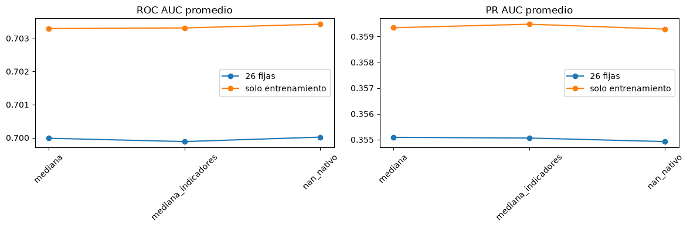

*Figura A.1. Comparación de imputación por mediana, mediana con indicadores y tratamiento nativo de valores faltantes en HistGradientBoosting. Fuente: elaboración propia; [notebook 07](../notebooks/07_comparacion_variables_imputacion.ipynb) y [resultados de comparación de imputación](../outputs/comparacion_imputacion/resumen_promedios_y_variabilidad.csv).*

La figura permite comparar tres estrategias de tratamiento de valores faltantes bajo configuraciones de modelo previamente fijadas.

Para la selección temporal de características evaluada en este experimento, la imputación por mediana obtuvo un ROC-AUC medio de 0.703295; la incorporación de indicadores alcanzó 0.703312 y el tratamiento nativo de valores faltantes registró 0.703426.

Las diferencias fueron reducidas y no demostraron una ventaja sustancial o uniforme de las estrategias más complejas. Asimismo, la alternativa con mayor ROC-AUC no necesariamente obtuvo la mayor Average Precision.

Estos resultados respaldan la utilización de un procedimiento sencillo y reproducible, pero no demuestran que la imputación por mediana sea universalmente superior. La comparación corresponde a la etapa experimental de selección e imputación y no debe confundirse con la evaluación definitiva del modelo calibrado.

### A.2. Comparación de estrategias de faltantes en modelos lineales


*Figura A.2. Comparación del rendimiento de regresión logística y SVM lineal con imputación por mediana y mediana acompañada de indicadores de valores faltantes. Fuente: elaboración propia; [notebook 07](../notebooks/07_comparacion_variables_imputacion.ipynb) y [resultados de comparación de modelos lineales](../outputs/comparacion_lineales/resumen_promedios_y_variabilidad.csv).*

La figura complementa la comparación anterior al examinar los efectos de incorporar indicadores de ausencia en modelos lineales.

En los experimentos con selección temporal de características, los resultados de regresión logística y SVM lineal fueron prácticamente equivalentes con y sin indicadores. Las diferencias observadas no mostraron una mejora consistente que justificara incorporar automáticamente estas columnas adicionales.

La comparación incluye también un conjunto exploratorio de 59 características cuya selección no corresponde estrictamente a la disponibilidad histórica de cada corte. Por ello, sus métricas deben interpretarse como resultados exploratorios y no como evidencia equivalente a la validación temporal sin información futura.

En conjunto, ambas figuras muestran que las estrategias de tratamiento de valores faltantes deben evaluarse según el algoritmo, el conjunto de características y el periodo utilizado. Los resultados contribuyeron a justificar un preprocesamiento final basado en imputación numérica por mediana, sin indicadores adicionales, manteniendo la selección temporal de características.

---

## Referencias bibliográficas

- scikit-learn developers. (s. f.-a). *average_precision_score*. En *scikit-learn 1.8 API reference*. [Definición de Average Precision](https://scikit-learn.org/1.8/modules/generated/sklearn.metrics.average_precision_score.html).

- scikit-learn developers. (s. f.-b). *Cross-validation: Evaluating estimator performance*. En *scikit-learn 1.8 User Guide*. [Validación cruzada](https://scikit-learn.org/1.8/modules/cross_validation.html).

- scikit-learn developers. (s. f.-c). *Probability calibration*. En *scikit-learn 1.8 User Guide*. [Calibración de probabilidades](https://scikit-learn.org/1.8/modules/calibration.html).

- scikit-learn developers. (s. f.-d). *RandomizedSearchCV*. En *scikit-learn 1.8 API reference*. [Búsqueda aleatoria de hiperparámetros](https://scikit-learn.org/1.8/modules/generated/sklearn.model_selection.RandomizedSearchCV.html).

- wordsforthewise. (s. f.). *All Lending Club loan data* [Conjunto de datos]. Kaggle. [Fuente del dataset](https://www.kaggle.com/datasets/wordsforthewise/lending-club). Consulta documentada el 17 de noviembre de 2026; las condiciones de licencia y reutilización requieren verificación en la fuente original. Véase [documentación de procedencia](../data/README.md).
